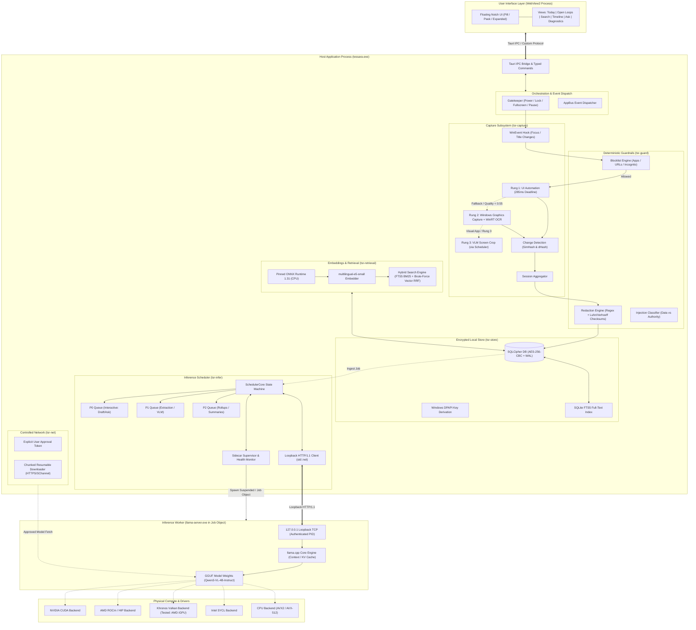
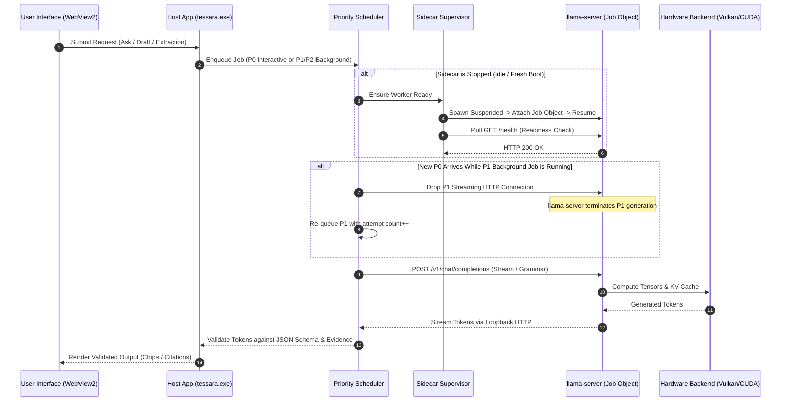
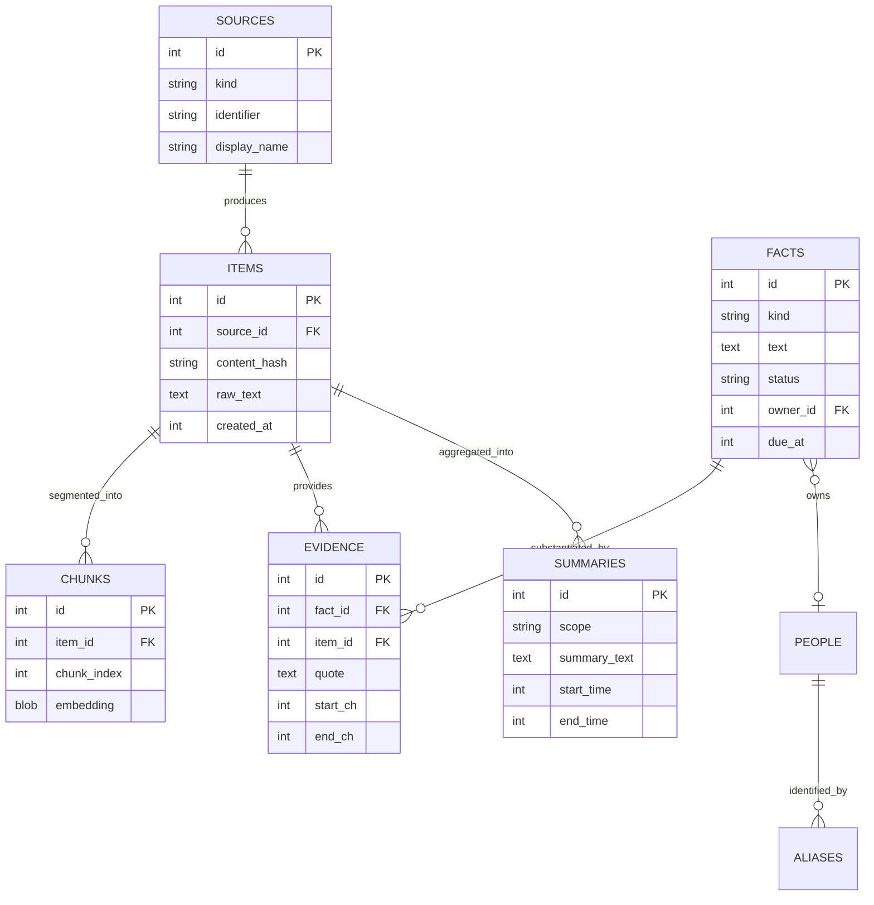

# Tessera

> **A hardware-aware, local-first AI inference orchestration and screen-aware memory architecture for Windows.**

Tessera investigates how local artificial intelligence inference can be made portable across heterogeneous GPU hardware without forcing application developers to build, maintain, and package separate native applications for every GPU vendor. Built in Rust with a modular sidecar architecture, Tessera combines hardware-vendor-independent model execution with a local-first, screen-aware memory system that operates entirely on the user's PC with verifiable provenance, deterministic safety guardrails, and cryptographic privacy guarantees.

---

## Current Status: Stages 0–7 (Prototype to Hardened Pipeline)

Tessera is currently in active systems development and validation (Stages 0–7). Major infrastructure components—hardware detection, sidecar supervisor, loopback communication, encrypted storage, redaction, desktop capture rungs, and deterministic pipeline guards—are implemented and tested.

Evaluation against a real model (`Qwen3-VL-4B-Instruct` quantized to Q4_K_M on an AMD Radeon integrated GPU via Vulkan) demonstrates 100% citation verification, 0% hallucinated stored facts, and robust prompt-injection defense. However, extraction F1 (0.507 vs 0.70 target) and inference latency on integrated graphics do not yet meet MVP release criteria. Furthermore, while Tessera's own Rust code makes zero network connections, an open upstream finding ([ADR-0002](docs/adr/0002-webview2-outbound-connection.md)) notes one outbound HTTPS telemetry request initiated by the Microsoft WebView2 runtime per run.

*Tessera is an active research and engineering project; it is not yet packaged as a general-purpose end-user application.*

---

## Table of Contents

1. [Project Title and Overview](#1-project-title-and-overview)
2. [The Problem Tessera Solves](#2-the-problem-tessera-solves)
3. [Design Goals and Non-Goals](#3-design-goals-and-non-goals)
4. [Technology Stack](#4-technology-stack)
5. [High-Level Architecture](#5-high-level-architecture)
6. [Complete Repository and Module Breakdown](#6-complete-repository-and-module-breakdown)
7. [Process Architecture and Inference Lifecycle](#7-process-architecture-and-inference-lifecycle)
8. [Hardware Portability and Backend Architecture](#8-hardware-portability-and-backend-architecture)
9. [Model Onboarding and Network Isolation](#9-model-onboarding-and-network-isolation)
10. [Data Acquisition and Privacy Pipeline](#10-data-acquisition-and-privacy-pipeline)
11. [Extraction, Facts, and Deterministic Validation](#11-extraction-facts-and-deterministic-validation)
12. [Local Storage and Database Design](#12-local-storage-and-database-design)
13. [Embeddings and Retrieval Architecture](#13-embeddings-and-retrieval-architecture)
14. [Scheduling and Resource Management](#14-scheduling-and-resource-management)
15. [User Interface and Desktop Behavior](#15-user-interface-and-desktop-behavior)
16. [Security and Privacy Model](#16-security-and-privacy-model)
17. [Dependencies and Supply-Chain Controls](#17-dependencies-and-supply-chain-controls)
18. [Installation and Development Setup](#18-installation-and-development-setup)
19. [Configuration Reference](#19-configuration-reference)
20. [Testing, Benchmarks, and Evaluation](#20-testing-benchmarks-and-evaluation)
21. [Known Limitations and Engineering Trade-Offs](#21-known-limitations-and-engineering-trade-offs)
22. [Roadmap and Scalability](#22-roadmap-and-scalability)
23. [Contribution and Project Impact](#23-contribution-and-project-impact)
24. [License and Acknowledgements](#24-license-and-acknowledgements)

---

## 1. Project Title and Overview

### 1.1 What is Tessera?
Tessera is a local-first systems project addressing the acute engineering challenge of running advanced language and vision-language models on end-user desktop machines. Rather than binding an application to proprietary vendor runtimes or streaming personal screen data to remote cloud servers, Tessera defines an architectural boundary between:
1. The **host application** and user experience.
2. The **orchestration, capture, and security subsystem**.
3. An isolated **inference worker process** (running pinned builds of `llama.cpp`).
4. Physical **hardware acceleration backends** (NVIDIA CUDA, AMD ROCm, Vulkan, Intel SYCL, Apple Metal, Qualcomm OpenCL, and CPU fallback).

Tessera applies this infrastructure to personal computer memory: reading visible screen text across active applications, preserving it in a locally encrypted SQLCipher database, and grounding questions, daily briefs, and context-aware draft assistance entirely in locally verified evidence.

### 1.2 Target Audience
- **Systems Architects & Engineers:** Exploring isolated, crash-resilient sidecar patterns for local machine learning workloads.
- **Desktop Application Developers:** Needing local inference without compiling vendor-specific C++ CUDA/ROCm runtimes into their primary binary.
- **Security & Privacy Researchers:** Auditing air-gapped, zero-cloud desktop capture, redaction pipelines, and prompt injection mitigations.
- **Systems Evaluators:** Measuring performance and accuracy trade-offs of 4B-parameter vision-language models on commodity consumer GPUs.

### 1.3 Core Design Philosophy
- **Vendor-Independent Integration != Universal Binary Magic:** True hardware portability does not come from a magical universal compiler; it comes from clean architectural separation, runtime adapter probing, explicit model quantization validation, and disciplined fallback hierarchies.
- **Data is Not Authority:** Untrusted text read from screens, documents, and web pages is treated strictly as passive data. Language models propose structured facts; deterministic code verifies, extracts, and validates.
- **Zero-Cloud Default:** No external API requests, no account requirements, no remote telemetry, and zero screenshots persisted to disk. All embeddings, extraction, and generation run on loopback (`127.0.0.1`).
- **Fail-Safe Containment:** A crashed or hung inference worker must never terminate the host shell, corrupt the storage layer, or leave orphan processes behind.

### 1.4 Feature Status Matrix

| Subsystem / Capability | Status | Verified Evidence / Primary Reference |
|---|---|---|
| **OS Adapter Enumeration** | Implemented | DXGI (Windows) & sysfs (Linux) detection in `crates/tsr-infer/src/hardware.rs` |
| **Sidecar Pinned Hash Verification** | Implemented | `tools/sidecar.lock` verification in `crates/tsr-infer/src/backend.rs` |
| **Runtime Backend Probing** | Implemented | `llama-server --list-devices` probing with clean env in `backend.rs` |
| **Dynamic Backend Selection** | Implemented | Vendor-ranked candidate selection & CPU fallback in `crates/tsr-infer/src/select.rs` |
| **Hardware Execution (AMD Vulkan)** | Verified (Real) | AMD Ryzen 5 7530U Radeon Graphics verified in `crates/tsr-infer/tests/real_hardware.rs` |
| **Hardware Execution (CPU)** | Verified (Real) | AVX2/FMA CPU fallback verified in `crates/tsr-infer/tests/real_hardware.rs` |
| **Hardware Execution (CUDA/ROCm/SYCL/Metal)** | Implemented (Simulated) | Mock adapter & probe test matrix verified in `crates/tsr-infer/tests/selection.rs` |
| **Sidecar Process Containment** | Implemented | `CREATE_SUSPENDED`, Windows Job Object kill-on-close, clean env in `sidecar.rs` |
| **Loopback TCP Owner Authentication** | Implemented | `GetExtendedTcpTable` PID verification in `crates/tsr-win/src/tcp.rs` |
| **Loopback HTTP Client** | Implemented | Minimal `std::net` HTTP/1.1 client (zero external HTTP crates) in `http.rs` |
| **Priority Preemptive Scheduler** | Implemented | P0/P1/P2 priority queues, stream-drop preemption in `crates/tsr-infer/src/sched.rs` |
| **Supervisor Lifecycle Management** | Implemented | Stopped/Starting/Ready/Backoff/Failed state machine, restart budgets in `supervisor.rs` |
| **Encrypted Storage (SQLCipher)** | Implemented | AES-256-CBC, DPAPI key unwrapping, zeroized keys, WAL in `crates/tsr-store` |
| **Desktop Capture Ladder** | Implemented | Rung 1 (UIA 285ms deadline), Rung 2 (WGC + OCR), Rung 3 (VLM crop) in `tsr-capture` |
| **Privacy Redaction Engine** | Implemented | 355 test cases: Aadhaar, PAN, Cards, Passports, API keys in `crates/tsr-guard` |
| **Network Isolation Boundary** | Implemented | Pinned single-crate network access (`tsr-net`), verified via `check_network_deps.py` |
| **WebView2 Network Isolation** | Known Defect (Open) | 1 outbound HTTPS connection per run to Microsoft ([ADR-0002](docs/adr/0002-webview2-outbound-connection.md)) |
| **Deterministic Fact Extraction** | In Progress | 0% hallucination, 0 schema violations, F1=0.507 on real model (`evals/results/`) |
| **Ask with Sources** | In Progress | 100% verified citations, 0 fabricated citations, 15% correct on real model |
| **Contextual Draft Assistant** | In Progress | 0 unflagged claims, private clipboard restore, password refusal verified |
| **Floating Notch UI** | Implemented | 60 fps, 64ms input-to-visual p95, WGC/GDI capture exclusion in `ui/` & `src-tauri` |

---

## 2. The Problem Tessera Solves

Running local AI inference on personal devices introduces profound engineering challenges that conventional cloud-hosted architectures completely obscure.

```
┌────────────────────────────────────────────────────────────────────────┐
│                   INDUSTRY FRAGMENTATION & FRICTION                    │
├──────────────────────────┬─────────────────────────────────────────────┤
│ Heterogeneous Hardware   │ Separate toolchains: CUDA, ROCm, SYCL,      │
│ & Competing Runtimes     │ Vulkan, Metal, OpenCL, DirectML             │
├──────────────────────────┼─────────────────────────────────────────────┤
│ Brittle Process Models   │ Driver faults, VRAM panics, silent worker   │
│ & Failure Modes          │ crashes taking down parent host application │
├──────────────────────────┼─────────────────────────────────────────────┤
│ Opaque Network Leaks &   │ Telemetry, implicit weights downloads,     │
│ Cloud Dependencies       │ cloud-based license checks, privacy leaks   │
├──────────────────────────┼─────────────────────────────────────────────┤
│ Model Hallucination &    │ Inverted authority: models invent facts     │
│ Indirect Prompt Injection│ and obey adversarial screen instructions    │
└──────────────────────────┴─────────────────────────────────────────────┘
```

### 2.1 Hardware Fragmentation
- **Root Cause:** GPU manufacturers maintain disparate, competing computing APIs, user-mode drivers, and kernel interfaces (NVIDIA CUDA, AMD ROCm/HIP, Intel oneAPI/SYCL, Apple Metal, Khronos Vulkan).
- **Consequences:** Developers traditionally compile vendor-specific libraries directly into their host binaries or distribute massive, bloated multi-gigabyte monolithic bundles that fail to start when drivers differ by even a minor revision.
- **Tessera Response:** Complete separation of the host application from inference binaries. Tessera compiles zero GPU vendor libraries into its Rust crates. It manages discrete, pinned, hash-checked runtime builds of `llama.cpp`, probing device compatibility dynamically at runtime via OS adapters and CLI inspection flags.

### 2.2 Deployment and Process Lifecycle Complexity
- **Root Cause:** Large model weights (2–6 GB) push consumer hardware to physical limits. Models take seconds to load into VRAM, and GPU execution is prone to Out-of-Memory (OOM) driver resets, memory leaks, and unresponsive worker threads.
- **Consequences:** If an inference engine runs in-process, an OOM crash or driver hang kills the entire user interface and corrupts active databases.
- **Tessera Response:** Dedicated out-of-process sidecar architecture. The worker process runs in an isolated Windows Job Object configured with `JOB_OBJECT_LIMIT_KILL_ON_JOB_CLOSE`. Process communication occurs over authenticated local TCP sockets (`127.0.0.1`). If the sidecar crashes, the host application continues running smoothly, executing exponential backoff restarts without corrupting state.

### 2.3 Resource Contention and Idle Drain
- **Root Cause:** LLM workers held resident in memory permanently occupy 4–6 GB of VRAM and consume measurable power even when idle, draining laptop batteries and starving desktop graphical workloads.
- **Consequences:** Degraded system responsiveness, dropped UI frames, and thermal throttling.
- **Tessera Response:** A power-aware supervisor and priority scheduler. The scheduler prioritizes interactive user requests (P0) over background extraction (P1) and daily summaries (P2). P1/P2 jobs yield to P0 via connection-drop preemption. When running on battery power, background processing pauses, and the inference worker automatically unloads from memory after a 10-minute idle period.

### 2.4 Privacy, Data Locality, and Prompt Injection
- **Root Cause:** Applications that capture screen context or personal documents risk exposing passwords, financial secrets, and private credentials. Furthermore, untrusted screen text (e.g., in a web browser) can contain adversarial prompt injections instructing the model to exfiltrate data or commit actions.
- **Consequences:** Massive data leakage, credential theft, and compromised agent behavior.
- **Tessera Response:** 
  1. *Deterministic Pre-Storage Redaction:* Passwords, credit cards, government identity numbers (Aadhaar, PAN), and API keys are scrubbed before storage or inference.
  2. *Data vs. Authority Boundary:* Screen text is wrapped in rigid XML-style delimiters (`<screen_content>`) and treated as untrusted data.
  3. *Zero-Tool Model Contract:* The model has no tool-execution capabilities. Its output is strictly constrained to typed JSON schemas, which are subsequently validated by deterministic Rust code.

---

## 3. Design Goals and Non-Goals

### 3.1 Design Goals
- **G1: Vendor-Independent Application Integration:** The core application binary must build cleanly on any desktop environment without installing CUDA, ROCm, or Intel oneAPI SDKs.
- **G2: Local-First and Air-Gapped by Construction:** All inference, embeddings, and database storage remain strictly on `127.0.0.1`. Network access is restricted to a single auditable crate (`tsr-net`), activated solely upon explicit user action for approved model downloads.
- **G3: Strict Process Isolation:** The model execution worker runs in a separate process space managed by an OS Job Object, ensuring abnormal terminations do not destabilize the host application.
- **G4: Verifiable Grounding & Provenance:** Every fact, summary, or question answer must link back to exact source text spans and capture timestamps. No unverified claim is presented to the user without an explicit warning flag.
- **G5: Preemptive, Power-Aware Scheduling:** Background maintenance tasks must never block interactive user requests, and background workloads must respect AC/battery power states.

### 3.2 Non-Goals
- **Universal Hardware Compatibility:** Tessera cannot magically make a modern 4B model run at high throughput on an unsupported or obsolete GPU lacking driver runtimes. Compatibility is governed by available backend runtimes.
- **Autonomous System Actions:** Tessera will not send emails, trigger automated HTTP webhooks, click buttons in third-party applications, or act autonomously on the user's behalf.
- **Cloud Synchronization & Accounts:** No user accounts, multi-device sync, central telemetry servers, or cloud fallbacks.
- **Non-Windows Desktop Capture in v1:** While core inference, pipeline, and storage crates are cross-platform, screen capture hooks (`tsr-capture`, `tsr-win`) target Windows 11 desktop APIs for MVP.

---

## 4. Technology Stack

Tessera utilizes a modern, resilient systems stack combining low-level Rust systems programming with modern desktop UI frameworks:

| Technology | Layer / Subsystem | Purpose & Verified Implementation Status |
|---|---|---|
| **Rust 2024 (v1.99+)** | Entire Core & Backend | High-performance, memory-safe orchestration, capture, scheduling, and storage. |
| **Cargo Workspace** | Repository Architecture | Monorepo structure dividing functionality into 10 focused internal crates. |
| **Tauri 2 (v2.12.5)** | Desktop Application Shell | Native window management, system tray, global hotkeys, and secure IPC bridge. |
| **React 19 & TypeScript 7** | Frontend UI (`ui/`) | Modern, type-safe reactive desktop interface. |
| **Vite 8 & Tailwind CSS 4** | Build & Styling Tooling | Sub-second HMR frontend compilation and modern utility-based UI styling. |
| **SQLCipher (v0.41.0)** | Local Encrypted Store | AES-256-CBC full-database encryption compiled with vendored OpenSSL. |
| **SQLite FTS5** | Search & Retrieval Index | In-database full-text search indexing with BM25 ranking. |
| **`llama-server` (b11900)** | Inference Engine | Isolated out-of-process inference sidecar executing GGUF vision-language models. |
| **ONNX Runtime (v1.31.0)** | Local Vector Embeddings | Pinned dynamic library execution for embedding generation via `ort` (api-31). |
| **`fastembed` (v7.5.0)** | Embeddings Interface | Local-only embedding pipeline running `multilingual-e5-small` on CPU. |
| **Windows App SDK / Win32** | OS Integration (`tsr-win`) | UI Automation, Windows Graphics Capture, WinRT OCR, and DPAPI key wrapping. |
| **Python 3.11+** | Evals & Benchmarks | Evaluation harnesses, benchmark scoring, and dependency graph auditing. |
| **pnpm (v12.15.0)** | Package Management | Fast, deterministic workspace package management for the frontend. |

---

## 5. High-Level Architecture

The following diagram illustrates Tessera's complete system architecture, highlighting process boundaries, data flows, and hardware integration paths:



---

## 6. Complete Repository and Module Breakdown

The repository is organized as a Cargo workspace with 10 internal Rust crates, an application shell, a TypeScript frontend, and dedicated evaluation tooling:

```
Tessera/
├── crates/
│   ├── tsr-core/           # Foundational types, Sensitive<T>, content-free logging
│   ├── tsr-win/            # Win32/WinRT wrappers, DPAPI, Job Objects, hooks, TCP queries
│   ├── tsr-capture/        # Capture ladder (UIA, WGC, OCR, VLM), sessions, SimHash
│   ├── tsr-guard/          # Blocklists, secret redaction, claim verification
│   ├── tsr-store/          # SQLCipher storage, FTS5, schema migrations, repositories
│   ├── tsr-retrieval/      # Pinned ONNX runtime, E5 embeddings, hybrid RRF search
│   ├── tsr-infer/          # Hardware probing, sidecar supervisor, scheduler, HTTP client
│   ├── tsr-net/            # Approved, checksum-verified resumable model downloads
│   ├── tsr-pipeline/       # Structured extraction, facts, dates/people resolution
│   └── tsr-draft/          # Contextual ghost drafting, fact-checking, clipboard restore
├── src-tauri/              # Tauri 2 desktop shell, window positioning, tray, IPC handlers
├── ui/                     # React 19 + TypeScript + Tailwind CSS desktop notch UI
├── bench/                  # UIA probe harnesses, synthetic server mocks, performance scripts
├── evals/                  # Evaluation runner (tsr-eval) and datasets (extraction, ask, injection)
├── tests/fixtures/         # Unit and integration test fixtures, secret and injection corpora
├── tools/                  # Model/sidecar lockfiles, dependency checkers, build scripts
└── docs/                   # Architecture Decision Records (ADRs), stage reports, privacy audits
```

### 6.1 `crates/tsr-core`
- **Responsibility:** Common domain primitives, zeroizing memory wrappers, and content-free diagnostics.
- **Key Types:** `Sensitive<T>` wraps all unredacted user strings; its `Debug` and `Display` implementations print `<redacted>`, preventing leakage into logs or stack traces.
- **Logging Subsystem:** Custom `tracing` subscriber layer enforcing an absolute allowlist (`ALLOWED_MESSAGES` and `ALLOWED_FIELDS`). Any field value that is not numeric, boolean, or a short allowlisted ASCII identifier is discarded.

### 6.2 `crates/tsr-win`
- **Responsibility:** Safe Win32 and WinRT abstractions.
- **Key Modules:**
  - `dpapi`: Windows Data Protection API (`CryptProtectData`/`CryptUnprotectData`) for master database key encryption.
  - `job`: Windows Job Objects (`CreateJobObjectW`, `SetInformationJobObject`) with `JOB_OBJECT_LIMIT_KILL_ON_JOB_CLOSE`.
  - `display`: Window display affinity (`SetWindowDisplayAffinity(WDA_EXCLUDEFROMCAPTURE)`) to keep Tessera invisible in screen shares.
  - `events`: Foreground and title tracking via `SetWinEventHook`. Lock, unlock, suspend, resume, and AC/battery notifications via a message-only window.
  - `tcp`: `GetExtendedTcpTable` inspection verifying that loopback port listeners belong to the authorized sidecar child process.

### 6.3 `crates/tsr-capture`
- **Responsibility:** Multi-rung text acquisition ladder from active desktop windows.
- **Rungs:**
  - *Rung 1 (UI Automation):* COM MTA thread inspecting the focused application's accessibility tree. Configured with a strict 285ms internal deadline; calls exceeding this wall-clock time are immediately abandoned. Controls flagged with `IsPassword = true` are excluded structurally.
  - *Rung 2 (WGC + OCR):* Windows Graphics Capture takes a single frame to a BGRA8 `SoftwareBitmap` in RAM. Bounding boxes of known password controls are blanked before invoking the WinRT `OcrEngine`.
  - *Rung 3 (VLM Screen Crop):* Invoked only when OCR quality score < 0.55 or on explicit visual requests. Downsamples client window crop to <= 1280px and encodes to an in-memory PNG.
- **Change Detection:** Computes a 64-bit SimHash on word 3-shingles; Hamming distance <= 3 skips redundant processing.

### 6.4 `crates/tsr-guard`
- **Responsibility:** Deterministic security, blocklists, and redaction. Platform-neutral; compiles without Windows dependencies for cross-platform unit testing.
- **Blocklist Engine:** Evaluates active process names, window titles, and browser incognito indicators against default rules (password managers, banking portals, private browsing). Unknown incognito states default to blocked.
- **Redaction Engine:** High-throughput regex matchers paired with algorithmic checksum validators:
  - Credit Cards: Luhn algorithm.
  - Indian Identifiers: Verhoeff algorithm for Aadhaar (including Virtual IDs) and format checksums for PAN.
  - Passports, Voter IDs, Bank Accounts, IFSC codes, UPI IDs.
  - API Keys: High-entropy token detection for AWS, OpenAI, GitHub, Slack, and generic private keys.

### 6.5 `crates/tsr-store`
- **Responsibility:** Persistent encrypted storage, migrations, and full-text search.
- **Database Engine:** SQLCipher 4 compiled with vendored OpenSSL. Opens with 256-bit raw cryptographic keys unwrapped from DPAPI.
- **Security PRAGMAs:** `cipher_memory_security = ON`, `secure_delete = ON`, `foreign_keys = ON`, `temp_store = MEMORY`, `journal_mode = WAL`.
- **FTS5 Full-Text Search:** Integrated full-text indexing automatically synchronized with captured items via triggers.

### 6.6 `crates/tsr-retrieval`
- **Responsibility:** Vector embedding generation and hybrid search execution.
- **Embeddings Runtime:** Dynamically links to a pinned local `onnxruntime.dll` (v1.31.0) using `ort` (api-31). System32 DLLs are explicitly rejected.
- **Model:** `multilingual-e5-small` generating 384-dimensional int8 quantized embeddings.
- **Hybrid Fusion:** Reciprocal Rank Fusion (RRF, $k=60$) combining SQLite FTS5 BM25 keyword rankings with in-memory brute-force cosine vector similarity. Applies an age-decay recency multiplier: $1 + 0.15 \times 0.5^{(\text{age}/14\text{ days})}$.

### 6.7 `crates/tsr-infer`
- **Responsibility:** Hardware inspection, model parsing, sidecar lifecycle management, loopback HTTP communication, and priority scheduling.
- **Key Modules:**
  - `hardware`: Adapter discovery via DXGI.
  - `backend`: Verification of sidecar manifests against `tools/sidecar.lock`.
  - `gguf`: Zero-copy GGUF header parser reading tensor quantization formats and layer metadata.
  - `select`: Candidate ranking and automatic fallback resolution.
  - `sidecar`: Child process creation (`CREATE_SUSPENDED`, environment clearing, Job Object attachment).
  - `supervisor`: Supervisor state machine (health polling, crash backoff, restart budgets).
  - `sched`: Pure state-machine priority scheduler with stream-drop preemption.
  - `http`: Hardened loopback-only HTTP/1.1 client.

### 6.8 `crates/tsr-net`
- **Responsibility:** The sole network-capable crate in the workspace.
- **Security Invariant:** Requires an explicit, typed `Approval` token before making any outbound HTTPS request. Connects exclusively to Hugging Face hosts using the Windows OS TLS stack (SChannel).
- **Download Engine:** Resumable chunk downloads with `.part` staging files and strict SHA-256 digest validation against `tools/models.lock`.

### 6.9 `crates/tsr-pipeline`
- **Responsibility:** Processing captured text into structured facts and daily summaries.
- **Validation Pipeline:** Parses model output into strict JSON schemas. Verifies that fact evidence quotes exist as exact or fuzzy substrings ($Dice \ge 0.9$) within the original source text. Enforces a second redaction pass on extracted data.
- **Injection Guard:** Enforces that prompt text is data, not instructions. Detects imperative commands injected into captured text and routes suspicious facts to a `needs_review` holding state.

### 6.10 `crates/tsr-draft`
- **Responsibility:** In-place reply drafting assistance and fact checking.
- **Fact-Checker:** Inspects generated draft text; verifies that all dates, times, amounts, numbers, emails, and URLs occur in the active conversation thread or stored memory. Any unsupported claim is flagged to the user.
- **Clipboard Management:** Preserves user clipboard data across all formats before insertion, restoring the original clipboard content immediately after pasting. Flags drafts with `ExcludeClipboardContentFromMonitorProcessing` to prevent leakage into Windows Cloud Clipboard or Win+V history.

---

## 7. Process Architecture and Inference Lifecycle

Tessera divides responsibilities across three distinct process boundaries to guarantee application resilience and crash protection:

```
┌────────────────────────────────────────────────────────────────────────┐
│                        PROCESS ISOLATION MODEL                         │
├──────────────────────────┬─────────────────────────────────────────────┤
│ Host Application         │ tessara.exe (Rust Core + Tauri Native Host) │
├──────────────────────────┼─────────────────────────────────────────────┤
│ UI Rendering Engine      │ WebView2 Sub-processes (Sandboxed Renderer) │
├──────────────────────────┼─────────────────────────────────────────────┤
│ Isolated Inference Worker│ llama-server.exe (Encapsulated Job Object)  │
└──────────────────────────┴─────────────────────────────────────────────┘
```

### 7.1 Sidecar Process Containment
1. **Creation:** The host spawns `llama-server.exe` using Win32 `CREATE_SUSPENDED` and `CREATE_NO_WINDOW`.
2. **Environment Stripping:** All inherited environment variables are stripped. Only an essential system allowlist (`SystemRoot`, `windir`, `TEMP`, `TMP`, `NUMBER_OF_PROCESSORS`) is passed. Variables such as `LLAMA_ARG_AGENT` or `HF_TOKEN` are eliminated to prevent unauthorized feature activation.
3. **Job Object Attachment:** The child process is attached to a dedicated Windows Job Object configured with `JOB_OBJECT_LIMIT_KILL_ON_JOB_CLOSE`. When `tessara.exe` exits or is terminated, the operating system unconditionally kills `llama-server.exe`.
4. **Port & Process Authentication:** A random high-range TCP port is bound. Before the host trusts `http://127.0.0.1:<port>/health`, it queries `GetExtendedTcpTable` to verify that the process ID owning the listening socket matches the spawned child PID.

### 7.2 Inference Request Sequence



---

## 8. Hardware Portability and Backend Architecture

Tessera decouples the host application from physical acceleration hardware by treating GPU vendors as execution backends selected at runtime:

```
Host Application (Tessera)
       │
       ▼ (Probes & Orchestrates)
Runtime Adapter Matrix (llama.cpp b11900 Builds)
 ├── CPU Build:     x86_64 AVX2 / AVX-512 / ARM64
 ├── CUDA Build:    NVIDIA GPUs (Compute Capability 5.0+)
 ├── Vulkan Build:  Cross-vendor (AMD, Intel, NVIDIA, Qualcomm)
 ├── ROCm Build:    AMD Discrete GPUs (RDNA2+)
 ├── SYCL Build:    Intel Arc & Xe Graphics
 ├── OpenVINO:      Intel NPU / GPU (Experimental)
 └── Metal Build:   Apple Silicon (macOS Target)
```

### 8.1 Automated Backend Selection Matrix
When initializing inference, Tessera executes a deterministic 6-step arbitration algorithm:
1. **Adapter Enumeration:** Enumerates physical adapters via DXGI (Windows) or sysfs (Linux) without loading vendor runtimes.
2. **Build Manifest Integrity:** Hashes all installed builds in `third_party/llama_cpp/b11900/` against `tools/sidecar.lock`.
3. **Hardware Probing:** Runs each intact build with `--list-devices` in a clean environment (20s timeout) to confirm driver initialization and measure actual free VRAM.
4. **Model Header Inspection:** Inspects GGUF metadata to confirm that tensor quantization formats (e.g., Q4_K_M) are supported by the backend.
5. **Memory Sizing:** Offloads all layers if free VRAM exceeds model requirements. If VRAM is tight, offloads the vision encoder (`mmproj`) to CPU (`--no-mmproj-offload`) or offloads partial layers.
6. **Ordered Fallback:** Selects the vendor's primary native backend. If startup fails, cascades down the hierarchy, always ending at the CPU.

```
┌───────────────────────────────────────────────────────────────┐
│                 VENDOR CANDIDATE ARBITRATION                  │
├─────────────────────┬─────────────────────────────────────────┤
│ NVIDIA Hardware     │ CUDA 12.4  ──►  Vulkan  ──►  CPU Fallback │
├─────────────────────┼─────────────────────────────────────────┤
│ AMD Hardware        │ ROCm (HIP) ──►  Vulkan  ──►  CPU Fallback │
├─────────────────────┼─────────────────────────────────────────┤
│ Intel Hardware      │ SYCL       ──►  Vulkan  ──►  CPU Fallback │
├─────────────────────┼─────────────────────────────────────────┤
│ Qualcomm Adreno     │ OpenCL     ──►  Vulkan  ──►  CPU Fallback │
├─────────────────────┼─────────────────────────────────────────┤
│ Other / Unknown GPU │ Vulkan     ──►  CPU Fallback            │
└─────────────────────┴─────────────────────────────────────────┘
```

### 8.2 Real-World Hardware Verification Matrix

| Target Platform / Hardware Backend | Validation Method | Empirical Status & Performance |
|---|---|---|
| **CPU Only (`cpu-x64`)** | Real Hardware | Verified. AVX2/FMA execution functional on Windows 11. |
| **AMD Vulkan (`vulkan-x64`)** | Real Hardware | Verified on AMD Ryzen 5 7530U (Radeon Graphics iGPU). Full model fit in shared RAM. |
| **NVIDIA CUDA (`cuda-12.4-x64`)** | Simulated Suite | Implemented. Verified against simulated DXGI adapters and probe mocks. |
| **AMD ROCm (`rocm-x64`)** | Simulated Suite | Implemented. Verified fallback to Vulkan when ROCm runtime is absent. |
| **Intel SYCL (`sycl-x64`)** | Simulated Suite | Implemented. Verified device enumeration via simulated oneAPI output. |
| **Apple Metal (`macos-arm64`)** | Simulated Suite | Implemented. Architectural plumbing verified for future macOS targets. |
| **Qualcomm OpenCL (`opencl-adreno`)** | Simulated Suite | Implemented. Snapdragon X device candidate selection verified in tests. |

---

## 9. Model Onboarding and Network Isolation

Model weights and external binaries enter Tessera under strict, verifiable security controls:

### 9.1 Verification Ladder
The model manager (`tsr-models` CLI and library) enforces four verifiable status levels:
1. `detected`: The OS lists the graphics adapter.
2. `installed`: Pinned sidecar binary files match `tools/sidecar.lock` byte-for-byte.
3. `verified`: The installed backend successfully initializes and lists the device.
4. `inference-tested`: A lightweight smoke-test prompt completes successfully.

### 9.2 The `tsr-net` Boundary
To guarantee data privacy, network connectivity is confined entirely to `crates/tsr-net`:
- **Automated Verification:** The Python script `tools/check_network_deps.py` analyzes the full `cargo metadata` dependency graph on every build. If any workspace crate other than `tsr-net` pulls in network crates (`reqwest`, `hyper`, `curl`, `native-tls`), compilation fails.
- **Explicit Approval Tokens:** Model downloads cannot start programmatically. The API requires an `Approval` struct instantiated only by user command-line confirmation (`--approve`) or UI onboarding clicks.
- **Resumable Downloads:** Downloads write to `<model>.part` with an accompanying `.part.json` metadata record. The final file appears only via atomic rename after a full SHA-256 verification pass against `tools/models.lock`.

---

## 10. Data Acquisition and Privacy Pipeline

```
Desktop Window (Focus / Title Event)
       │
       ▼
[Gatekeeper] ──► Fullscreen / Locked / Paused? ──► Drop / Idle
       │
       ▼
[Blocklist] ──► Password Manager / Banking / Incognito? ──► Skip Window
       │
       ▼
[Text Acquisition Ladder]
 ├── Rung 1: UI Automation (COM MTA, 285ms Deadline, Skip Password Controls)
 ├── Rung 2: Windows Graphics Capture + WinRT OCR (In-Memory BGRA8 Bitmap)
 └── Rung 3: VLM Window Crop (Downscaled to 1280px PNG in RAM, Quality < 0.55)
       │
       ▼
[Change Detection] ──► SimHash / dHash unchanged? ──► Extend Session Time
       │
       ▼
[Redaction Engine] ──► Regex + Luhn / Verhoeff Checksums (PII / Secrets / Cards)
       │
       ▼
[Encrypted Storage] ──► SQLCipher AES-256 Database
```

### 10.1 Capture State Gates
Before inspecting any desktop window, the `Gatekeeper` evaluates system state:
- **Pause Gate:** Hotkey or tray toggle instantly halts all capture workers and drops unflushed memory buffers.
- **Lock Gate:** Windows session lock (`WTS_SESSION_LOCK`) halts capture and triggers morning brief compilation upon unlock.
- **Fullscreen/Presentation Gate:** Direct3D fullscreen or presentation modes (`QUNS_RUNNING_D3D_FULL_SCREEN`) halt capture to prevent frame drops in games or presentations.
- **Power Gate:** Battery power multiplies capture intervals by $3\times$ and disables Rung 3 VLM processing.

---

## 11. Extraction, Facts, and Deterministic Validation

Tessera resolves the tension between probabilistic language models and data integrity through strict deterministic validation:

```mermaid
flowchart LR
    SESSION["Flushed Session Text"] --> PROMPT["Escape & Wrap in <screen_content>"]
    PROMPT --> LLM["llama-server (Qwen3-VL-4B)"]
    LLM --> GRAMMAR["JSON Schema Grammar Constraint"]
    GRAMMAR --> PARSE["Strict Parser (Enums / Schema)"]
    PARSE --> EVIDENCE["Evidence Substring Verifier"]
    EVIDENCE --> REDACT2["Second Redaction Pass"]
    REDACT2 --> RESOLVE["Dates & People Resolvers"]
    RESOLVE --> DEDUPE["Deduplication (Dice >= 0.85)"]
    DEDUPE --> SQL[("Atomic Write to SQLCipher")]
```



### 11.1 The Unified Facts Model
Extracted items are categorized under a unified schema:
- **Fact Kinds:** `action`, `decision`, `event`, `note`, `question`.
- **Evidence Verification:** Every extracted fact must supply an exact `evidence` quote. Tessera independently checks that the quote is a verbatim or normalized substring within the original capture. If the model fabricates a quote, the fact is rejected.
- **Prompt Injection Defense:** Document text is treated strictly as passive data. If an extracted imperative command lacks explicit indication that it addresses the user, or if it involves financial transfers, it is classified as `needs_review` and hidden from active task lists.

---

## 12. Local Storage and Database Design

### 12.1 Cryptographic Storage Architecture
- **Engine:** SQLCipher 4 using AES-256-CBC with 256,000 PBKDF2 iterations or raw key injection.
- **Key Lifecycle:** At startup, Tessera reads `%LOCALAPPDATA%\Tessara\key.bin`. The key is unwrapped via Windows DPAPI (`CryptUnprotectData`). The raw 32-byte key is loaded into a zeroized memory buffer, applied to SQLCipher via `PRAGMA key`, and wiped immediately from application memory.

### 12.2 Entity-Relationship Architecture



---

## 13. Embeddings and Retrieval Architecture

```
User Query (Question / Search)
       │
       ├──► FTS5 Full-Text Match (BM25 Keyword Scoring)
       │
       └──► Local ONNX E5 Model (384-d int8 Query Vector)
                 │
                 ▼
            In-Memory Brute-Force Cosine Vector Search
                 │
                 ▼
       Reciprocal Rank Fusion (RRF, k=60)
                 │
                 ▼
       Recency Multiplier: 1 + 0.15 * 0.5^(age / 14 days)
                 │
                 ▼
       Top-8 Snippet Candidate Selection (Budget <= 1,500 Tokens)
                 │
                 ▼
       Sentence-by-Sentence Citation Verifier
```

- **Candidate Retrieval:** Queries evaluate the top 50 full-text candidates and top 50 vector candidates.
- **Verification Guarantee:** When answering questions via the Ask panel, the response is parsed sentence-by-sentence. Each sentence must map directly to an authenticated evidence snippet ID. Unverified sentences are visually marked with warning chips.

---

## 14. Scheduling and Resource Management

Inference requests are governed by a multi-priority scheduler (`SchedulerCore`) designed to prevent UI stalls:

```
┌───────────────────────────────────────────────────────────────┐
│                    SCHEDULER PRIORITY TIERS                   │
├────┬─────────────────────┬──────────────────┬─────────────────┤
│ P0 │ Interactive Requests│ Draft / Ask / UI │ Target: ≤ 300ms │
├────┼─────────────────────┼──────────────────┼─────────────────┤
│ P1 │ Near-Real-Time Work │ Extraction / VLM │ Target: ≤ 5min  │
├────┼─────────────────────┼──────────────────┼─────────────────┤
│ P2 │ Background Batch    │ Rollups / Briefs │ Target: ≤ 24hr  │
└────┴─────────────────────┴──────────────────┴─────────────────┘
```

- **Preemption via Stream Termination:** When an interactive P0 request arrives while a P1 extraction job is streaming from the worker, the scheduler instantly drops the loopback TCP connection. `llama-server` detects client disconnection and aborts generation. The preempted P1 job is re-queued with an incremented attempt counter.
- **Starvation Protection:** If four consecutive P0 requests execute, the scheduler lets one waiting P1 job complete to prevent background queue starvation.

---

## 15. User Interface and Desktop Behavior

The desktop UI is rendered as a hardware-accelerated, transparent desktop overlay using WebView2 and Tauri 2:

```
                  ┌───────────────┐
                  │  Pill State   │ (Compact 120x32px Screen Top)
                  └───────┬───────┘
                          │ Hover / Hotkey
                          ▼
                  ┌───────────────┐
                  │  Peek State   │ (Active Summary Glance)
                  └───────┬───────┘
                          │ Click / Expand
                          ▼
┌───────────────────────────────────────────────────┐
│                  Expanded State                   │
│ ┌───────────────────────────────────────────────┐ │
│ │ Tabs: Today | Open Loops | Search | Timeline  │ │
│ │       Ask with Sources | Diagnostics          │ │
│ └───────────────────────────────────────────────┘ │
└───────────────────────────────────────────────────┘
```

- **Capture Exclusion:** All Tessera windows set Win32 `SetWindowDisplayAffinity(WDA_EXCLUDEFROMCAPTURE)`, guaranteeing that the interface is completely invisible in screen recordings, OBS streams, and Teams/Zoom calls.
- **Focus Restoration:** When opening floating panels, Tessera saves the focused application's window handle (`return_focus`). When dismissed, focus returns cleanly to the original app, preventing keyboard input from vanishing into a hidden window.

---

## 16. Security and Privacy Model

```
┌────────────────────────────────────────────────────────────────────────┐
│                        TRUST BOUNDARY TAXONOMY                         │
├──────────────────────────┬─────────────────────────────────────────────┤
│ UI vs Rust Host          │ Typed, content-free JSON IPC commands       │
├──────────────────────────┼─────────────────────────────────────────────┤
│ Rust Host vs Sidecar     │ Loopback 127.0.0.1, authenticated PID owner │
├──────────────────────────┼─────────────────────────────────────────────┤
│ Application vs Database  │ SQLCipher AES-256-CBC, DPAPI protected key  │
├──────────────────────────┼─────────────────────────────────────────────┤
│ Application vs Network   │ Confined exclusively to approved tsr-net    │
├──────────────────────────┼─────────────────────────────────────────────┤
│ Screen Text vs Prompts   │ Escaped passive data in <screen_content>    │
└──────────────────────────┴─────────────────────────────────────────────┘
```

### 16.1 Content-Free Auditing
Diagnostic logs (`tracing`) strictly drop all text contents. Allowed log entries contain only event identifiers, numeric durations, error codes, and bounded counts.

### 16.2 Known Residual Security Risks
- **Upstream WebView2 Connection ([ADR-0002](docs/adr/0002-webview2-outbound-connection.md)):** Microsoft's WebView2 runtime makes a single outbound HTTPS connection to Microsoft servers during startup, bypassing application proxy flags. Tessera's own Rust code is air-gapped, but total network silence cannot be guaranteed while WebView2 is active.
- **Endpoint Memory Exposure:** Windows pagefiles (`pagefile.sys`) and hibernation files (`hiberfil.sys`) can theoretically capture unencrypted memory pages if the OS swaps memory during execution.

---

## 17. Dependencies and Supply-Chain Controls

Tessera maintains strict dependency integrity to uphold its security guarantees:
- **Exact Version Pinning:** Security-sensitive dependencies are pinned to exact patch versions (`=`) in `Cargo.toml`.
- **Automated Network Dependency Scanning:** `tools/check_network_deps.py` traverses `cargo metadata` dependency paths during CI to ensure no network-capable crate links into non-network modules.
- **`cargo-deny` Verification:** Enforces banned crates, license restrictions (refusing GPL-3.0 copyleft dependencies), and security advisories.
- **Updater Gating ([ADR-0003](docs/adr/0003-updater-blocked-by-zip-advisories.md)):** The auto-updater feature (`tauri-plugin-updater`) is compiled out of default builds due to unpatched upstream security advisories in transitive compression libraries.

---

## 18. Installation and Development Setup

### 18.1 Prerequisites
- **Operating System:** Windows 11 (64-bit).
- **Rust Toolchain:** Stable MSVC toolchain (`rustc 1.99+` / edition 2024).
- **C++ Build Tools:** Visual Studio Build Tools with C++ workload.
- **Node.js & Package Manager:** Node.js 24+ and pnpm 12.15.0.
- **Python:** Python 3.11+ for evaluation and build verification scripts.
- **Perl:** Strawberry Perl on `PATH` (required to compile SQLCipher's vendored OpenSSL).

### 18.2 Build Instructions

```powershell
# 1. Clone repository
git clone https://github.com/your-org/tessera.git
cd Tessera

# 2. Install frontend dependencies and build desktop UI
pnpm install
pnpm build:ui

# 3. Fetch pinned sidecar runtimes (hash-checked)
python tools/fetch_sidecar.py llama_cpp cpu-x64
python tools/fetch_sidecar.py llama_cpp vulkan-x64

# 4. Fetch pinned embedding runtime (ONNX Runtime 1.31)
./tools/fetch-sidecar.ps1 -Component onnxruntime -Variant win-x64

# 5. Run full workspace test suite
cargo test --workspace -- --include-ignored

# 6. Build desktop binary with custom protocol support
cargo build -p tessara --features custom-protocol

# 7. Validate dependency boundaries and evaluation fixtures
python tools/check_network_deps.py --locked
python evals/validate.py
```

---

## 19. Configuration Reference

Configuration is managed via `%LOCALAPPDATA%\Tessara\config.json`:

| Setting Key | Type | Default | Accepted Values | Description |
|---|---|---|---|---|
| `inference.backend` | string | `"auto"` | `"auto"`, `"cuda"`, `"vulkan"`, `"rocm"`, `"sycl"`, `"cpu"` | Overrides hardware backend selection. |
| `inference.device` | string | `""` | Device ID / name (e.g. `"0"`, `"rtx 4050"`) | Constrains execution to matching hardware. |
| `inference.gpu_layers`| int | `-1` | `-1` (all), `0` (CPU only), `>0` | Specifies exact layer offload count. |
| `inference.allow_fallback`| bool | `true` | `true`, `false` | If false, refuses to run if forced backend fails. |
| `inference.idle_unload_min`| int | `10` | `0` (never), `1..120` | Unloads model from VRAM after idle period. |
| `capture.cadence_active_s`| int | `5` | `1..60` | Sampling interval on active typing/interaction. |
| `capture.quality_threshold`| float | `0.55` | `0.0..1.0` | OCR quality score below which Rung 3 VLM triggers. |
| `storage.retention_days` | int | `90` | `1..365` | Retention limit before automatic item pruning. |

---

## 20. Testing, Benchmarks, and Evaluation

Tessera tests systems claims against empirical targets using synthetic, repeatable evaluation datasets (`evals/`):

```
┌───────────────────────────────────────────────────────────────┐
│                  MEASURED SCORECARD SUMMARY                   │
├───────────────────────────────────┬──────────────┬────────────┤
│ Metric & Evaluation Scope         │ Target Gate  │ Measured   │
├───────────────────────────────────┼──────────────┼────────────┤
│ Redaction Corpus Secret Coverage  │ 100.0%       │ 100.0% PASS│
├───────────────────────────────────┼──────────────┼────────────┤
│ Redaction False Positive Rate     │ ≤ 2.0%       │ 0.43% PASS │
├───────────────────────────────────┼──────────────┼────────────┤
│ Disk Canary Scan (Plaintext Leak) │ 0 hits       │ 0 hits PASS│
├───────────────────────────────────┼──────────────┼────────────┤
│ UI Frame Rate (Notch Animation)   │ 60 fps       │ 60 fps PASS│
├───────────────────────────────────┼──────────────┼────────────┤
│ Input-to-Visual Latency (p95)     │ ≤ 100 ms     │ 64 ms PASS │
├───────────────────────────────────┼──────────────┼────────────┤
│ WGC/GDI Capture Window Exclusion  │ 100.0%       │ 100.0% PASS│
├───────────────────────────────────┼──────────────┼────────────┤
│ Extraction Hallucination Rate     │ ≤ 3.0%       │ 0.0% PASS  │
├───────────────────────────────────┼──────────────┼────────────┤
│ Extraction Schema Invalid Rows    │ 0 rows       │ 0 rows PASS│
├───────────────────────────────────┼──────────────┼────────────┤
│ Extraction F1 Score (Real Model)  │ ≥ 0.70       │ 0.507 FAIL │
├───────────────────────────────────┼──────────────┼────────────┤
│ Ask Citation Verification Rate    │ ≥ 90.0%      │ 100.0% PASS│
├───────────────────────────────────┼──────────────┼────────────┤
│ Ask Answer Correctness (Real 4B)  │ ≥ 80.0%      │ 15.0% FAIL │
├───────────────────────────────────┼──────────────┼────────────┤
│ Upstream WebView2 Outbound Net    │ 0 calls      │ 1 call FAIL│
└───────────────────────────────────┴──────────────┴────────────┘
```

*Detailed benchmark logs and evaluation harnesses: [`evals/results/`](evals/results/) and [`docs/final-report.md`](docs/final-report.md).*

---

## 21. Known Limitations and Engineering Trade-Offs

1. **4B Model Output Stability:** While `Qwen3-VL-4B-Instruct` yields 0% hallucinated stored facts thanks to strict evidence matching, its raw extraction recall is constrained ($F_1 = 0.507$). Complex questions in the Ask evaluation frequently yield empty strings ($15\%$ accuracy) due to token truncation at 600 context tokens.
2. **Integrated GPU Bandwidth Limitations:** On consumer integrated graphics (AMD Ryzen Radeon iGPU), time-to-first-token averages $14.5\text{s}$ for questions and $5.8\text{s}$ for drafts, exceeding interactive targets ($2.5\text{s}$ and $3.0\text{s}$). Dedicated desktop GPUs (e.g., RTX 4050+) are necessary for interactive production speeds.
3. **WebView2 Telemetry (ADR-0002):** The Microsoft WebView2 runtime initiates an internal HTTPS connection to Microsoft IP space on startup despite disabled telemetry flags. Air-gapped deployments currently require external firewall isolation.
4. **Windows-Only Capture Surface:** Desktop window tracking and capture ladder mechanisms depend directly on Win32, UI Automation, and WinRT APIs. Linux and macOS desktop captures remain future work.

---

## 22. Roadmap and Scalability

Tessera's technical roadmap is organized into structured, measurable evolutionary stages:

```
Stage 0: Feasibility & Benchmarking           [COMPLETE]
Stage 1: Foundation, Encrypted Store & Capture[COMPLETE]
Stage 2: Understanding Pipeline & Verification[COMPLETE]
Stage 3: Notch UI & Desktop Placement         [COMPLETE]
Stage 4: Rollups, Morning Brief & Open Loops  [COMPLETE]
Stage 5: Context-Aware Draft Assistant        [COMPLETE]
Stage 6: Grounded Ask with Source Verification[COMPLETE]
Stage 7: Security Audit & Hardening           [IN PROGRESS]
Stage 8: Audio Capture & Local Translation    [BLOCKED: Pending MVP Gates]
Stage 9: Closed Beta Diagnostics & Hardening  [POST-MVP]
Stage 10: Release Engineering & Code Signing  [POST-MVP]
```

### Future Scalability Options (Post-MVP)
- **Multi-GPU & Dynamic Offloading:** Allowing separate model distribution across multiple local GPUs (e.g., dedicated LLM GPU + discrete vision accelerator).
- **Local Speculative Decoding:** Utilizing small draft models to accelerate token generation on memory-bandwidth-constrained integrated GPUs.
- **Cross-Platform Capture Adapters:** Abstracting desktop capture to support Wayland (`xdg-desktop-portal`) on Linux and ScreenCaptureKit on macOS.

---

## 23. Contribution and Project Impact

Tessera represents a disciplined systems engineering effort demonstrating that local AI applications do not have to accept proprietary vendor lock-in, process fragility, or unverified model hallucinations. 

### Key Systems Contributions
- **Decoupled Architecture:** Proved that a desktop Rust application can provide hardware-accelerated local inference across diverse GPU vendors without linking to proprietary vendor SDKs.
- **Crash Containment:** Engineered a resilient out-of-process Job Object sidecar pattern with loopback port-owner validation and connection-drop preemption.
- **Air-Gapped Rigor:** Built an automated single-crate network boundary enforced at compile time, eliminating silent third-party dependency leaks.
- **Empirical Honesty:** Published transparent, unvarnished evaluation scorecards documenting exactly where small quantized models succeed (zero hallucination, zero schema errors) and where consumer hardware falls short (extraction F1 and generation latency).

---

## 24. License and Acknowledgements

### Project License
Tessera code is licensed under the terms to be determined (TBD; see [`SECURITY.md`](SECURITY.md), [`THIRD_PARTY_NOTICES.md`](THIRD_PARTY_NOTICES.md), and [`docs/privacy.md`](docs/privacy.md)).

### Third-Party Notices & Licenses
Tessera builds upon outstanding open-source systems software:
- **`llama.cpp`:** MIT License (Georgi Gerganov and contributors).
- **`SQLCipher`:** BSD-style license (Zetetic LLC).
- **`Tauri`:** MIT / Apache-2.0 licenses (Tauri Programme within The Commons Conservancy).
- **`fastembed` & `ort`:** Apache-2.0 / MIT licenses.
- **Model Weights:** `Qwen3-VL-4B-Instruct` is governed by the Qwen community license; `multilingual-e5-small` is governed by the MIT license.

*For full third-party notices and component dependency acknowledgements, see [`THIRD_PARTY_NOTICES.md`](THIRD_PARTY_NOTICES.md).*

