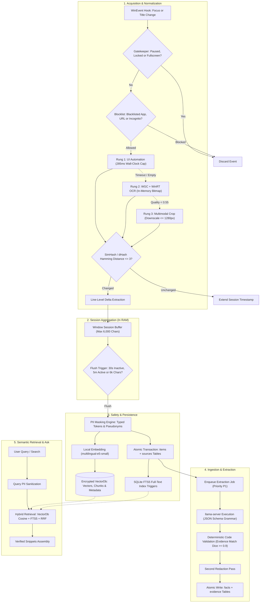

# Data Flow

This document details how screen events flow through the capture rungs, change detection, session aggregation, redaction, database persistence, and extraction.

---

## End-to-End Data Processing Pipeline

---

## Detailed Pipeline Stages

### 1. Event Ingestion & Gates
- **WinEvent Hooks:** The host thread listens for `EVENT_SYSTEM_FOREGROUND` and `EVENT_OBJECT_NAMECHANGE`.
- **State Gates:** If the screen is locked, fullscreen presentation is active, or the user has toggled **Pause**, the event is dropped immediately.
- **Blocklist Evaluation:** Applications matching known process names (`1password.exe`, `bitwarden.exe`) or window titles indicating banking portals are skipped. If a browser window's private/incognito state cannot be determined, it defaults to blocked.

### 2. The Acquisition Ladder
- **Rung 1 (UIA):** Attempts a structured tree walk. Skips controls with `IsPassword = true`. Aborted at exactly 285ms to prevent hung applications from blocking the pipeline.
- **Rung 2 (WGC + OCR):** Grabs a frame to a BGRA8 `SoftwareBitmap` in RAM. Password control rectangles are blacked out before running the WinRT `OcrEngine`.
- **Rung 3 (VLM):** Invoked if OCR quality score $< 0.55$. Downsamples the window crop to $\le 1280\text{ px}$ and passes it in memory to the multimodal model.

### 3. Change Detection & Session Buffering
- **SimHash:** Computes a 64-bit SimHash over word 3-shingles. If the Hamming distance is $\le 3$, text is treated as unchanged.
- **Window Sessions:** Groups interactions by `(exe, HWND, URL/title)`. Buffers text in memory until focus leaves for $> 30\text{s}$, continuous use reaches 5 minutes, or the buffer exceeds 6,000 characters.

### 4. PII Masking & Persistent Storage
- **Pre-Embedding & Pre-Storage Scrubbing:** Screen text is processed through `tsr_guard::redact::mask_pii`. Personal names (with deterministic document-scoped pseudonyms `[PERSON_01]`), contact details (`[EMAIL]`, `[PHONE]`), national IDs (`[AADHAAR]`, `[PAN]`), financial identifiers (`[CARD]`, `[BANK_ACCOUNT]`, `[IFSC]`), physical addresses (`[ADDRESS]`), dates of birth (`[DATE_OF_BIRTH]`), credentials (`[PASSWORD]`, `[SECRET]`, `[API_KEY]`, `[JWT]`, `[PRIVATE_KEY]`), and OTPs (`[OTP]`) are replaced with typed placeholders.
- **VectorDb Ingestion:** Text chunks are embedded locally using the ONNX Runtime `multilingual-e5-small` model into 384-dimensional vectors and stored encrypted at rest in `tessera_vectors.enc` (`VectorDb`) alongside metadata.
- **Relational Persistence:** Redacted session items and sources are written in atomic transactions to SQLCipher. Database triggers automatically update the SQLite FTS5 search index.

### 5. Structured Extraction & Evidence Verification
- **Model Ingestion:** An extraction job is enqueued in the P1 priority scheduler.
- **Evidence Verification:** Model output must match a strict JSON schema. Every extracted fact must supply an evidence quote that matches a substring ($Dice \ge 0.9$) within the original captured screen item. Fabricated facts are discarded.
- **Second Redaction Pass:** A second redaction pass is executed over model outputs before writing to `facts` and `evidence`.

### 6. Semantic Retrieval & Ask with Sources
- **Query Sanitization:** User queries are sanitized with `mask_pii` before generating embeddings or executing keyword searches.
- **Hybrid Retrieval:** Fuses full-text keyword retrieval (FTS5 BM25) and `VectorDb` cosine similarity search with metadata pre-filtering using Reciprocal Rank Fusion ($k=60$) and an exponential recency decay multiplier.
- **Snippet Assembly:** The top 8 candidate snippets within a 1,500 token budget are presented as grounded context.
- **Deterministic Verification:** Generated sentences cite authenticated snippet IDs and are verified against cited snippet text before display.
