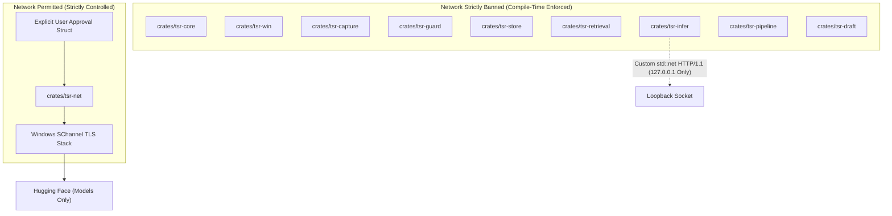

# Dependency Boundaries

Tessera enforces an architectural separation between network-capable crates, systems crates, and runtime binaries.

---

## The Network Air-Gap Rule

### Compile-Time Verification
Tessera enforces the network ban via `tools/check_network_deps.py`:
- Walks the complete resolved dependency graph from `cargo metadata`.
- Verifies that banned network crates (`reqwest`, `hyper`, `curl`, `ureq`, `native-tls`, `tungstenite`) are unreachable from any crate other than `tsr-net`.
- Flags transitive dependencies in build scripts (e.g. `ort-sys` binary downloaders).

---

## Pinned Native Runtime Binaries

To guarantee reproducible and safe execution, external native runtimes are version-pinned and hash-verified:

| Runtime / Binary | Pinned Revision / Version | Manifest Reference | Loading & Validation Mechanism |
|---|---|---|---|
| **`llama-server.exe`** | b11900 | `tools/sidecar.lock` | Spawned as child process; all DLLs and executables checked against SHA-256 digests. |
| **`onnxruntime.dll`** | 1.31.0 | `tools/sidecar.lock` | Dynamically linked via `tsr-retrieval::runtime::load_pinned`. System32 DLLs rejected. |
| **`Qwen3-VL-4B-Instruct`** | Q4_K_M (commit-pinned) | `tools/models.lock` | GGUF header checked; SHA-256 digest validated before first launch. |
| **`multilingual-e5-small`** | ONNX format | `tools/models.lock` | Loaded exclusively by local `fastembed` runtime; no online model discovery. |
