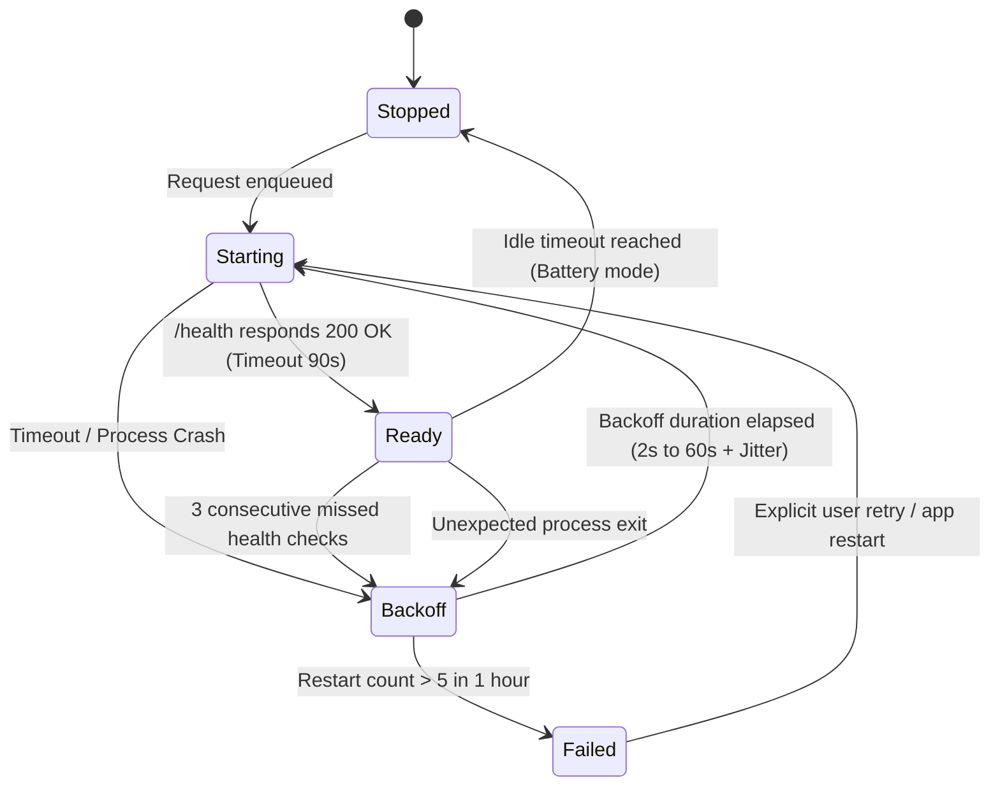

# Failure Handling & Recovery

Tessera is built with the assumption that local machine learning runtimes, GPU drivers, and third-party accessibility trees will fail periodically.

---

## Failure Modes & Recovery Matrix

| Failure Mode | Detection Mechanism | System Behavior | Recovery Action | Residual Risk |
|---|---|---|---|---|
| **Hung Accessibility Tree** | UIA thread deadline timer | Wall-clock timer aborts read after exactly 285ms | Abandons read; falls back to Rung 2 (WGC + OCR); marks app as sluggish | In-progress abandoned COM call continues in background until complete |
| **Sidecar Process Crash (OOM)** | Supervisor health check / process exit event | Host UI remains responsive; loopback HTTP returns error | Supervisor initiates exponential backoff restart (2s $\rightarrow$ 60s); enqueued P0/P1 jobs re-queued | If crashes exceed 5 per hour, model is marked "unavailable" |
| **GPU Driver Reset (TDR)** | `--list-devices` or worker HTTP 500 error | Supervisor detects failed probe | Cascades down backend hierarchy (e.g. Vulkan $\rightarrow$ CPU) | Slower generation throughput on CPU fallback |
| **Corrupted GGUF Model File** | Header parser / SHA-256 manifest check | `tsr-models` startup check fails with `DigestMismatch` | Refuses to launch sidecar; alerts user in notch Diagnostics | User must re-download or replace corrupted model file |
| **Port Collision on Loopback** | `GetExtendedTcpTable` owner check | Socket PID does not match child PID | Host tears down sidecar, selects a different ephemeral port, and retries | Short startup delay during port renegotiation |
| **Model Hallucination / Injection** | Substring verifier / Imperative classifier | Evidence quote not found in source text ($Dice < 0.9$) | Fact is rejected and dropped from database; suspicious tasks flagged `needs_review` | Fact extraction recall is slightly reduced |

---

## The Supervisor Lifecycle State Machine

The inference worker's lifecycle is governed by an explicit state machine implemented in `crates/tsr-infer/src/supervisor.rs`:

### Restart Budgeting
To prevent infinite crash-restart loops from consuming 100% of CPU and GPU cycles, the supervisor enforces an hourly budget:
- **Maximum Restarts:** 5 restarts per rolling 60-minute window.
- **Exponential Backoff:** Base delay of 2.0 seconds doubling up to a maximum of 60.0 seconds with $\pm 20\%$ randomized jitter.
- **Budget Exhaustion:** If the budget is exhausted, the supervisor enters the `Failed` state, presents a "Model Unavailable" banner in the notch, and keeps keyword search and desktop capture operational.
