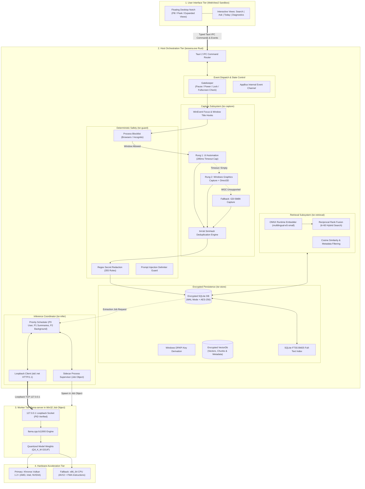

# High-Level Architecture

This document provides a comprehensive technical overview of Tessera's multi-tiered system architecture.

Tessera divides its responsibilities across four distinct runtime tiers, establishing strict boundaries between the graphical user interface, host orchestration, hardware execution, and persistent storage.

---

## 1. System Architecture Diagram

---

## 2. Walkthrough of the Architecture

To understand how Tessera functions as an integrated system, let us examine the five key operational dimensions of this architecture:

### A. What Each Component Does
* **UI Tier (WebView2 Sandbox):** Presents the user interface—the top desktop notch, search modal, question-answering dialog, and diagnostics dashboard. It never accesses raw screen pixels or the database directly.
* **Host Tier (`tessera.exe` in Rust):** The central nervous system. It orchestrates window focus events, runs the capture ladder, scrubs secrets, manages database transactions, and supervises the AI sidecar process.
* **Worker Tier (`llama-server` Sidecar):** An isolated native child process running a pinned build of `llama.cpp`. It loads the model weights and executes token generation without knowing anything about your screen or user identity.
* **Hardware Tier:** Physical compute units. By utilizing **Vulkan** as the primary cross-vendor GPU abstraction, Tessera runs on AMD, Intel, and NVIDIA GPUs without installing vendor-specific SDKs.

### B. How Information Moves Between Components
1. **Window Change Event:** When you switch windows, the Windows OS notifies `tsr-win` via a `WinEventHook`.
2. **Content Capture:** `tsr-capture` samples the window text. If UI Automation succeeds within 285 milliseconds, text is extracted directly. If not, it falls back to Windows Graphics Capture (WGC) and OCR.
3. **Deduplication:** A 64-bit SimHash compares the text against the previous frame. If the content has not meaningfully changed, processing stops immediately, saving battery and CPU cycles.
4. **Redaction Gate:** New text passes through `tsr-guard`. Credit cards, passwords, API keys, and sensitive tokens are overwritten with redaction placeholders.
5. **Encrypted Persistence:** Scrubbed text is written to SQLite inside `tsr-store`, protected by DPAPI encryption.
6. **Inference Request:** When a question is asked or an extraction is needed, `tsr-infer` sends a structured JSON prompt across a local TCP socket (`127.0.0.1`) to the sidecar.

### C. Which Component Initiates Each Operation
* **Capture Operations:** Initiated by the **Gatekeeper** and **WinEvent Hooks** in response to user desktop activity (window focus changes, scrolling).
* **Search & Ask Operations:** Initiated by the **User** through keyboard input in the floating notch UI (`Alt + Space`).
* **Maintenance & Pruning:** Initiated by internal **Background Timers** in the host orchestration tier (cleaning up old history, compressing embeddings).

### D. Where Data is Processed, Stored, and Transmitted
* **Processing:** Screen parsing and redaction occur in host CPU memory (`tsr-guard`). Neural network tensor math occurs in GPU VRAM (or CPU cache via AVX2).
* **Storage:** Data resides exclusively on the local drive in an encrypted SQLite database located at `%LOCALAPPDATA%\Tessera\store.db`.
* **Transmission:** **Zero data is transmitted across the internet.** All network calls from application code are strictly forbidden. The only network socket used is a local loopback (`127.0.0.1`) connecting the host to the sidecar.

### E. What Happens When a Component Fails (Fault Tolerance)
* **If the UI Tier Crashes:** WebView2 reloads automatically; the host process and database remain unharmed.
* **If the AI Worker Crashes (OOM / Driver Glitch):** Because the sidecar lives inside a Windows **Job Object**, its crash is completely isolated. The host supervisor detects the worker exit code, cleans up the Job Object, waits a brief backoff interval, and restarts the sidecar without interrupting your work.
* **If WGC Screen Capture Fails:** The capture ladder automatically steps down to **GDI BitBlt** capture. The user is never blocked from using the application.
* **If the GPU Runs Out of VRAM:** The inference coordinator catches the memory allocation failure and restarts the sidecar in **CPU fallback mode** with AVX2 acceleration.

---

## 3. Next Steps

To explore individual subsystems in greater technical depth:
* **[Component Breakdown](/architecture/components)** — Specific types, traits, and module relationships.
* **[Process Isolation Model](/architecture/process-model)** — Deep dive into Win32 Job Objects and memory caps.
* **[Hardware Backends](/runtime/hardware-backends)** — How Vulkan and CPU sidecars dynamically load on Windows.
