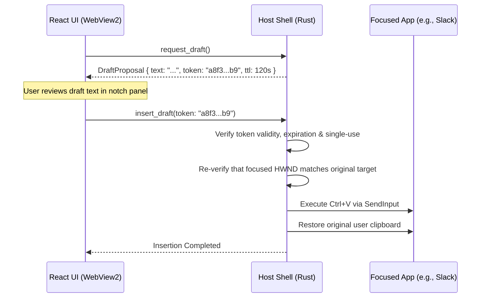

# IPC & Event Dispatch

Communication between the WebView2 frontend and the native Rust host is handled via typed Tauri 2 IPC commands and event channels.

---

## Inter-Process Communication Design

Tessera enforces three core IPC design constraints:
1. **Typed Command Structs:** All command arguments and responses are defined as Serde-serializable Rust structs.
2. **Content-Free Error Codes:** Error messages never return raw database queries, user strings, or captured text. Errors are serialized as standard enumerated error codes (e.g. `E_UNAVAILABLE`, `E_INVALID`).
3. **No Dynamic Code Evaluation:** The frontend never transmits arbitrary SQL queries, shell commands, or executable code across the IPC bridge.

---

## Command Registry

Below are the primary Tauri commands registered in `src-tauri/src/lib.rs`:

| Command Identifier | Parameters | Response Type | Purpose |
|---|---|---|---|
| `get_status` | None | `StatusDto` | Returns live system state, active panel, power status, and model health. |
| `set_panel` | `panel: Panel` | `Result<(), ApiError>` | Resizes and repositions the native notch window (Pill, Peek, Expanded). |
| `toggle_pause` | None | `Result<bool, ApiError>` | Toggles desktop capture pause state. |
| `get_today` | None | `Result<Today, ApiError>` | Fetches hour buckets and timeline summaries for the current day. |
| `get_open_loops` | None | `Result<Vec<FactDto>, ApiError>` | Fetches pending tasks, commitments, and unanswered questions. |
| `search` | `query: String, limit: u32` | `Result<Vec<SearchHit>, ApiError>` | Executes hybrid FTS5 + vector retrieval against stored memory. |
| `ask_question` | `question: String` | `EventStream` (SSE) | Initiates streaming question answering with citation validation. |
| `request_draft` | None | `Result<DraftRequestDto, ApiError>` | Captures focused field context and initiates ghost reply generation. |
| `insert_draft` | `token: ApprovalToken` | `Result<(), ApiError>` | Executes verified text insertion into the original focused target. |
| `get_diagnostics` | None | `DiagnosticsBundle` | Returns content-free performance metrics, queue depths, and VRAM usage. |

---

## The Action Approval Token Pattern

For operations that modify user documents (such as inserting drafted replies), Tessera implements a single-use cryptographic approval token pattern:

This prevents the UI from inadvertently triggering text insertions if focus changes or if a stale draft response arrives late.
