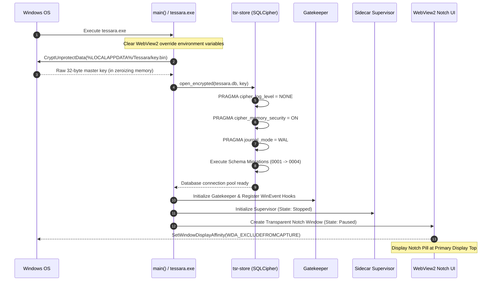

# Startup & Runtime Lifecycle

This document describes the sequential execution stages of Tessera from cold boot and key unwrapping to active operation and graceful termination.

---

## Application Startup Sequence



---

## State Transition Model

The host application coordinates state transitions via the central `Gatekeeper`:

```
                 ┌───────────────┐
                 │    Paused     │ (Fresh boot / User Hotkey)
                 └───────┬───────┘
                         │ User clicks Start / Unpause
                         ▼
                 ┌───────────────┐
                 │    Active     │ (Full desktop capture & processing)
                 └───────┬───────┘
                         │
        ┌────────────────┼────────────────┐
        │ Screen Lock    │ Fullscreen     │ Low Battery
        ▼                ▼                ▼
┌───────────────┐ ┌───────────────┐ ┌───────────────┐
│    Locked     │ │  Fullscreen   │ │  Battery Sav  │
│ (Halt capture;│ │ (Halt capture;│ │ (3x intervals;│
│  P2 allowed)  │ │  hide notch)  │ │  P2 deferred) │
└───────────────┘ └───────────────┘ └───────────────┘
```

---

## Shutdown & Teardown Sequence

When Tessera is terminated via the system tray, hotkey, or system shutdown:
1. **Gatekeeper Deactivation:** Screen event hooks and cadence timers are immediately unregistered.
2. **Session Flushing:** Active in-memory session text buffers are either flushed to SQLCipher or zeroized (if paused).
3. **Database Checkpointing:** Active SQLite WAL transactions are flushed to disk, and database handles are closed.
4. **Sidecar Termination:** The Windows Job Object handle is closed. The Windows kernel unconditionally terminates the `llama-server` child process.
5. **Memory Zeroization:** Cryptographic keys and sensitive buffers in memory are wiped using the `zeroize` crate before process exit.
