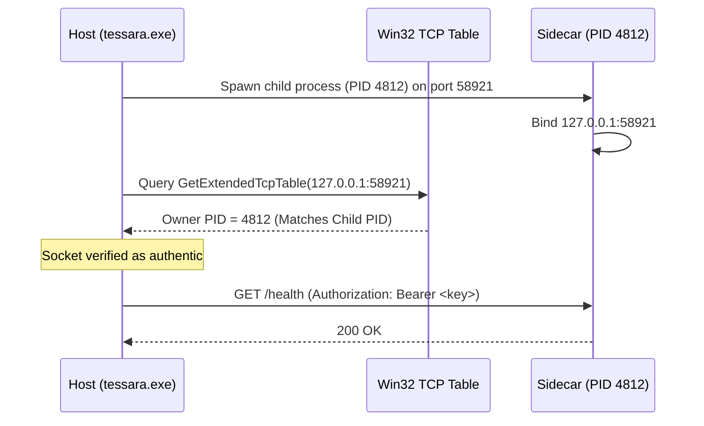

# Process Isolation Model

Tessera divides its runtime execution across three distinct operating-system process domains to prevent inference instability from affecting the user experience.

---

## The Three-Process Topology

```
┌────────────────────────────────────────────────────────────────────────┐
│                        PROCESS DOMAIN TOPOLOGY                         │
├──────────────────────────┬─────────────────────────────────────────────┤
│ 1. Host Application      │ tessara.exe (Native Rust 64-bit Process)    │
│    Role                  │ Orchestration, capture, storage, scheduling │
├──────────────────────────┼─────────────────────────────────────────────┤
│ 2. UI Renderer Sandbox   │ msedgewebview2.exe (Sandboxed WebView2)     │
│    Role                  │ React 19 UI presentation, user input        │
├──────────────────────────┼─────────────────────────────────────────────┤
│ 3. Inference Sidecar     │ llama-server.exe (Isolated Job Object)      │
│    Role                  │ GPU tensor execution, JSON grammar parsing  │
└──────────────────────────┴─────────────────────────────────────────────┘
```

---

## 1. Inference Worker Encapsulation

The inference worker executes untrusted C++ code and pushes graphics drivers to their memory limits. To protect the host, Tessera applies four layers of OS containment:

### Creation in Suspended State
The child process is created with Win32 `CREATE_SUSPENDED` and `CREATE_NO_WINDOW`:
```rust
// Pseudo-code representation of tsr-infer::sidecar
let mut cmd = Command::new(&server_exe);
cmd.creation_flags(CREATE_SUSPENDED | CREATE_NO_WINDOW);
let child = cmd.spawn()?;
```
Because the process is created suspended, it executes zero instructions until it is assigned to its containment Job Object.

### Windows Job Object Assignment
Tessera creates a Win32 Job Object configured with `JOB_OBJECT_LIMIT_KILL_ON_JOB_CLOSE`:
```rust
// Configured via tsr-win::job
let job = JobObject::create()?;
job.set_kill_on_close(true)?;
job.assign_process(child.handle())?;
child.resume()?;
```
Even if `tessara.exe` crashes or is killed abruptly via Task Manager, the Windows kernel guarantees that `llama-server.exe` is terminated instantly.

### Clean Environment Stripping
The child process starts with an empty environment, inheriting only an explicit system allowlist:
- `SystemRoot`, `SystemDrive`, `windir`
- `TEMP`, `TMP`
- `NUMBER_OF_PROCESSORS`, `PROCESSOR_ARCHITECTURE`

All user-level variables—especially `LLAMA_ARG_*` (such as `LLAMA_ARG_AGENT` or `LLAMA_ARG_MCP_SERVERS_JSON`) and `HF_TOKEN`—are stripped, ensuring the sidecar cannot activate network tools or auto-download models.

---

## 2. Loopback TCP Port Authentication

The host application and the sidecar communicate via HTTP/1.1 on loopback (`127.0.0.1`):
1. The host binds a temporary listener to `127.0.0.1:0` to identify an open OS port, releases it, and passes `--port <port>` to the sidecar.
2. The host generates a random 32-byte cryptographic API key, passed via `--api-key`.
3. Before trusting the endpoint, the host calls `GetExtendedTcpTable` via `tsr-win::tcp` to inspect the PID owning the listening socket:



This closes the bind race condition where an unrelated local process could bind the chosen port and intercept or spoof model responses.
