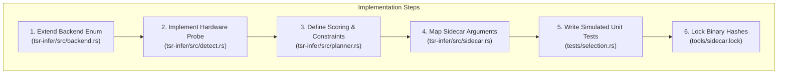

# Adding Hardware Backend Adapters

Tessera abstracts local AI acceleration through the [`tsr-infer`](https://github.com/webex042/Tessera/tree/main/crates/tsr-infer) crate. The architecture uses a pluggable adapter selection matrix that probes available physical devices (via DXGI, Vulkan, or vendor SDKs) and ranks them according to capability, VRAM headroom, and stability.

This guide explains how to add support for a new hardware backend (e.g., DirectML, OpenVINO, or an NPU runtime).



---

## Step 1: Extend the `Backend` Enum

In `crates/tsr-infer/src/backend.rs`, add the new backend variant:

```rust
#[derive(Debug, Clone, Copy, PartialEq, Eq, Hash, Serialize, Deserialize)]
pub enum Backend {
    Cuda,
    Rocm,
    Vulkan,
    Sycl,
    Metal,
    OpenCl,
    DirectMl, // <-- New backend variant
    Cpu,
}
```

Implement the required display names, feature strings, and default priorities.

---

## Step 2: Implement Adapter Detection

In `crates/tsr-infer/src/detect.rs`, implement detection for the target device using Windows DXGI or driver APIs:

```rust
pub fn probe_directml_adapters() -> Vec<Adapter> {
    // Enumerate DXGI adapters supporting DirectML compute levels
    // Return structured Adapter representations:
    // - vendor_id
    // - device_id
    // - name
    // - dedicated_video_memory
    // - driver_version
}
```

Ensure detection does not crash if the required vendor runtime DLLs are missing on the host. Always wrap native Win32/COM calls in safe error handlers.

---

## Step 3: Configure Selection Scoring & VRAM Constraints

In `crates/tsr-infer/src/planner.rs`, define the scoring priority and VRAM calculation rules:

```rust
impl Planner {
    fn score_candidate(&self, adapter: &Adapter, model_reqs: &ModelRequirements) -> Option<CandidatePlan> {
        match adapter.backend {
            Backend::DirectMl => {
                let available_vram = adapter.dedicated_video_memory;
                let required_vram = model_reqs.min_vram_bytes;
                if available_vram >= required_vram {
                    Some(CandidatePlan {
                        backend: Backend::DirectMl,
                        gpu_layers: self.calculate_layer_offload(available_vram, model_reqs),
                        estimated_latency_ms: 120,
                    })
                } else {
                    None // Insufficient VRAM, fall back to next candidate
                }
            }
            // ... existing backends
        }
    }
}
```

---

## Step 4: Map Sidecar CLI Flags

In `crates/tsr-infer/src/sidecar.rs`, map the selected backend to the execution flags required by `llama-server`:

```rust
pub fn build_sidecar_args(plan: &ExecutionPlan, model_path: &Path) -> Vec<String> {
    let mut args = vec![
        "-m".into(),
        model_path.to_string_lossy().into(),
        "--port".into(),
        plan.port.to_string(),
        "--host".into(),
        "127.0.0.1".into(),
    ];

    match plan.backend {
        Backend::DirectMl => {
            args.push("--directml".into());
            args.push("-ngl".into());
            args.push(plan.gpu_layers.to_string());
        }
        // ... other backends
    }

    args
}
```

---

## Step 5: Write Simulated Hardware Tests

Tessera tests hardware selection using synthetic adapter mocks so tests pass on any CI runner (even headless CPU instances).

Add test cases to `crates/tsr-infer/tests/selection.rs`:

```rust
#[test]
fn test_directml_selected_when_sufficient_vram() {
    let mock_adapters = vec![
        mock_intel_arc_adapter(8 * 1024 * 1024 * 1024), // 8GB Arc A770
        mock_cpu_adapter(),
    ];

    let planner = Planner::new(&mock_adapters);
    let plan = planner.select_best_backend(&phi4_requirements()).unwrap();

    assert_eq!(plan.candidates[0].backend, Backend::DirectMl);
    assert!(plan.candidates[0].gpu_layers > 0);
}
```

---

## Step 6: Lock Sidecar Assets in `tools/sidecar.lock`

If the backend requires specialized pre-compiled sidecar binaries or shared libraries:

1. Add the asset URL and SHA-256 checksum to [`tools/sidecar.lock`](https://github.com/webex042/Tessera/blob/main/tools/sidecar.lock).
2. Update [`tools/fetch_sidecar.py`](https://github.com/webex042/Tessera/blob/main/tools/fetch_sidecar.py) to extract the new variant.
3. Validate offline extraction and hash verification.
