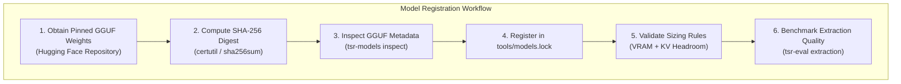

# Adding Model Formats & Registrations

Tessera requires all machine learning models to be explicitly registered in [`tools/models.lock`](file:///c:/Users/prans/OneDrive/Desktop/Tessera/tools/models.lock). The system verifies models via GGUF header inspection and cryptographic SHA-256 validation to prevent arbitrary model execution or unexpected memory exhaustion.



---

## Step 1: Model Selection Requirements

Before submitting a model for inclusion in `models.lock`, ensure it meets Tessera's runtime criteria:

1. **Format**: Must be valid **GGUF v2 or v3**. Non-GGUF weights (SafeTensors, PyTorch `.bin`) are not supported directly by `llama-server`.
2. **Quantization**: Recommended quantizations are `Q4_K_M` or `Q5_K_M`. Unquantized `F16` weights exceed consumer VRAM budgets.
3. **Context Length**: Model architecture must support a minimum context window of **2,048 tokens** (ideally 4,096+ tokens).
4. **Chat Template**: The GGUF metadata must embed a valid Jinja chat template (`tokenizer.chat_template`) compatible with structured JSON extraction.

---

## Step 2: Compute Cryptographic Hashes

Compute the exact SHA-256 checksum of the GGUF file:

```powershell
# Windows PowerShell
Get-FileHash -Algorithm SHA256 .\phi-4-mini-instruct-Q4_K_M.gguf

# Command Prompt
certutil -hashfile .\phi-4-mini-instruct-Q4_K_M.gguf SHA256
```

---

## Step 3: Register in `tools/models.lock`

Add a new model entry to [`tools/models.lock`](file:///c:/Users/prans/OneDrive/Desktop/Tessera/tools/models.lock):

```json
{
  "id": "phi-4-mini-instruct",
  "name": "Phi-4-mini-instruct",
  "architecture": "phi3",
  "license": "MIT",
  "context_length": 4096,
  "files": [
    {
      "path": "phi-4-mini-instruct-Q4_K_M.gguf",
      "quantization": "Q4_K_M",
      "size_bytes": 2490000000,
      "sha256": "e3b0c44298fc1c149afbf4c8996fb92427ae41e4649b934ca495991b7852b855",
      "download_url": "https://huggingface.co/microsoft/Phi-4-mini-instruct-GGUF/resolve/main/Phi-4-mini-instruct-Q4_K_M.gguf"
    }
  ]
}
```

---

## Step 4: Verify Local Model Detection

Test that the CLI tool recognizes and verifies the newly registered model:

```powershell
# Verify files in local model directory
cargo run -p tsr-net --bin tsr-models --locked -- locate "C:\path\to\models" --verify
```

Expected output:
```text
[OK] phi-4-mini-instruct (Q4_K_M) - SHA-256 verified successfully.
```

---

## Step 5: Run Empirical Quality Evaluation

Before opening a pull request, run the evaluation benchmark suite against the new model to measure extraction accuracy and latency:

```powershell
# Run extraction evaluation on the development split
cargo run -p tsr-evals --bin tsr-eval --locked -- extraction --model "C:\path\to\models" --split dev
```

Inspect the generated scorecard in `evals/results/`. Ensure:
* Hallucination rate is within acceptable bounds (< 2.0%).
* Schema validity is 100% (zero invalid JSON rows).
* First-token latency meets interactive requirements (< 3.0s on discrete GPU, < 15.0s on integrated GPU).
