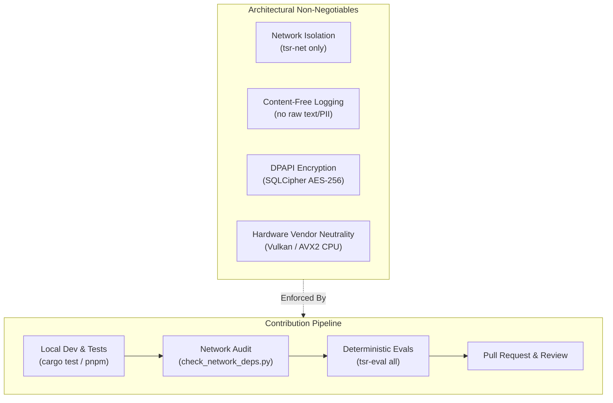

# Contributing to Tessera

Thank you for your interest in contributing to Tessera. Tessera is an open-source, local-first AI inference orchestration and screen-aware memory platform for Windows.

Because Tessera handles sensitive user screen data, OCR extractions, and local machine learning models, contributions must adhere to strict security, privacy, and architectural non-negotiables.

---

## Architectural Non-Negotiables

Every pull request must respect the following core invariants:

### 1. Network Boundary Isolation
* **Rule**: No crate other than `crates/tsr-net` may declare or import network-capable dependencies (`reqwest`, `tokio/net`, `hyper`, `ureq`, `tungstenite`, etc.).
* **Enforcement**: Verified in CI by [`tools/check_network_deps.py`](file:///c:/Users/prans/OneDrive/Desktop/Tessera/tools/check_network_deps.py). Any attempt to add networking to `tsr-core`, `tsr-capture`, `tsr-store`, or `tsr-infer` will fail CI immediately.

### 2. Content-Free Logging Invariant
* **Rule**: Never log raw OCR text, window titles, user prompts, assistant answers, encryption keys, or file contents.
* **Format**: All logs must emit structured, content-free metrics only (e.g., token counts, latency in milliseconds, row counts, and error enum variants).

### 3. Hardware Independence
* **Rule**: Never write vendor-locked code that assumes NVIDIA CUDA exists.
* **Requirement**: All features must either gracefully degrade to standard CPU execution or support vendor-neutral acceleration via Vulkan or DirectML.

### 4. Zero Unverified Performance Claims
* **Rule**: Never assert performance improvements, latency numbers, or extraction accuracy without reproducible evaluation run logs. All evaluation metrics are governed by the harness in `evals/`.

---

## Areas Where Contributions Are Welcomed

* **Backend Adapters**: Adding or optimizing runtime execution backends (e.g., ONNX Runtime DirectML, TensorRT-LLM, OpenVINO) within the [`tsr-infer`](file:///c:/Users/prans/OneDrive/Desktop/Tessera/crates/tsr-infer) crate.
* **Model Configurations**: Expanding verified GGUF model formats and quantization profiles in `tools/models.lock`.
* **Window Detection & Win32 Hooks**: Improving capture ladder fallback heuristics in `tsr-capture` and `tsr-win`.
* **Evaluation Corpora**: Adding realistic edge cases to the synthetic redaction and prompt injection test corpora in `tests/fixtures/`.
* **Documentation**: Improving technical guides, clarifying error codes, and authoring architecture decision records (ADRs).

---

## Contribution Guides

* **[Development Workflow](/contributing/workflow)**: Step-by-step setup, branch conventions, running tests, and preparing pull requests.
* **[Adding Backend Adapters](/contributing/adding-backends)**: Implementation guide for adding new hardware acceleration paths to `tsr-infer`.
* **[Adding Model Formats](/contributing/adding-models)**: How to validate, hash-lock, and register new GGUF models in `tools/models.lock`.
