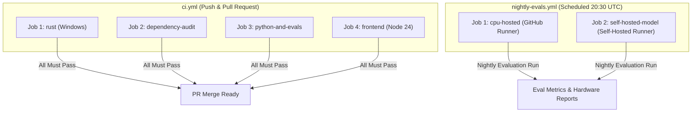
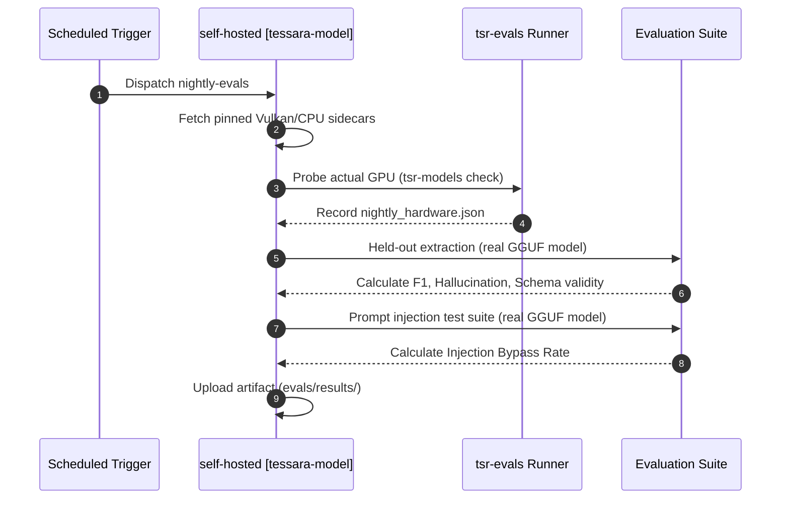

# CI/CD Automation Workflows

Tessera maintains two GitHub Actions workflows designed to enforce strict code quality, verify architectural boundaries, and evaluate model performance without incurring unnecessary cloud GPU compute costs.

---

## 1. Continuous Integration Pipeline (`ci.yml`)

The primary CI workflow runs on every push to `main` and on all pull requests. It runs exclusively on `windows-latest` runners.

### Job 1: `rust`
* **Toolchain**: Stable Rust with `rustfmt` and `clippy`.
* **Frontend Prerequisite**: Builds UI assets via `pnpm build:ui` (required by `tauri-build` build script).
* **Linting**:
  * `cargo fmt --all --check`
  * `cargo clippy --workspace --all-targets --locked -- -D warnings`
* **Sidecar Fetching**: Downloads pinned CPU binaries (`onnxruntime win-x64` and `llama_cpp cpu-x64`) with hash verification.
* **Unit & Simulated Tests**: `cargo test --workspace --locked` (exercises simulated CUDA, ROCm, Vulkan, SYCL, and CPU adapters).
* **Real Runtime Tests (No GPU)**:
  * `tsr-retrieval` ignored tests (executes real FastEmbed ONNX embedder on CPU).
  * `tsr-infer` tests (`real_cpu_only_path`, missing executable probes, router mode isolation).
* **Deterministic Stage 2 Evaluations**: `cargo run -p tsr-evals --bin tsr-eval --locked -- all` (evaluates injection corpus with simulated model, oracle extraction pipeline loss, and backlog drain).
* **Hardware Detection Sanity Check**: Runs `tsr-hw --json` and asserts that the GitHub runner is accurately identified as `Cpu`.
* **Release Compilation**: Compiles the desktop host binary with `custom-protocol` enabled.

### Job 2: `dependency-audit`
* **Network Boundary Gate**: Executes `python tools/check_network_deps.py --locked` to prove that network-capable crates exist only in `tsr-net`.
* **Checker Self-Test**: Tests the verification tool itself against known-bad fixtures in `tests/fixtures/netdeps/` to ensure regression protection.
* **Cargo Deny**: Runs `cargo deny --locked check` against ban rules, unapproved licenses, and known RustSec advisories.
* **Updater Advisory Monitor**: Evaluates `cargo deny --locked --features tessara/updater check` (monitors upstream `zip` vulnerabilities; continues on error until resolved).

### Job 3: `python-and-evals`
* **Synthetic Evaluation Sets**: Validates JSON schema integrity via `python evals/validate.py`.
* **Corpus Reproducibility**: Generates redaction and injection corpora and confirms zero Git diff (`git diff --exit-code`).
* **Harness Self-Tests**: Executes benchmark unit tests with a simulated server (`bench/tests`).

### Job 4: `frontend`
* **Node Environment**: Node.js 24 with Corepack-managed pnpm.
* **Typecheck**: `pnpm -r typecheck` across all workspace UI packages.
* **Production Build**: `pnpm build:ui`.

---

## 2. Nightly Evaluations Pipeline (`nightly-evals.yml`)

Runs daily at 20:30 UTC or via manual `workflow_dispatch`. Designed to decouple slow or hardware-specific evaluation tasks from fast PR feedback loops.

### Job 1: `cpu-hosted`
* Runs on GitHub Windows runners without attached GPUs.
* Executes deterministic evaluations (`tsr-eval all`) and dev split oracle extraction.

### Job 2: `self-hosted-model`
* **Gate**: Runs only when repository variable `TESSARA_MODEL_RUNNER == 'true'`.
* **Environment**: Runs on a physical machine labelled `[self-hosted, tessara-model]` equipped with target GPU hardware and local model weights (`TESSARA_MODELS_DIR`).
* **Hardware Recording**: Executes `tsr-models check` and logs detected hardware and VRAM to `evals/results/nightly_hardware.json`.
* **Real Model Evaluations**:
  * Held-out split extraction evaluation (measuring F1, hallucination rate, and schema failures).
  * 30-case prompt injection suite against the live quantized model.
  * Uploads timestamped metric artifacts to GitHub.
