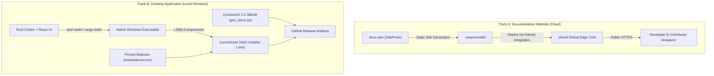

# Deployment & Distribution Overview

Tessera's deployment model separates the documentation and public web presence from the local-first desktop application runtime. The application itself never runs on the web, does not use a cloud backend, and does not require persistent server infrastructure.

---

## The Dual Deployment Tracks

| Dimension | Track A: Documentation Website | Track B: Desktop Application |
| :--- | :--- | :--- |
| **Directory** | `docs-site/` | Root repository (`src-tauri/`, `crates/`, `ui/`) |
| **Platform** | Vercel Edge Network | Microsoft Windows 11 (x64) |
| **Output Type** | Pure Static HTML, JS, CSS, SVG | Native Win32 / WebView2 binary (`.exe`) + NSIS installer |
| **Runtime Backend** | None (Client-side MiniSearch index) | Local Rust engine, SQLCipher, `llama-server` sidecar |
| **Data Boundary** | Zero telemetry, zero external search APIs | 100% loopback, DPAPI-encrypted local database |
| **CI / CD Pipeline** | Vercel GitHub App (preview + production) | `.github/workflows/ci.yml` & `nightly-evals.yml` |

---

## Deployment Subsections

1. **[Vercel Documentation Hosting](/deployment/vercel-hosting)**  
   Detailed guide for deploying this VitePress documentation site to Vercel, including Root Directory overrides, build commands, output paths, clean URLs, and preview branch workflows.
2. **[Desktop Application Packaging](/deployment/packaging)**  
   How the Tauri 2 desktop shell packages the React 19 frontend, bundles WebView2 bootstrappers, and configures NSIS installers with per-user privileges.
3. **[Release Engineering & SBOM](/deployment/release-engineering)**  
   The zero-network software bill of materials (`tools/gen_sbom.py`), cryptographic hash locking (`sidecar.lock`, `models.lock`), code signing prerequisites, and the auto-updater security gate ([ADR-0003](/developer/adrs)).
4. **[CI/CD Workflows](/deployment/ci-cd)**  
   Architecture of GitHub Actions automation: continuous integration checks, simulated hardware matrices, deterministic evaluation gates, and nightly self-hosted GPU evaluations.
