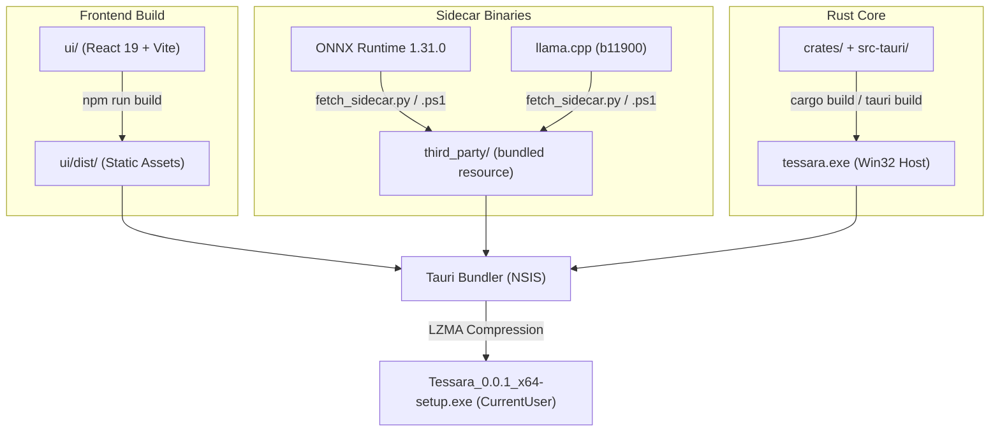

# Desktop Application Packaging

Tessera targets **Microsoft Windows 11 (x64)** as a standalone native desktop application. It uses **Tauri 2** to integrate a Rust system core with a React 19 frontend, bundled as an NSIS single-executable installer.



---

## Packaging Configuration (`tauri.conf.json`)

The packaging pipeline is defined in [`src-tauri/tauri.conf.json`](https://github.com/webex042/Tessera/blob/main/src-tauri/tauri.conf.json):

```json
{
  "$schema": "https://schema.tauri.app/config/2",
  "productName": "Tessara",
  "version": "0.0.1",
  "identifier": "app.tessara.desktop",
  "build": {
    "frontendDist": "../ui/dist",
    "devUrl": "http://localhost:5173",
    "beforeDevCommand": { "script": "npm run dev", "cwd": "../ui" },
    "beforeBuildCommand": { "script": "npm run build", "cwd": "../ui" }
  },
  "bundle": {
    "active": true,
    "targets": ["nsis"],
    "icon": ["icons/icon.ico", "icons/icon.png"],
    "shortDescription": "Local-first memory of your screen",
    "copyright": "Tessara contributors",
    "licenseFile": "../THIRD_PARTY_NOTICES.md",
    "resources": {
      "../third_party/llama_cpp/b11900/cpu-x64": "third_party/llama_cpp/b11900/cpu-x64",
      "../third_party/llama_cpp/b11900/vulkan-x64": "third_party/llama_cpp/b11900/vulkan-x64",
      "../third_party/onnxruntime/1.31.0/win-x64/onnxruntime-win-x64-1.31.0/lib/onnxruntime.dll": "third_party/onnxruntime/1.31.0/win-x64/onnxruntime-win-x64-1.31.0/lib/onnxruntime.dll"
    },
    "windows": {
      "webviewInstallMode": { "type": "embedBootstrapper" },
      "nsis": {
        "installMode": "currentUser",
        "displayLanguageSelector": false,
        "compression": "lzma"
      }
    }
  }
}
```

---

## NSIS Installer Architecture

### 1. `currentUser` Privilege Scope
* The installer does **not require Windows Administrator UAC prompts**.
* Installs exclusively into `%LOCALAPPDATA%\Programs\Tessera`.
* Stores user databases and runtime models in `%LOCALAPPDATA%\Tessera`.
* Prevents privilege escalation vectors and simplifies deployment on enterprise workstations where users lack administrative rights.

### 2. WebView2 Bootstrapper Integration
* Configured with `"webviewInstallMode": { "type": "embedBootstrapper" }`.
* If the target Windows machine lacks the Microsoft Edge WebView2 Evergreen Runtime (rare on Windows 11), the installer embeds the Microsoft bootstrapper to automatically download and initialize the runtime.

### 3. LZMA Compression
* The installer applies maximum LZMA compression to reduce disk footprint and download bandwidth.
* Includes all compiled native DLLs (SQLCipher, DirectML/Vulkan dependencies) and embedded UI assets.

---

## Sidecar Binaries

Tessera isolates high-risk C/C++ runtimes into child processes rather than linking them statically into the main process.

| Sidecar Component | Pinned Version | Bundled Resource Path | Checksum Source |
| :--- | :--- | :--- | :--- |
| **llama-server (`cpu-x64`, `vulkan-x64`)** | `b11900` | `third_party/llama_cpp/b11900/{cpu-x64,vulkan-x64}` | [`tools/sidecar.lock`](https://github.com/webex042/Tessera/blob/main/tools/sidecar.lock) |
| **ONNX Runtime** | `1.31.0` | `third_party/onnxruntime/1.31.0/win-x64/onnxruntime-win-x64-1.31.0/lib/onnxruntime.dll` | [`tools/sidecar.lock`](https://github.com/webex042/Tessera/blob/main/tools/sidecar.lock) |

During packaging, sidecar binaries must be pre-fetched into `third_party/` using the verified fetch tools:

```powershell
python tools/fetch_sidecar.py onnxruntime win-x64
python tools/fetch_sidecar.py llama_cpp cpu-x64
```

---

## Building the Production Bundle

To build the release desktop installer locally:

```powershell
# 1. Install frontend dependencies and build React 19 assets
npm --prefix ui install
npm --prefix ui run build

# 2. Ensure sidecars are populated
python tools/fetch_sidecar.py onnxruntime win-x64
python tools/fetch_sidecar.py llama_cpp cpu-x64
python tools/fetch_sidecar.py llama_cpp vulkan-x64

# 3. Compile the native host with custom-protocol feature (local air-gapped default)
cargo build -p tessara --release --features custom-protocol --locked
# Optional Groq build (still defaults to TSR_LLM_PROVIDER=local at runtime):
cargo build -p tessara --release --features "custom-protocol,groq" --locked

# 4. Build NSIS bundle (bundle.active is true in tauri.conf.json)
.\node_modules\.bin\tauri.cmd build --features groq --bundles nsis
```

The resulting installer is generated at:
`target/release/bundle/nsis/Tessara_0.0.1_x64-setup.exe`

---

## Free Desktop & Documentation Distribution

- **Windows Desktop Installer (GitHub Releases, `$0`):** Publish the signed or unsigned `Tessara_0.0.1_x64-setup.exe` NSIS installer (and `Tessara_0.0.1_x64-portable.zip`) on GitHub Releases at zero hosting cost.
  - **Strict Credential Rule (BYOK):** Never embed `GROQ_API_KEY` or `.env` files inside distributed binaries or installers. Users switching `TSR_LLM_PROVIDER=groq` supply their own key via environment variables, a local `.env` file, or DPAPI `%LOCALAPPDATA%\Tessara\groq_key.bin`.
- **Documentation Website (Vercel Hobby, `$0`):** `docs-site/` builds as static HTML/JS/CSS/SVG via `vercel.json` and `docs-site/vercel.json` without any backend server or secrets.
- **Optional Future Proxy Pattern:** If centralized shared-quota hosting is ever required instead of per-user keys, deploy a thin edge proxy (for example, **Cloudflare Workers** + **Cloudflare D1** free tier for per-user rate accounting) storing `GROQ_API_KEY` server-side as a Worker secret rather than distributing keys to desktop clients.
