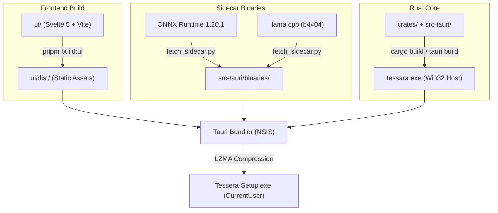

# Desktop Application Packaging

Tessera targets **Microsoft Windows 11 (x64)** as a standalone native desktop application. It uses **Tauri 2** to integrate a Rust system core with a Svelte 5 frontend, bundled as an NSIS single-executable installer.



---

## Packaging Configuration (`tauri.conf.json`)

The packaging pipeline is defined in [`src-tauri/tauri.conf.json`](file:///c:/Users/prans/OneDrive/Desktop/Tessera/src-tauri/tauri.conf.json):

```json
{
  "$schema": "https://schema.tauri.app/config/2",
  "productName": "Tessera",
  "version": "0.0.1",
  "identifier": "app.tessara.desktop",
  "build": {
    "frontendDist": "../ui/dist",
    "devUrl": "http://localhost:5173",
    "beforeDevCommand": { "script": "pnpm dev", "cwd": "../ui" },
    "beforeBuildCommand": { "script": "pnpm build", "cwd": "../ui" }
  },
  "bundle": {
    "active": false,
    "targets": ["nsis"],
    "icon": ["icons/icon.ico", "icons/icon.png"],
    "shortDescription": "Local-first memory of your screen",
    "copyright": "Tessera contributors",
    "licenseFile": "../THIRD_PARTY_NOTICES.md",
    "windows": {
      "webviewInstallMode": { "type": "embedBootstrapper" },
      "nsis": {
        "installMode": "currentUser",
        "displayLanguageSelector": false,
        "compression": "lzma"
      }
    }
  }
}
```

---

## NSIS Installer Architecture

### 1. `currentUser` Privilege Scope
* The installer does **not require Windows Administrator UAC prompts**.
* Installs exclusively into `%LOCALAPPDATA%\Programs\Tessera`.
* Stores user databases and runtime models in `%LOCALAPPDATA%\Tessera`.
* Prevents privilege escalation vectors and simplifies deployment on enterprise workstations where users lack administrative rights.

### 2. WebView2 Bootstrapper Integration
* Configured with `"webviewInstallMode": { "type": "embedBootstrapper" }`.
* If the target Windows machine lacks the Microsoft Edge WebView2 Evergreen Runtime (rare on Windows 11), the installer embeds the Microsoft bootstrapper to automatically download and initialize the runtime.

### 3. LZMA Compression
* The installer applies maximum LZMA compression to reduce disk footprint and download bandwidth.
* Includes all compiled native DLLs (SQLCipher, DirectML/Vulkan dependencies) and embedded UI assets.

---

## Sidecar Binaries

Tessera isolates high-risk C/C++ runtimes into child processes rather than linking them statically into the main process.

| Sidecar Component | Pinned Version | Windows Target Binary | Checksum Source |
| :--- | :--- | :--- | :--- |
| **llama-server** | `b4404` | `src-tauri/binaries/llama-server-x86_64-pc-windows-msvc.exe` | [`tools/sidecar.lock`](file:///c:/Users/prans/OneDrive/Desktop/Tessera/tools/sidecar.lock) |
| **ONNX Runtime** | `1.20.1` | `src-tauri/binaries/onnxruntime.dll` | [`tools/sidecar.lock`](file:///c:/Users/prans/OneDrive/Desktop/Tessera/tools/sidecar.lock) |

During packaging, sidecar binaries must be pre-fetched into `src-tauri/binaries/` using the verified fetch tool:

```powershell
python tools/fetch_sidecar.py onnxruntime win-x64
python tools/fetch_sidecar.py llama_cpp cpu-x64
```

---

## Building the Production Bundle

To build the release desktop installer locally:

```powershell
# 1. Install frontend and root dependencies
corepack enable
pnpm install --frozen-lockfile

# 2. Build the production Svelte 5 frontend
pnpm build:ui

# 3. Ensure sidecars are populated
python tools/fetch_sidecar.py onnxruntime win-x64
python tools/fetch_sidecar.py llama_cpp cpu-x64

# 4. Compile the native host with custom-protocol feature
cargo build -p tessara --release --features custom-protocol --locked

# 5. Build NSIS bundle (when bundle.active is enabled in tauri.conf.json)
pnpm tauri build
```

The resulting installer is generated at:
`target/release/bundle/nsis/Tessera_0.0.1_x64-setup.exe`
