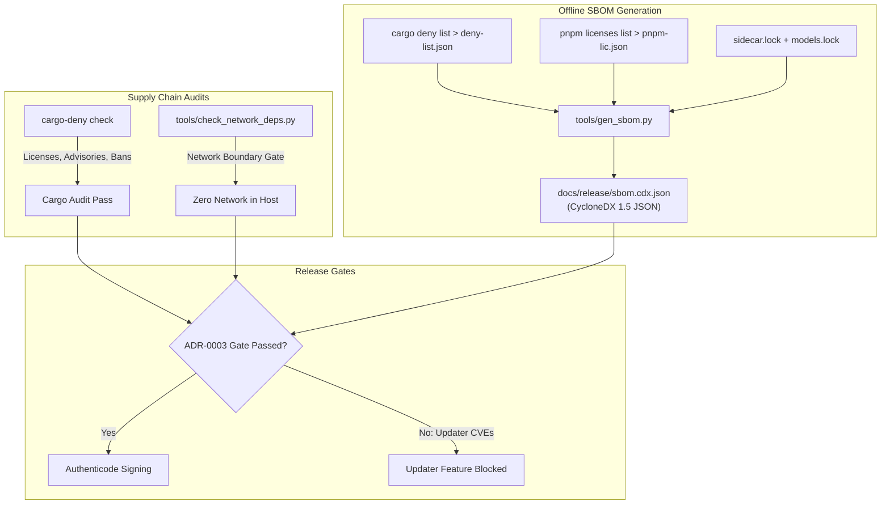

# Release Engineering & Supply Chain Security

Tessera treats supply chain security as an engineering invariant. Release engineering workflows ensure that all dependencies, native binaries, and machine learning models are cryptographically verifiable and auditable without relying on live network access during builds.



---

## Software Bill of Materials (SBOM)

Tessera ships a complete **CycloneDX 1.5** specification SBOM generated entirely offline using [`tools/gen_sbom.py`](https://github.com/webex042/Tessera/blob/main/tools/gen_sbom.py).

### Generating the Release SBOM

```powershell
# 1. Export Rust crate dependency graph and declared licenses
cargo deny --offline list -f json -l crate > deny-list.json

# 2. Export npm production dependency graph and licenses
(cd ui && pnpm licenses list --json --prod > ../pnpm-lic.json)

# 3. Generate CycloneDX 1.5 SBOM from local metadata
python tools/gen_sbom.py deny-list.json pnpm-lic.json > docs/release/sbom.cdx.json
```

### Components Tracked in the SBOM

1. **Rust Crates**: Every non-internal crate compiled into the binary graph (`pkg:cargo` Package URLs).
2. **NPM Packages**: Every production dependency bundled into the React UI (`pkg:npm` Package URLs).
3. **Native Sidecars**: Pinned binary releases (`llama-server`, `onnxruntime.dll`) accompanied by their SHA-256 digests.
4. **Machine Learning Models**: GGUF weights tracked in `tools/models.lock` (`type: "machine-learning-model"`).

---

## Cryptographic Hash Pinning

To prevent supply chain poisoning or silent upstream mutations, external assets are pinned by SHA-256 digests:

### 1. Sidecar Pinning (`tools/sidecar.lock`)
Defines the official download URLs, versions, and expected cryptographic hashes for pre-compiled backend runtimes. The fetching script [`tools/fetch_sidecar.py`](https://github.com/webex042/Tessera/blob/main/tools/fetch_sidecar.py) verifies the hash before extracting any binary into the build tree:

```json
{
  "llama_cpp": {
    "version": "b4404",
    "assets": [
      {
        "variant": "cpu-x64",
        "sha256": "4b684c3ea8c772e70e302506dd5e28a47caec908bf5b0c95a208221b369f7d43",
        "url": "https://github.com/ggerganov/llama.cpp/releases/download/b4404/llama-b4404-bin-win-avx2-x64.zip"
      }
    ]
  }
}
```

### 2. Model Weight Pinning (`tools/models.lock`)
Specifies the exact Hugging Face revisions and SHA-256 checksums for verified model files. The model loader [`tsr-net`](https://github.com/webex042/Tessera/tree/main/crates/tsr-net) rejects files whose hashes deviate from this lockfile.

---

## Code Signing Requirements

Before distributing Windows binaries publicly:

* **Authenticode Certificate**: The NSIS installer executable (`Tessera-Setup.exe`) and host binary (`tessara.exe`) must be signed with a valid Microsoft Authenticode code signing certificate (EV recommended to prevent Windows SmartScreen warnings).
* **Signing Command**:
  ```powershell
  signtool.exe sign /fd SHA256 /tr http://timestamp.digicert.com /td SHA256 /d "Tessera" /f certificate.pfx /p <PASSWORD> target/release/bundle/nsis/Tessera_0.0.1_x64-setup.exe
  ```

---

## Auto-Updater Security Gate (ADR-0003)

The auto-updater feature (`tessara/updater`) is **compiled out of default release builds**.

### Root Cause
An audit via `cargo deny check` revealed that `tauri-plugin-updater` depends on older versions of the `zip` crate containing three unpatched security advisories:
* `RUSTSEC-2026-0367`
* `RUSTSEC-2026-0368`
* `RUSTSEC-2026-0369`

### Policy
Per [ADR-0003](/developer/adrs), automatic background self-updates present a high-risk privilege escalation vector when unpacking untrusted zip archives. Therefore:
1. `tessara/updater` feature remains disabled in default builds.
2. The CI pipeline executes `cargo deny --locked --features tessara/updater check` with `continue-on-error: true` as an active security monitor.
3. Enabling auto-updates for production release is blocked until the upstream plugin updates to `zip >= 0.9` or replaces zip decompression with tar.
