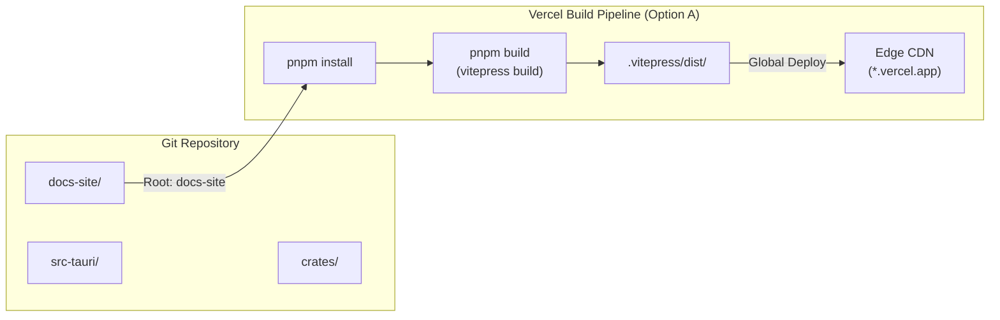
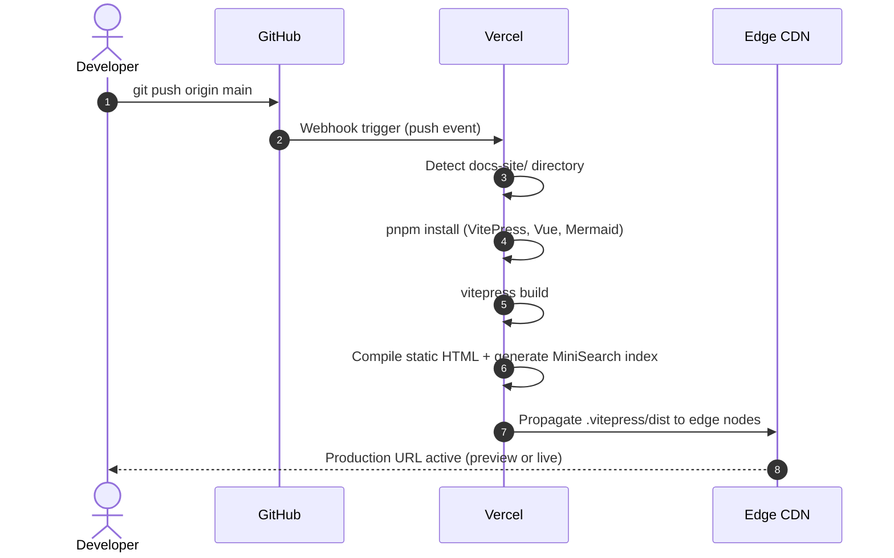

# Vercel Documentation Hosting Guide

The Tessera documentation website (`docs-site/`) is architected for static generation and instant global edge distribution using **Vercel**. It requires zero server runtimes, zero cloud databases, and zero external API keys.

---

## Deployment Architecture Options

There are two supported methods for deploying Tessera docs to Vercel:

### Option A: Root Directory Set to `docs-site` (Recommended)

When connecting the GitHub repository to Vercel, set the **Root Directory** setting in the Vercel dashboard to `docs-site`.

* **Root Directory**: `docs-site`
* **Framework Preset**: `VitePress` (detected automatically)
* **Build Command**: `pnpm build` (or `npm run build`)
* **Output Directory**: `.vitepress/dist`
* **Install Command**: `pnpm install`

In this configuration, Vercel ignores the desktop Rust and Svelte codebase, installing only the lightweight documentation dependencies in `docs-site/package.json`.



### Option B: Monorepo Root Deployment

If you prefer to deploy from the repository root without changing the Vercel project settings, a root [`vercel.json`](file:///c:/Users/prans/OneDrive/Desktop/Tessera/vercel.json) is provided at the repository root:

```json
{
  "$schema": "https://openapi.vercel.sh/vercel.json",
  "framework": "vitepress",
  "buildCommand": "cd docs-site && pnpm install && pnpm build",
  "outputDirectory": "docs-site/.vitepress/dist",
  "cleanUrls": true
}
```

---

## Step-by-Step Vercel Deployment

### Step 1: Import Repository
1. Navigate to [https://vercel.com/new](https://vercel.com/new).
2. Connect your GitHub account and locate the **Tessera** repository.
3. Click **Import**.

### Step 2: Configure Project Settings
In the **Configure Project** screen:

* **Project Name**: `tessera-docs` (or your preferred name)
* **Framework Preset**: Select **VitePress** (or leave as auto-detect).
* **Root Directory**: Click **Edit** and select `docs-site`. Click **Continue**.
* **Build and Output Settings**:
  * Build Command: `pnpm build` (default override enabled if necessary)
  * Output Directory: `.vitepress/dist`
  * Install Command: `pnpm install`
* **Node.js Version**: Select **20.x** or **22.x** in Project Settings → General.



### Step 3: Environment Variables
**No environment variables are required.**  
All search indexes, navigation trees, and syntax themes are built entirely into client-side static assets. Never inject production API secrets or private tokens into the documentation build pipeline.

### Step 4: Click Deploy
Click **Deploy**. The build completes in approximately 20 to 45 seconds.

---

## Production Routing & Behavior

VitePress generates clean URLs that pair with Vercel's edge routing:

### 1. Clean URLs & Direct Page Access
* URLs do not require `.html` extensions (e.g., `/architecture/high-level`).
* Both `docs-site/vercel.json` and the root `vercel.json` configure `"cleanUrls": true`.
* Direct navigation or browser refresh on deep routes (e.g., `/runtime/hardware-backends`) resolves directly to the static HTML file at edge without 404 redirects.

### 2. Client-Side Search
* Search runs locally inside the user's browser using `@vitepress/client` MiniSearch.
* All documentation pages, headings, and code titles are indexed during `vitepress build`.
* No external API calls are made to Algolia, OpenAI, or third-party search servers.

### 3. Client-Side Mermaid Diagrams
* Mermaid diagrams are rendered on the client side via `Mermaid.vue`.
* The server-side generation (SSG) compiles raw Mermaid source code into safe data attributes.
* When loaded in the browser, diagrams are rendered dynamically to match the user's active theme (Light vs. Dark mode).

### 4. Custom 404 Handling
* VitePress generates a built-in 404 page (`404.html`) that adheres to the technical graphite design system.
* Vercel automatically serves this page for any unmatched request paths.

---

## SEO & Static Assets

| Resource | Path | Verification |
| :--- | :--- | :--- |
| **Favicon** | `docs-site/public/favicon.svg` | Scalable vector logo mark in graphite and white |
| **Robots Policy** | `docs-site/public/robots.txt` | Permissive crawling (`Allow: /`) for public developer docs |
| **Open Graph** | Meta tags in `config.ts` | Sets `og:title`, `og:description`, and `og:type` |
| **Theme Color** | `meta[name="theme-color"]` | Set to `#0A0A0A` (dark slate background) |

---

## Preview Deployments & Pull Requests

Vercel automatically creates isolated **Preview Deployments** for every pull request opened against the repository.
* When documentation files in `docs-site/` are updated, Vercel posts a comment with a unique preview URL (e.g., `https://tessera-docs-git-feat-docs-username.vercel.app`).
* Pull request reviewers can inspect diagrams, navigation links, and code copy blocks prior to merging into `main`.

---

## Local Verification Commands

Before committing and pushing documentation changes, run the following verification pipeline locally:

```bash
# 1. Navigate to documentation directory
cd docs-site

# 2. Install dependencies
pnpm install

# 3. Test production static build
pnpm build

# 4. Preview the production build locally (starts local HTTP server on http://localhost:4173)
pnpm preview
```
