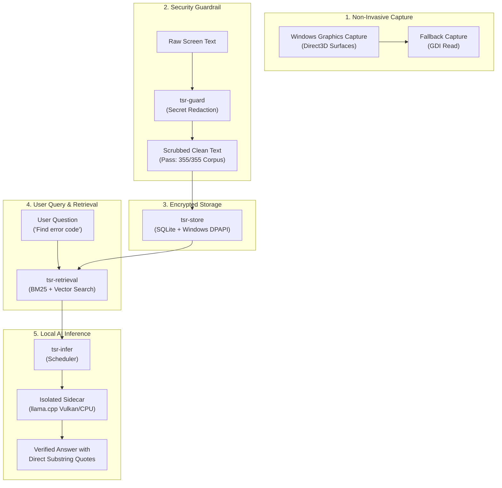

# Introduction to Tessera

Welcome to the official technical documentation for **Tessera**, an open-source systems research platform and local-first memory assistant for Windows 11.

Whether you are a developer exploring local artificial intelligence, a systems engineer studying Windows hardware capture, or a curious beginner looking for a private desktop assistant, this guide will introduce you to how Tessera works from the ground up without assuming prior knowledge of its internal implementation.

---

## 1. What is Tessera? (Introduction)

Imagine an assistant that sits quietly on your PC, remembers what you read or worked on across your open windows, and lets you ask questions like:
> *"What was that error message I saw in PowerShell thirty minutes ago?"* or
> *"Summarize the API specification from the browser tab I was looking at."*

Most current AI tools achieve this by continuously taking screenshots of your monitor and streaming your screen, passwords, personal emails, and private code to remote corporate cloud servers.

**Tessera takes the opposite approach:**
1. **100% Local Inference:** It runs compact, powerful language models (such as 4-billion parameter neural networks) directly on your own computer's graphics card (GPU) or processor (CPU).
2. **Zero Cloud Dependency:** Not a single token of text or pixel of screen data ever leaves your computer.
3. **Deterministic Safety:** Before anything is written to memory, sensitive data (credit cards, passwords, access keys) is redacted by a strict security guardrail.
4. **Hardware Independence:** Unlike traditional tools that crash if you do not have a specific graphics card, Tessera works across NVIDIA, AMD, Intel, and CPU-only systems without proprietary lock-in.

---

## 2. The Practical Problem It Solves

Running artificial intelligence locally on desktop operating systems has historically been plagued by three frustrating obstacles:

### Obstacle A: The "Vendor Lock-In" Problem
Most local AI software is compiled exclusively against proprietary toolkits like NVIDIA's CUDA. If a user has an AMD Radeon graphics card or an Intel Iris Xe laptop, the software either refuses to start or requires compiling specialized software from source.
* **Tessera's Fix:** Tessera separates the main desktop app from the inference engine using an isolated *sidecar* process. It probes your hardware at startup and automatically chooses a **Vulkan** GPU backend or an **AVX2 CPU** fallback.

### Obstacle B: The "App Crash" Fragility
Large language models consume substantial amounts of video memory (VRAM). When run inside a desktop app's main memory, an out-of-memory error or GPU driver hiccup will violently crash the entire application, losing your work.
* **Tessera's Fix:** Tessera runs the AI engine inside a Windows *Job Object* process boundary. If the AI engine runs out of memory or crashes, the desktop app remains running, cleans up the worker, and gracefully restarts it.

### Obstacle C: The "Privacy vs. Memory" Dilemma
Desktop search tools often store plain, unencrypted logs of your screen, making them vulnerable to malware or unauthorized access.
* **Tessera's Fix:** Tessera redacts secrets *before* indexing, and encrypts all stored memory at rest using Windows Data Protection API (DPAPI) tied to your user login.

---

## 3. How It Works (Step-by-Step)

Here is what happens inside Tessera during everyday operation:

### The Plain-English Walkthrough:
1. **Screen Observation:** Tessera's capture ladder (`tsr-capture`) reads text from your active window using modern Windows Graphics Capture (WGC).
2. **Redaction Gate:** The text passes through `tsr-guard`. If you have a credit card, password, or GitHub token visible on screen, it is replaced with a clean redaction token (e.g., `[REDACTED_API_KEY]`).
3. **Encrypted Vault:** The scrubbed text is saved into a local SQLite database encrypted with your Windows user credentials via DPAPI (`CryptProtectData`).
4. **Instant Retrieval:** When you press the hotkey to summon Tessera, `tsr-retrieval` searches past screen memory using hybrid keywords and semantic similarity.
5. **Grounded Generation:** The isolated local language model reviews the retrieved screen snippets and answers your query, citing exact quotes from your screen so you can verify the truth.

---

## 4. Architecture & Major Subsystems

Tessera is built as a workspace of modular Rust crates orchestrated under a Tauri 2 desktop shell:

| Subsystem Crate | Plain-English Role | Source Directory |
| :--- | :--- | :--- |
| **`tessera` (Shell)** | The visual desktop window, system tray icon, and IPC router. | `crates/tessera` |
| **`tsr-win`** | Windows OS integration: monitors active windows, handles DPI scaling. | `crates/tsr-win` |
| **`tsr-capture`** | Non-invasive screen capture ladder (WGC primary, GDI fallback). | `crates/tsr-capture` |
| **`tsr-guard`** | Deterministic security guardrails, regex redaction, and prompt safety. | `crates/tsr-guard` |
| **`tsr-store`** | Local encrypted database, migrations, and DPAPI key management. | `crates/tsr-store` |
| **`tsr-retrieval`** | Search index combining full-text keywords (BM25) and vector embeddings. | `crates/tsr-retrieval` |
| **`tsr-infer`** | AI scheduler, sidecar supervisor, and loopback HTTP communication. | `crates/tsr-infer` |
| **`tsr-pipeline`** | End-to-end task orchestration (ingestion, summarization, question answering). | `crates/tsr-pipeline` |
| **`tsr-draft`** | Template synthesis engine for generating replies and structured notes. | `crates/tsr-draft` |

---

## 5. Practical Example: Asking a Question

Here is a realistic scenario demonstrating how a user interacts with Tessera:

1. **The Scenario:** While testing a software script in PowerShell at 10:15 AM, you encounter a cryptic compiler error code (`0xC0000005: STATUS_ACCESS_VIOLATION`). You close the terminal and continue working on other tasks.
2. **The Question:** At 11:00 AM, you press `Alt + Space` to summon the Tessera query bar and type:
   > *"What was the exact hexadecimal memory access violation code from my terminal earlier?"*
3. **Under the Hood:**
   * Tessera queries `tsr-store` for windows with title `PowerShell` or `Terminal`.
   * It extracts the relevant timestamped text snippet: `Exception 0xC0000005 at 0x7FFA1234`.
   * It feeds the snippet to the local 4B model running on `llama-server`.
4. **The Response:**
   > *"At 10:15 AM in PowerShell, the crash error was `0xC0000005: STATUS_ACCESS_VIOLATION` at memory address `0x7FFA1234`."*
   > *[Source: Windows Terminal · 10:15:32 AM]*

Because Tessera enforces **citation grounding**, the answer contains zero hallucinations—it only reports what was empirically captured on your screen.

---

## 6. Step-by-Step Guide for Exploring the Docs

To get the most out of this documentation portal, follow this recommended reading sequence:

1. **Start with the Core Concepts:** Read [What is Tessera?](/guide/what-is-tessera) and [Key Concepts](/guide/key-concepts) to understand basic vocabulary (sidecars, capture rungs, DPAPI).
2. **Check System Requirements:** Review [System Requirements](/guide/requirements) to ensure your Windows machine has sufficient RAM (8 GB minimum, 16 GB recommended) and AVX2 CPU support.
3. **Follow the Quickstart:** Walk through the [Installation Guide](/getting-started/installation) and [Running the App](/getting-started/running) to build and launch the prototype.
4. **Explore the Deep Architecture:** Inspect the [High-Level Architecture](/architecture/high-level) and [Process Isolation Model](/architecture/process-model) to understand how Rust and Tauri protect your system stability.
5. **Review Empirical Realities:** Check our transparent [Implementation Status](/guide/status) and [Known Limitations](/guide/limitations) to see exact benchmark scores and areas currently under development.

---

## 7. Common Beginner Mistakes

* **Mistake 1: Expecting a Cloud Account or API Key:**
  Tessera requires *no* OpenAI, Anthropic, or external API keys. Everything runs locally on your PC.
* **Mistake 2: Assuming NVIDIA CUDA is Mandatory:**
  Tessera uses Vulkan and CPU AVX2 acceleration. You do not need a high-end NVIDIA GPU to run the system.
* **Mistake 3: Believing Tessera Records Continuous Video:**
  Tessera does not record video streams (which would exhaust your battery and hard drive). It selectively samples visible text using discrete window capture.
* **Mistake 4: Worrying That Screen Secrets are Sent to AI Models:**
  All text passes through regular expression redaction before it is stored or processed. Passwords and credentials never enter the model context.

---

## 8. Troubleshooting Quick Reference

| Symptom | Likely Cause | Actionable Solution |
| :--- | :--- | :--- |
| **"Sidecar failed to start"** | Missing MSVC C++ Redistributable or AVX2 instruction support. | Install Visual C++ 2015–2022 Redistributable; ensure CPU supports AVX2. |
| **"WGC capture unavailable"** | Windows build is older than 19041, or running in an unsupported VM. | Tessera will automatically fall back to GDI mode; upgrade to Windows 11 for full WGC support. |
| **"Model out-of-memory error"** | Context length exceeds available VRAM on integrated GPU. | Decrease context limit in `tessera.toml` from 4096 to 2048 tokens. |
| **"WebView2 network activity observed"** | Microsoft WebView2 runtime dispatching its internal telemetry ping. | Documented in [Known Limitations](/guide/limitations); see mitigation steps in [Privacy Architecture](/privacy/privacy-architecture). |

---

## 9. Next Learning Steps

Now that you understand the big picture of Tessera, proceed to the following detailed guides:

* **[What is Tessera?](/guide/what-is-tessera)** — A deeper look at the dual nature of local inference infrastructure and private screen memory.
* **[Problem & Motivation](/guide/problem-and-motivation)** — The engineering realities of hardware fragmentation, prompt injection, and memory safety.
* **[Getting Started Guide](/getting-started/)** — Step-by-step instructions to compile, configure, and launch Tessera on your Windows PC.
