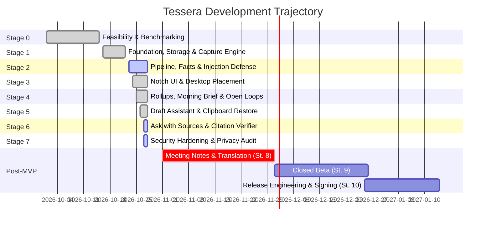

# Roadmap & Milestones

Tessera's technical development plan is structured into ten distinct stages, divided between the Minimum Viable Product (MVP, Stages 0–7) and post-MVP extensions (Stages 8–10).

---

## MVP Milestones (Stages 0–7)

### Stage 0: Feasibility & Model Benchmark <StatusBadge status="partial" />
- **Goal:** Validate model execution, desktop capture APIs, and GPU memory budgets on consumer hardware.
- **Completed:** Hardware detection and backend arbitration tooling (`crates/tsr-infer`); GGUF metadata parsing; UIA/WGC capture spikes; SQLCipher compilation.
- **Open Finding:** [ADR-0002](https://github.com/webex042/Tessera/blob/main/docs/adr/0002-webview2-outbound-connection.md) documents WebView2 (`msedgewebview2.exe`) opening Microsoft TLS port-443 sockets outside Chromium NetLog.

### Stage 1: Foundation, Encrypted Store & Capture <StatusBadge status="pass" />
- **Goal:** Build the encrypted database, `VectorDb`, DPAPI key unwrapping, desktop capture ladder, and secret redaction engine.
- **Completed:** SQLCipher 4 + AES-256-GCM `VectorDb` v2 (`tsr-store`); 285ms UIA deadline worker; WGC frame grabbing; `355/355` secret redaction (`0.41%` FP across `242` clean docs).

### Stage 2: Understanding Pipeline & Injection Guard <StatusBadge status="partial" />
- **Goal:** Implement structured fact extraction, prompt injection defense, and sidecar supervision.
- **Completed:** Sidecar Job Object containment; loopback HTTP/1.1 client; `0.0%` hallucination rate; `0` schema violations; `152/152` + `20/20` (`unseen_v3`) guarded prompt-injection **PASS**.
- **Open Finding:** Blind held-out extraction F1 is **0.500** (`FAIL` vs. `>= 0.60` `local-igpu-beta` and `>= 0.70` `standard`; `dev` split = `0.702`). Precision (`40.6%`) is limited by false-positive `action` and `note` rows on the 4B model.

### Stage 3: Floating Notch UI & Desktop Placement <StatusBadge status="partial" />
- **Goal:** Implement the desktop user interface shell with hardware capture exclusion.
- **Completed:** 60 fps rendering (`16.8 ms` p95 frame time); input-to-visual latency p95 `64 ms`; `20/20` focus return; `2026-10-27` pixel exclusion (`0x11`).
- **Open Finding:** Unlocked desktop re-verification (blocked by `BitBlt 0x80070005` while locked on `2026-11-28`) and live Teams/Zoom/OBS capture tests remain incomplete (`Zoom`/`OBS` `NOT TESTED`).

### Stage 4: Rollups, Morning Brief & Open Loops <StatusBadge status="partial" />
- **Goal:** Multi-tier map-reduce summarization and task tracking.
- **Completed:** Hour/day/month rollups (`11/11` exact active hours, `0` invalid IDs); code-assembled morning brief; open-loop status engine; zero auto-closing without user confirmation. OS lock/unlock trigger not live-tested.

### Stage 5: Contextual Draft Assistant <StatusBadge status="partial" />
- **Goal:** In-place ghost drafting grounded in active window context.
- **Completed:** UIA target focus re-verification; password-field refusal; private clipboard save/restore; `20/20` valid drafts with `0` unflagged unsupported claims (`5,587 ms` first / `14,175 ms` complete on AMD iGPU = `PASS` `local-igpu-beta`, `FAIL` `standard`). Live Gmail/Outlook/Slack/Teams insertion and Win+V checks remain incomplete.

### Stage 6: Grounded Ask with Source Verification <StatusBadge status="pass" text="pass (beta)" />
- **Goal:** Question answering with sentence-level citation verification and hybrid E5+FTS5 search.
- **Completed:** Real `multilingual-e5-small` ONNX search (`R@10 1.000`, `MRR 0.900`, `nDCG@10 0.921`); 3 blind held-out Ask runs (`48` q): **77.1%** accuracy, **92.3%** verified, **0** fabricated citations, **14,240 ms** p50 first sentence (`PASS` `local-igpu-beta`; `FAIL` vs. `standard` RTX 4050 latency/80% floor).

### Stage 7: Security Hardening & Guardrail Audit <StatusBadge status="partial" />
- **Goal:** Comprehensive threat model, canary disk scans, and network isolation audit.
- **Completed:** Short-window `0` app outbound connections; NetLog `0` external URLs; `cargo deny` clean (default & `groq`); `355/355` redaction; `152/152` + `20/20` guarded injection safety.
- **Open Finding:** `msedgewebview2.exe` opened `3` TLS `443` sockets (`ADR-0002`); 24h elevated Sysmon/WFP + `pktmon` capture and 24h pagefile canary scan remain incomplete.

---

## Post-MVP Milestones (Stages 8–10)

- **Stage 8: Meeting Notes & Live Translation:** WASAPI audio capture in RAM only; whisper.cpp local speech-to-text; Opus-MT local neural translation. *Blocked pending MVP quality gates.*
- **Stage 9: Closed Beta:** Deployment to 10–20 testers on diverse hardware; content-free diagnostics bundle review.
- **Stage 10: Release Engineering:** Signed NSIS installer; CycloneDX Software Bill of Materials (SBOM); opt-in auto-updater once upstream zip vulnerabilities are patched ([ADR-0003](https://github.com/webex042/Tessera/blob/main/docs/adr/0003-updater-blocked-by-zip-advisories.md)).
