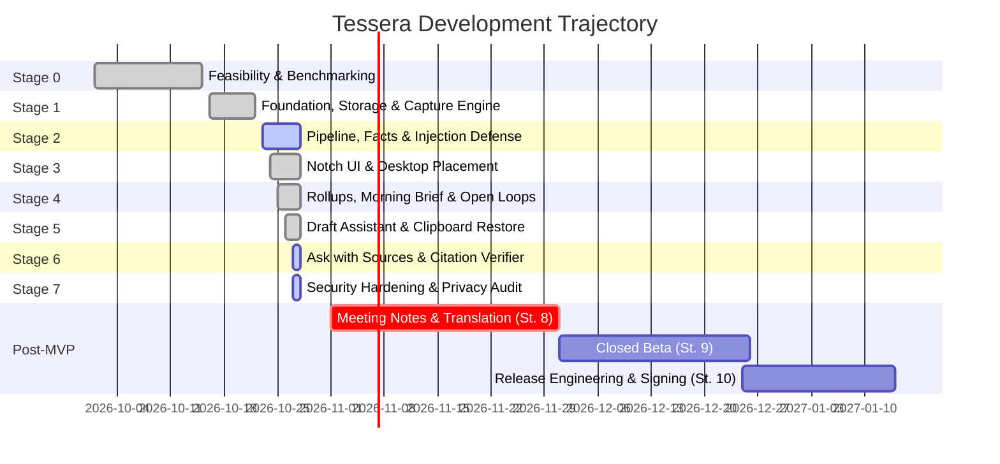

# Roadmap & Milestones

Tessera's technical development plan is structured into ten distinct stages, divided between the Minimum Viable Product (MVP, Stages 0–7) and post-MVP extensions (Stages 8–10).

---

## MVP Milestones (Stages 0–7)

### Stage 0: Feasibility & Model Benchmark <StatusBadge status="partial" text="In Progress" />
- **Goal:** Validate model execution, desktop capture APIs, and GPU memory budgets on consumer hardware.
- **Completed:** Hardware detection and backend arbitration tooling (`crates/tsr-infer`); GGUF metadata parsing; UIA/WGC capture spikes; SQLCipher compilation.
- **Open Finding:** [ADR-0002](https://github.com/webex042/Tessera/blob/main/docs/adr/0002-webview2-outbound-connection.md) identifies one outbound HTTPS connection per run initiated by the WebView2 runtime to Microsoft IP space.

### Stage 1: Foundation, Encrypted Store & Capture <StatusBadge status="implemented" text="Complete" />
- **Goal:** Build the encrypted database, DPAPI key unwrapping, desktop capture ladder, and secret redaction engine.
- **Completed:** SQLCipher 4 storage (`tsr-store`); 285ms UIA deadline worker; WGC frame grabbing; 355-case secret redaction corpus (100% detection, 0.43% false positives).

### Stage 2: Understanding Pipeline & Injection Guard <StatusBadge status="partial" text="In Progress" />
- **Goal:** Implement structured fact extraction, prompt injection defense, and sidecar supervision.
- **Completed:** Sidecar Job Object containment; loopback HTTP/1.1 client; 0% hallucination rate; 0 schema violations; 70/74 prompt injection defense cases passing.
- **Open Finding:** Real model extraction F1 = 0.533 (target 0.70). Invalid-JSON failures were fixed by keeping schema key order (ADR-0010); the remaining gap is precision (too many low-value `note` facts).

### Stage 3: Floating Notch UI & Desktop Placement <StatusBadge status="implemented" text="Complete" />
- **Goal:** Implement the desktop user interface shell with hardware capture exclusion.
- **Completed:** 60 fps rendering (p95 frame time 16.8ms); input-to-visual latency p95 64ms; multi-monitor DPI scaling; 100% capture exclusion affinity (`WDA_EXCLUDEFROMCAPTURE`).

### Stage 4: Rollups, Morning Brief & Open Loops <StatusBadge status="implemented" text="Complete" />
- **Goal:** Multi-tier map-reduce summarization and task tracking.
- **Completed:** Hour/day/month rollups; code-assembled morning brief; open-loop status engine; zero auto-closing of facts without user confirmation.

### Stage 5: Contextual Draft Assistant <StatusBadge status="implemented" text="Complete" />
- **Goal:** In-place ghost drafting grounded in active window context.
- **Completed:** UIA target focus re-verification; password-field refusal; private clipboard save/restore; zero unflagged unsupported claims.

### Stage 6: Grounded Ask with Source Verification <StatusBadge status="partial" text="In Progress" />
- **Goal:** Question answering with sentence-level citation verification.
- **Completed:** Pipeline verified in simulation (88% correct, 100% verified); 0 fabricated citations.
- **Open Finding:** Real 4B model answers 66.7 % of questions correctly (target 80 %) with 0 fabricated citations. The earlier 15 % came from empty answers caused by sorted schema keys (ADR-0010).

### Stage 7: Security Hardening & Guardrail Audit <StatusBadge status="partial" text="In Progress" />
- **Goal:** Comprehensive threat model, canary disk scans, and network isolation audit.
- **Completed:** Canary disk scan clean (0 plaintext hits); `check_network_deps.py` passing; dependency license audit.

---

## Post-MVP Milestones (Stages 8–10)

- **Stage 8: Meeting Notes & Live Translation:** WASAPI audio capture in RAM only; whisper.cpp local speech-to-text; Opus-MT local neural translation. *Blocked pending MVP quality gates.*
- **Stage 9: Closed Beta:** Deployment to 10–20 testers on diverse hardware; content-free diagnostics bundle review.
- **Stage 10: Release Engineering:** Signed NSIS installer; CycloneDX Software Bill of Materials (SBOM); opt-in auto-updater once upstream zip vulnerabilities are patched ([ADR-0003](https://github.com/webex042/Tessera/blob/main/docs/adr/0003-updater-blocked-by-zip-advisories.md)).
