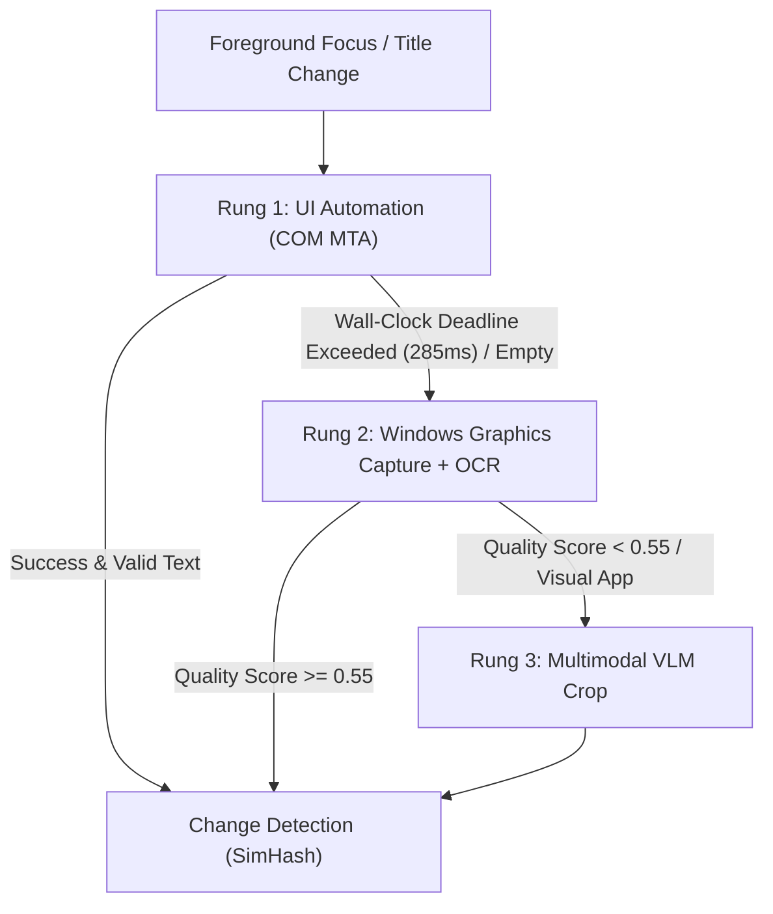

# Capture Ladder (`tsr-capture`)

The `tsr-capture` crate implements Tessera's text acquisition ladder, change detection heuristics, and window session aggregation.

---

## The Three Acquisition Rungs

### Rung 1: UI Automation (`tsr_capture::uia`)
- Executes on a dedicated COM MTA worker thread (T2).
- Attempts to read document text via `IUIAutomationTextPattern`.
- Falls back to a structured tree walk with a `CacheRequest` (capped at 3,000 nodes, 40 depth).
- **Password Exclusion:** Control nodes with `IsPassword = true` and their entire subtrees are skipped structurally.
- **Deadline Worker:** In Stage 0 testing, Microsoft Word blocked UIA calls for up to 2.8 seconds. Tessera enforces a strict **285ms wall-clock deadline**. If a call times out, it is abandoned, and the caller drops immediately to Rung 2.

### Rung 2: WGC + WinRT OCR (`tsr_capture::ocr`)
- Grabs a single frame using Windows Graphics Capture (`Direct3D11CaptureFramePool`).
- Copies the frame into an in-memory `SoftwareBitmap` (BGRA8).
- **Masking:** Any bounding boxes of password fields identified during Rung 1 are blacked out in memory before running OCR.
- WinRT `OcrEngine` extracts text lines with bounding coordinates.
- Bitmap memory buffers are wiped using `zeroize` upon completion.

### Rung 3: Multimodal VLM Crop (`tsr_capture::vlm`)
- Invoked when OCR heuristic quality score $< 0.55$, on designated canvas applications (Figma, charts), or upon explicit user request.
- Downsamples the client window area to $\le 1280\text{ px}$.
- Encodes the frame to an in-memory PNG and dispatches it to `llama-server` via a P1 inference job.

---

## Change Detection & Session Buffering

### SimHash & dHash
- **Text:** Calculates a 64-bit SimHash over word 3-shingles. If the Hamming distance is $\le 3$, the text is deemed unchanged.
- **Pixels (Rung 2):** Computes a 64-bit difference hash (dHash) on a $9 \times 8$ grayscale thumbnail. Distance $\le 6$ skips OCR.

### Window Sessions
Interactions are grouped into continuous sessions defined by `(executable, HWND, URL/title)`:
- Text is buffered exclusively in RAM.
- Flushed to storage when focus leaves for $> 30\text{s}$, continuous usage reaches 5 minutes, or the buffer exceeds 6,000 characters.
- If capture is paused by the user, active buffers are **discarded** without writing to disk.
