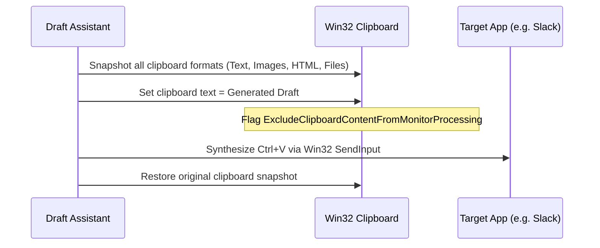

# Draft Assistant (`tsr-draft`)

The `tsr-draft` crate implements context-aware ghost reply drafting directly into active desktop applications (Gmail web, Outlook, Slack, Teams, WhatsApp, and plain text controls).

---

## 1. Context Capture & Focused Target Verification

When the user presses the draft hotkey (`Alt + Shift + D`):
1. **Target Identification:** UI Automation queries the currently focused HWND and control element.
2. **Password Guard:** If the focused control is an `Edit` element with `IsPassword = true`, drafting is **refused immediately**.
3. **Thread Context:** The active conversation thread is extracted from the focused application's accessibility tree.
4. **Memory Augmentation:** Hybrid search fetches related facts from SQLCipher, assembling a grounded prompt under the `draft/v1` template.

---

## 2. In-Line Fact-Checking (`tsr_draft::factcheck`)

Before presenting generated text to the user, deterministic code evaluates every factual claim made in the draft:
- **Checked Claim Types:** Calendar dates, clock times, days of the week, currency amounts, numerical values, email addresses, URLs, and capitalized proper names.
- **Verification Rule:** Every claim must appear in the active conversation thread, retrieved memories, or user instruction.
- **Flagging:** Any unsupported claim is visually highlighted in the draft panel with an amber warning flag, preventing embarrassing or erroneous factual statements.

---

## 3. Safe Insertion & Clipboard Restoration

Inserting text into third-party desktop applications requires careful coordination to avoid clobbering user data:

- **All-Format Restore:** Tessera saves and restores all active clipboard formats, not just plain text.
- **Cloud Clipboard Exclusion:** Formats are registered with `ExcludeClipboardContentFromMonitorProcessing`, ensuring private draft text never appears in Windows Cloud Clipboard or Win+V clipboard history.
