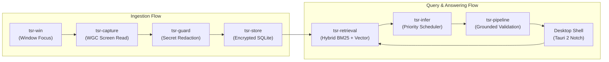

# Core Systems & Crates

This section provides a structured breakdown of the nine core subsystems and Rust crates that compose the Tessera platform.

Tessera is built following a strict **"separation of concerns"** design philosophy: each crate has a single, well-defined responsibility, clear input and output boundaries, and isolated failure domains.

---

## 1. Quick Reference: The Crate Ecosystem

Here is how the nine subsystems collaborate to deliver privacy-preserving desktop intelligence:

| Subsystem Crate | Plain-English Role | Primary Technology |
| :--- | :--- | :--- |
| **[Desktop Shell (Tauri 2)](/modules/tauri-host)** | The visual user interface, floating notch, and IPC bridge. | Tauri 2, WebView2, React, TypeScript |
| **[OS Integration (`tsr-win`)](/modules/win-integration)** | Windows system integration, DPAPI encryption, and Job Objects. | Win32 APIs, Windows Runtime (WinRT) |
| **[Capture Ladder (`tsr-capture`)](/modules/capture-ladder)** | Screen text acquisition, OCR, and SimHash deduplication. | Windows Graphics Capture (WGC), GDI, SimHash |
| **[Guardrails & Safety (`tsr-guard`)](/modules/guardrails)** | Secret redaction, process blocklists, and prompt injection defense. | Deterministic Regular Expressions, Luhn Algorithm |
| **[Encrypted Storage (`tsr-store`)](/modules/storage)** | Local encrypted database, migrations, and FTS5 search indexing. | SQLite, AES-256 (via DPAPI), FTS5 |
| **[Retrieval Engine (`tsr-retrieval`)](/modules/retrieval)** | Hybrid keyword (BM25) and semantic vector search. | Pinned ONNX Runtime 1.31, E5-small Embedder, RRF |
| **[Inference Coordinator (`tsr-infer`)](/modules/scheduler)** | Priority request scheduling, preemption, and sidecar supervision. | Loopback HTTP/1.1, Win32 Job Objects |
| **[Pipeline Orchestration (`tsr-pipeline`)](/modules/pipeline)** | End-to-end task pipelines (ingestion, summarization, Q&A). | Schema Grammars, Exact Substring Verifier |
| **[Draft Assistant (`tsr-draft`)](/modules/drafting)** | Context-aware reply generation and clipboard safety. | Prompt Engineering, In-Place Typing Synthesis |

---

## 2. How the Subsystems Interact

### The Ingestion Pipeline
1. `tsr-win` detects a window focus transition on your Windows 11 desktop.
2. `tsr-capture` checks if the window is allowed. If so, it acquires the visible text.
3. If the frame is novel (verified by 64-bit SimHash), `tsr-guard` scrubs any credentials or sensitive patterns.
4. `tsr-store` saves the clean text record into local encrypted storage.

### The Query Pipeline
1. You activate the Tessera notch UI and enter a search query.
2. `tsr-retrieval` runs hybrid search: BM25 keyword matching for exact terms, and dense vector search for conceptual meaning.
3. `tsr-infer` queues the question with high priority (`P0`), preempting any background background tasks.
4. `tsr-pipeline` sends the context to the local language model and verifies that every cited fact matches exact source text before showing you the result.

---

## 3. Detailed Subsystem Documentation

Explore each module's complete implementation specifications:

* **[Desktop Shell (Tauri 2)](/modules/tauri-host)** — Window state machines, screen positioning, and IPC event channels.
* **[OS Integration (`tsr-win`)](/modules/win-integration)** — Safe Win32 memory wrappers and DPAPI key management.
* **[Capture Ladder (`tsr-capture`)](/modules/capture-ladder)** — The three-rung acquisition strategy and OCR performance metrics.
* **[Guardrails (`tsr-guard`)](/modules/guardrails)** — The 355-rule redaction suite and prompt boundary defense.
* **[Encrypted Storage (`tsr-store`)](/modules/storage)** — SQLite database schema, WAL mode, and query triggers.
* **[Retrieval Subsystem (`tsr-retrieval`)](/modules/retrieval)** — ONNX Runtime embeddings and Reciprocal Rank Fusion ($k=60$).
* **[Inference Scheduler (`tsr-infer`)](/modules/scheduler)** — Three-tier queue priority and sidecar supervisor.
* **[Pipeline Subsystem (`tsr-pipeline`)](/modules/pipeline)** — Schema-constrained extraction and date/entity resolution.
* **[Draft Assistant (`tsr-draft`)](/modules/drafting)** — In-place reply generation and clipboard restoration.
