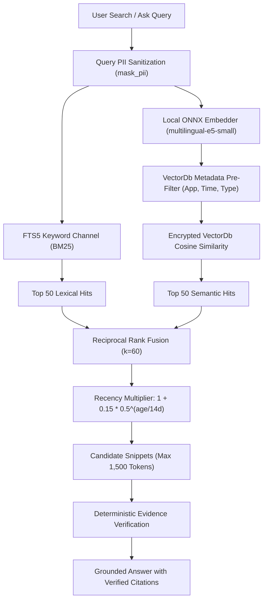

# Semantic Retrieval & Vector Search (`tsr-retrieval`)

The `tsr-retrieval` crate implements local vector embedding generation, full-text lexical indexing, semantic vector search backed by the encrypted `VectorDb`, and hybrid reciprocal rank fusion.

---

## 1. Pinned ONNX Runtime Execution

To prevent subtle cross-platform numerical discrepancies and avoid security vulnerabilities from uncontrolled system libraries, Tessera binds strictly to a pinned dynamic library:
- **`fastembed`:** Configured with `default-features = false, features = ["ort-load-dynamic"]`.
- **`ort`:** Version pinned to `=2.0.0-rc.15` with `features = ["std", "load-dynamic", "api-31"]`.
- **Dynamic Loader:** `tsr_retrieval::runtime::load_pinned` dynamically loads `third_party/onnxruntime/1.31.0/win-x64/onnxruntime.dll`. The `api-31` flag causes the loader to reject Windows 11's default `System32\onnxruntime.dll` (which is version 1.17).

---

## 2. Chunking & Embeddings Lifecycle

- **Model:** `multilingual-e5-small` in quantized ONNX format (0.46 GiB).
- **Compute Execution:** CPU-only to prevent VRAM contention with the primary vision-language model.
- **Privacy Boundary (Pre-Embedding Masking):** Text chunking and embedding generation occur **strictly after full PII masking** via `tsr_guard::redact::mask_pii`. Names are transformed into document-scoped pseudonyms (`[PERSON_01]`), and sensitive identifiers (emails, phone numbers, Aadhaar, cards, API keys) are replaced with typed tokens. Raw PII is never converted into vector embeddings.
- **Chunk Configuration:**
  - Token size: Up to 512 tokens.
  - Overlap: 64 tokens.
  - Vector dimensionality: 384 dimensions, stored in the encrypted `VectorDb` alongside normalized float representations and int8 quantized vectors.

---

## 3. Semantic Retrieval Pipeline

### End-to-End Retrieval Pipeline

The semantic retrieval workflow executes through the following ten stages:

1. **Query Submission:** The user submits a search query or natural language question through the desktop interface.
2. **Query PII Sanitization:** The query text is screened and masked using `tsr_guard::redact::mask_pii` before generating embeddings or logging.
3. **Full-Text Lexical Retrieval:** Lexical matching retrieves the top 50 candidates using SQLite's FTS5 full-text engine with BM25 keyword scoring over stored item texts and structured facts.
4. **Local Query Embedding Generation:** The pinned ONNX Runtime embedder runs `multilingual-e5-small` locally to produce a 384-dimensional query vector.
5. **VectorDb Cosine Similarity Search:** The query vector is evaluated against `VectorDb` (`search_vectordb`), applying metadata pre-filtering (by application names, time ranges, item IDs, source IDs, or memory types) and computing cosine similarity.
6. **Reciprocal Rank Fusion (RRF):** Ranks from the applicable retrieval channels are fused using standard RRF with constant $k = 60$:

   $$\text{RRF Score}(d) = \sum_{c} \frac{1}{60 + \text{Rank}_c(d)}$$

7. **Recency Multiplier:** An exponential half-life recency multiplier re-weights items based on age:

   $$\text{Final Score}(d) = \text{RRF Score}(d) \times \left(1 + 0.15 \times 0.5^{\frac{\text{Age in Days}}{14}}\right)$$

8. **Snippet Candidate Selection:** Up to eight top-ranked snippet candidates are assembled within the documented context budget of 1,500 tokens.
9. **Deterministic Evidence Verification:** Sentence-by-sentence deterministic code verifies that claims produced by the model are substantiated by verbatim or normalized spans within the cited evidence snippets.
10. **Authenticated Citations:** Answers provide authenticated snippet identifiers linking verified claims directly to the underlying source items in the local store.

### Deterministic Evidence Validation
Tessera preserves the foundational principle:

> **The model proposes. Deterministic code verifies.**

Semantic similarity helps retrieve relevant context efficiently, but high vector similarity does not independently establish factual correctness. When answering questions via the Ask panel, the model proposes structured sentence outputs with citation pointers, and deterministic verification code verifies that claims match verbatim or normalized substrings in the authenticated source snippets. Sentences that fail verification or fabricate citations are suppressed or visually flagged.
