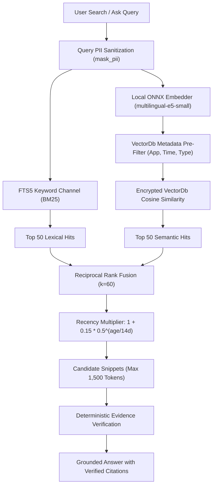

# Semantic Retrieval & Vector Search (`tsr-retrieval`)

The `tsr-retrieval` crate implements local vector embedding generation, full-text lexical indexing, semantic vector search backed by the encrypted `VectorDb`, and hybrid reciprocal rank fusion.

---

## 1. Pinned ONNX Runtime Execution

To prevent subtle cross-platform numerical discrepancies and avoid security vulnerabilities from uncontrolled system libraries, Tessera binds strictly to a pinned dynamic library:
- **`fastembed`:** Configured with `default-features = false, features = ["ort-load-dynamic"]`.
- **`ort`:** Version pinned to `=2.0.0-rc.15` with `features = ["std", "load-dynamic", "api-31"]`.
- **Dynamic Loader:** `tsr_retrieval::runtime::load_pinned` dynamically loads `third_party/onnxruntime/1.31.0/win-x64/onnxruntime.dll`. The `api-31` flag causes the loader to reject Windows 11's default `System32\onnxruntime.dll` (which is version 1.17).

---

## 2. Chunking & Embeddings Lifecycle

- **Model:** `multilingual-e5-small` in quantized ONNX format (0.46 GiB).
- **Compute Execution:** CPU-only to prevent VRAM contention with the primary vision-language model.
- **Privacy Boundary (Pre-Embedding Masking):** Text chunking and embedding generation occur **strictly after full PII masking** via `tsr_guard::redact::mask_pii`. Names are transformed into document-scoped pseudonyms (`[PERSON_01]`), and sensitive identifiers (emails, phone numbers, Aadhaar, cards, API keys) are replaced with typed tokens. Raw PII is never converted into vector embeddings.
- **Chunk Configuration:**
  - Token size: Up to 512 tokens.
  - Overlap: 64 tokens.
  - Vector dimensionality: 384 dimensions, stored in the encrypted `VectorDb` alongside normalized float representations and int8 quantized vectors.

---

## 3. Semantic Retrieval Pipeline

### Semantic Search Operations (`search_vectordb`)
Semantic retrieval executes directly against `VectorDb`:
1. **Query Preprocessing:** The query string is masked using `mask_pii` before generating embeddings, ensuring that sensitive search terms are not leaked into vector representations.
2. **Metadata Pre-Filtering:** Filters out non-matching records (by application name, source ID, item IDs, or timestamp ranges) before calculating dot products.
3. **Cosine Similarity Search:** Computes normalized vector dot products, ranking matches by descending similarity score.
4. **Reciprocal Rank Fusion (RRF):** Fuses semantic hits with full-text keyword hits and structured fact evidence.

### Deterministic Evidence Validation
Tessera preserves the foundational principle:

> **The model proposes. Deterministic code verifies.**

High vector similarity alone is never treated as proof of truth. When generating answers to questions, every sentence produced by the model must cite an authenticated snippet ID, and deterministic code verifies that claims are supported by verbatim or normalized spans in the source evidence. Unverified claims are flagged or suppressed.
