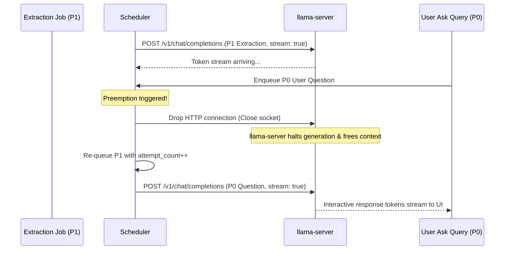

# Priority Scheduler & Preemption (`tsr-infer::sched`)

The `tsr-infer::sched` module implements a pure state-machine priority scheduler (`SchedulerCore`) designed to coordinate multiple competing workloads across a single inference sidecar.

---

## 1. Priority Tiers

Because local model inference can only execute one forward pass at a time (`-np 1` to preserve VRAM), workloads are categorized into three strict priority tiers:

| Tier | Workload Category | Max Wait Target | Scheduling Policy |
|---|---|---|---|
| **P0** | Interactive Requests (Ask, Draft Assistant) | $\le 300\text{ ms}$ | Preempts in-flight P1/P2 jobs immediately; dispatches on next scheduler tick. |
| **P1** | Near-Real-Time (Screen extraction, VLM crop) | $\le 5\text{ min}$ | Dispatched when queue is empty of P0 jobs; yields on P0 arrival. |
| **P2** | Batch Maintenance (Daily rollups, morning brief) | $\le 24\text{ hr}$ | Promoted after 6 hours; deferred entirely when operating on battery power. |

---

## 2. Stream-Drop Preemption

Tessera implements preemption without requiring complex GPU kernel interruption:

---

## 3. Starvation & Attempt Budgets

To ensure system stability under heavy workloads:
- **Max Preemptions:** A job can be preempted at most 3 times. Once it reaches 3 preemptions, it is granted non-preemptible priority on its next dispatch.
- **Starvation Protection:** If 4 consecutive P0 interactive requests complete, the scheduler permits one long-waiting P1 extraction job to complete before accepting another P0.
- **Exponential Retry Delays:** Failed jobs back off exponentially (5s $\rightarrow$ 30s) before re-entering the queue, preventing crash storms.
