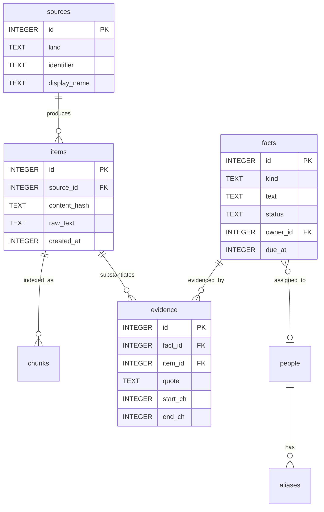

# Encrypted Storage (`tsr-store`)

The `tsr-store` crate manages local encrypted persistence using SQLCipher 4 compiled with a vendored OpenSSL bundle (`bundled-sqlcipher-vendored-openssl`).

---

## 1. Cryptographic Configuration

When opening the local database (`%LOCALAPPDATA%\Tessara\tessara.db`), Tessera executes the following sequence:

```rust
pub fn open_encrypted(path: &Path, key: &[u8; KEY_LEN]) -> Result<Connection, StoreError> {
    let conn = Connection::open(path)?;
    // 1. Silence stderr logging to ensure content-free diagnostics
    conn.query_row("PRAGMA cipher_log_level = NONE", [], |_| Ok(()))?;
    // 2. Inject 32-byte raw key (skips PBKDF2 derivation)
    conn.execute_batch(&format!("PRAGMA key = \"x'{hex_key}'\";"))?;
    // 3. Test page decrypt
    conn.query_row("SELECT count(*) FROM sqlite_master", [], |_| Ok(()))?;
    // 4. Enforce security PRAGMAs
    conn.execute_batch(
        "PRAGMA cipher_memory_security = ON;
         PRAGMA secure_delete = ON;
         PRAGMA foreign_keys = ON;
         PRAGMA temp_store = MEMORY;
         PRAGMA synchronous = NORMAL;"
    )?;
    // 5. Enable Write-Ahead Logging
    conn.query_row("PRAGMA journal_mode = WAL", [], |_| Ok(()))?;
    Ok(conn)
}
```

### Key Security PRAGMAs
- **`cipher_memory_security = ON`:** Overwrites decrypted cache pages in RAM with zeros when released.
- **`secure_delete = ON`:** Overwrites deleted rows with zeros, preventing raw plaintext forensics from recovery tools.
- **`temp_store = MEMORY`:** Temporary indexes and sorting tables are held in memory; zero plaintext spills to `%TEMP%`.
- **`journal_mode = WAL`:** High-concurrency Write-Ahead Logging allows background extraction threads to write facts while the UI reads timelines.

---

## 2. Database Schema & Tables

Tessera tracks memories and derived intelligence across ten core tables:



- **`sources`:** Unique origins (application executable, web domain, or document path).
- **`items`:** Raw captured sessions (redacted text, timestamps, SimHash).
- **`chunks`:** 512-token segments paired with 384-dimensional int8 embedding BLOBs.
- **`facts`:** Atomic intelligence (action, decision, event, question, note).
- **`evidence`:** Character spans (`start_ch..end_ch`) in `items` proving a fact.
- **`audit_events`:** Content-free tracking of system transitions, deletions, and model calls.
