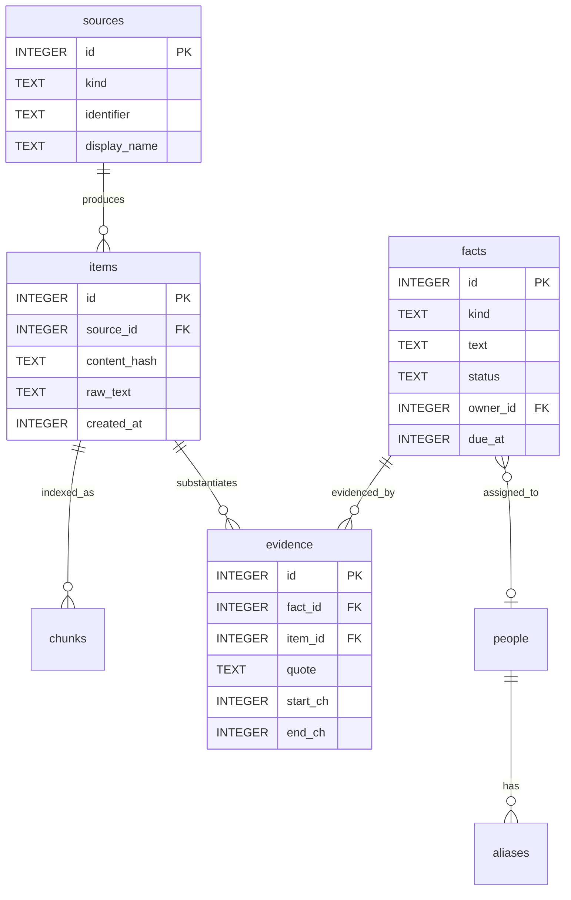

# Storage Architecture & Vector Database (`tsr-store`)

The `tsr-store` crate manages Tessera's local persistence architecture, combining an embedded, encrypted-at-rest local vector database (`VectorDb`) for semantic memory, chunk embeddings, and retrieval metadata, alongside an encrypted relational store for structured facts, sources, and audit logs.

---

## 1. Local Encrypted Vector Database (`VectorDb`)

To replace dependence on SQL-based chunk retrieval with native semantic vector similarity, Tessera includes a dedicated, embedded vector database engine (`tsr_store::vectordb::VectorDb`).

### Architectural Characteristics
- **Embedded & Local:** Runs entirely in-process inside the host application without external background daemons, cloud accounts, or network dependencies.
- **Encrypted at Rest:** Encrypted with 256-bit symmetric keys unwrapped directly from Windows DPAPI (`CryptUnprotectData`). Uses an authenticated SHA-256 CTR keystream with a random 16-byte nonce and HMAC integrity tag (`TSRV` magic header).
- **Native Cosine Similarity:** Computes exact cosine similarity over 384-dimensional normalized vector embeddings and scaled int8 quantized representations.
- **Metadata Pre-Filtering:** Efficient zero-leakage filtering before vector ranking by application name, time range (`min_ms..=max_ms`), item ID, source ID, and memory type.
- **Privacy Enforcement:** Vector records are strictly populated from PII-masked content (`mask_pii`). Raw sensitive identifiers never enter vector payloads or chunk text.

### Cryptographic File Layout (`tessera_vectors.enc`)
```
+----------------+---------------+----------------+----------------+--------------------------+
| Magic (4 bytes)| Version (1 B) | Nonce (16 B)   | Tag (32 B)     | Ciphertext (N bytes)     |
| "TSRV"         | 0x01          | Random Salt    | SHA-256 HMAC   | AES-CTR Keystream Stream |
+----------------+---------------+----------------+----------------+--------------------------+
```

---

## 2. Safe Data Migration Utility (`tsr_store::migration`)

Tessera provides a safe, idempotent, non-destructive migration utility to transition existing relational chunk data to the encrypted vector database:

```rust
pub fn migrate_sqlcipher_to_vectordb(
    conn: &Connection,
    vector_db: &mut VectorDb,
) -> Result<MigrationReport, StoreError>
```

### Migration Lifecycle & Guarantees
1. **Automatic Backup:** Backs up the active database to `tessara.db.bak` before initiating migration.
2. **PII Masking Application:** Reads legacy text and window titles, applying `mask_pii` with typed placeholders (`[PERSON_01]`, `[EMAIL]`, etc.) before vector database insertion.
3. **Metadata & Provenance Preservation:** Reconstructs vector embeddings and binds each record to its originating source metadata (`item_id`, `source_id`, `app_name`, `timestamp_ms`).
4. **Idempotent Execution:** Can be safely re-run without creating duplicate records or corrupting existing indexes.
5. **Non-Destructive:** Retains the original database until explicit user confirmation.

---

## 3. Relational Storage Configuration

When opening the local database (`%LOCALAPPDATA%\Tessara\tessara.db`), Tessera executes the following sequence:

```rust
pub fn open_encrypted(path: &Path, key: &[u8; KEY_LEN]) -> Result<Connection, StoreError> {
    let conn = Connection::open(path)?;
    // 1. Silence stderr logging to ensure content-free diagnostics
    conn.query_row("PRAGMA cipher_log_level = NONE", [], |_| Ok(()))?;
    // 2. Inject 32-byte raw key (skips PBKDF2 derivation)
    conn.execute_batch(&format!("PRAGMA key = \"x'{hex_key}'\";"))?;
    // 3. Test page decrypt
    conn.query_row("SELECT count(*) FROM sqlite_master", [], |_| Ok(()))?;
    // 4. Enforce security PRAGMAs
    conn.execute_batch(
        "PRAGMA cipher_memory_security = ON;
         PRAGMA secure_delete = ON;
         PRAGMA foreign_keys = ON;
         PRAGMA temp_store = MEMORY;
         PRAGMA synchronous = NORMAL;"
    )?;
    // 5. Enable Write-Ahead Logging
    conn.query_row("PRAGMA journal_mode = WAL", [], |_| Ok(()))?;
    Ok(conn)
}
```

### Key Security PRAGMAs
- **`cipher_memory_security = ON`:** Overwrites decrypted cache pages in RAM with zeros when released.
- **`secure_delete = ON`:** Overwrites deleted rows with zeros, preventing raw plaintext forensics from recovery tools.
- **`temp_store = MEMORY`:** Temporary indexes and sorting tables are held in memory; zero plaintext spills to `%TEMP%`.
- **`journal_mode = WAL`:** High-concurrency Write-Ahead Logging allows background extraction threads to write facts while the UI reads timelines.

---

## 2. Database Schema & Tables

Tessera tracks memories and derived intelligence across ten core tables:



- **`sources`:** Unique origins (application executable, web domain, or document path).
- **`items`:** Raw captured sessions (redacted text, timestamps, SimHash).
- **`chunks`:** 512-token segments paired with 384-dimensional int8 embedding BLOBs.
- **`facts`:** Atomic intelligence (action, decision, event, question, note).
- **`evidence`:** Character spans (`start_ch..end_ch`) in `items` proving a fact.
- **`audit_events`:** Content-free tracking of system transitions, deletions, and model calls.
