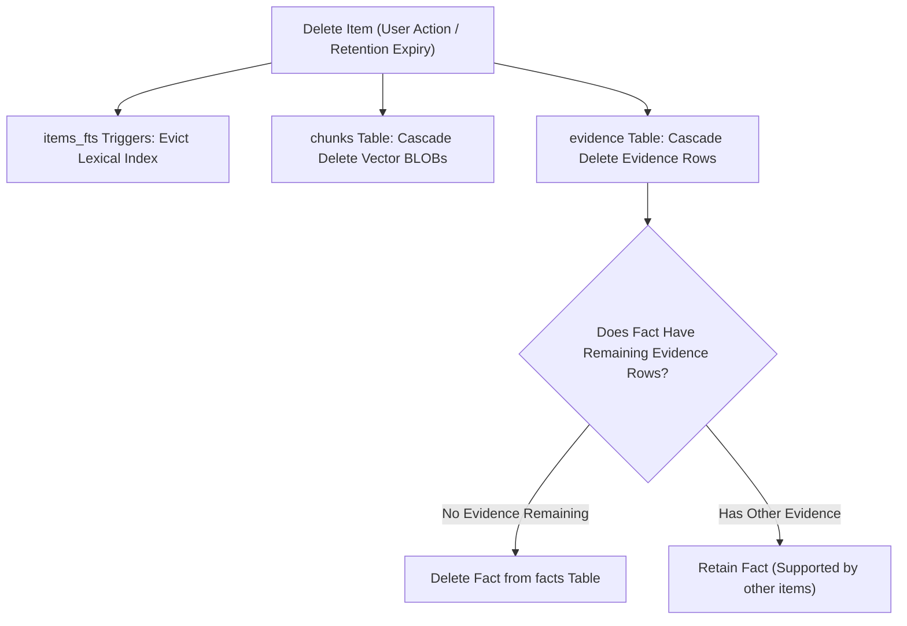

# Data Lifecycle & Sessions

This document traces the complete lifecycle of desktop data from screen attention through capture rungs, session buffering, redaction, persistence, and deletion.

---

## 1. Transient RAM Buffers

```
Window Focus ──► UIA / OCR ──► Delta Diff ──► Session Buffer (RAM) ──► Flush or Drop
```

- **Volatile Storage:** Captured text remains exclusively in volatile memory within the `tsr-capture::session` actor.
- **Deduplication:** Repeated text lines generated by scrolling through chat threads or documents are collapsed via line-level delta diffing.
- **Discard on Pause:** If the user presses the pause hotkey or toggles pause in the UI, all active, unflushed session buffers in RAM are immediately zeroized and discarded. Nothing from that session is ever written to disk.

---

## 2. Ingestion & Persistence

When a session flushes (focus shifts for $> 30\text{s}$, continuous usage reaches 5 minutes, or buffer size reaches 6,000 characters):
1. **Redaction:** Pre-storage regex and algorithmic checksum matchers scrub sensitive credentials.
2. **Item Creation:** Writes an atomic row to the `items` table in SQLCipher.
3. **FTS5 Indexing:** A SQLite database trigger inserts tokenized words into the `items_fts` full-text search table.
4. **Embedding Chunking:** Segments the text into 512-token chunks and schedules asynchronous int8 vector embedding generation via local ONNX Runtime.

---

## 3. Retention & Deletion Cascades

Tessera respects user privacy through strict data retention and cascading deletions:



### The Evidence Cascade Trigger
In SQLite, when an item is deleted (either via user command or automatic 90-day retention pruning):
- All associated `evidence` rows pointing to that `item_id` are deleted via foreign-key cascade (`ON DELETE CASCADE`).
- A database trigger detects if a `facts` row has zero remaining `evidence` rows.
- If a fact has no surviving evidence in any captured item, it is **automatically deleted**. A fact cannot exist without verified source evidence.
