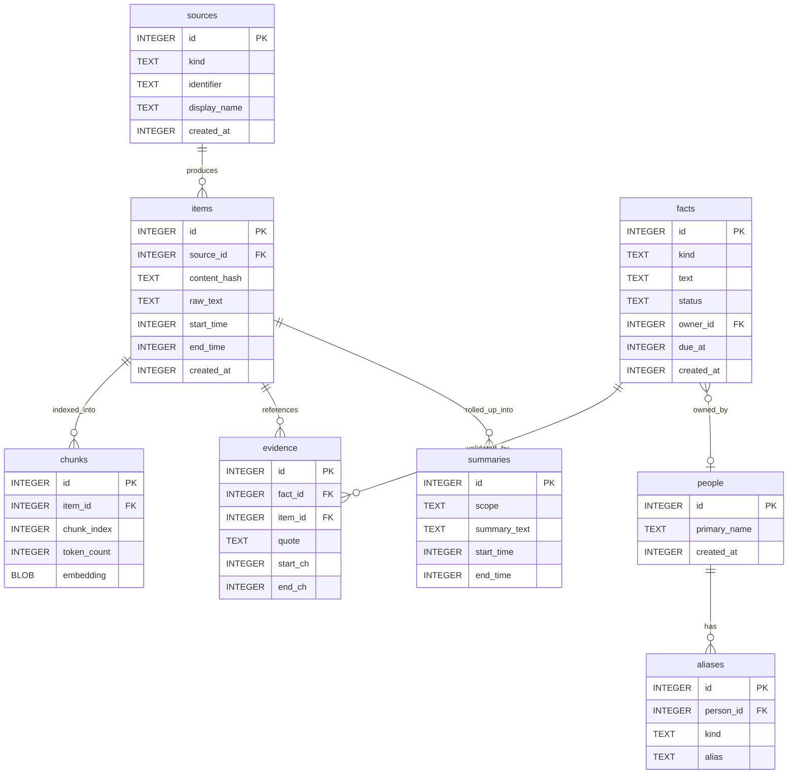

# Database Schema & ERD

Tessera stores persistent state in a single SQLCipher database managed by the `tsr-store` crate. Database migrations (`0001` through `0004`) define the schema.

---

## Entity-Relationship Diagram



---

## Core Table Definitions

### 1. `items` Table
Stores raw captured screen sessions:
```sql
CREATE TABLE items (
    id           INTEGER PRIMARY KEY AUTOINCREMENT,
    source_id    INTEGER NOT NULL REFERENCES sources(id) ON DELETE CASCADE,
    content_hash TEXT NOT NULL,
    raw_text     TEXT NOT NULL,
    start_time   INTEGER NOT NULL,
    end_time     INTEGER NOT NULL,
    created_at   INTEGER NOT NULL DEFAULT (strftime('%s', 'now'))
);
```

### 2. `facts` Table
Stores atomic intelligence derived from model extraction:
```sql
CREATE TABLE facts (
    id         INTEGER PRIMARY KEY AUTOINCREMENT,
    kind       TEXT NOT NULL CHECK (kind IN ('action', 'decision', 'event', 'note', 'question')),
    text       TEXT NOT NULL,
    status     TEXT NOT NULL CHECK (status IN ('open', 'completed', 'dismissed', 'needs_review')),
    owner_id   INTEGER REFERENCES people(id) ON DELETE SET NULL,
    due_at     INTEGER,
    created_at INTEGER NOT NULL DEFAULT (strftime('%s', 'now'))
);
```

### 3. `evidence` Table
Enforces provenance and grounding:
```sql
CREATE TABLE evidence (
    id       INTEGER PRIMARY KEY AUTOINCREMENT,
    fact_id  INTEGER NOT NULL REFERENCES facts(id) ON DELETE CASCADE,
    item_id  INTEGER NOT NULL REFERENCES items(id) ON DELETE CASCADE,
    quote    TEXT NOT NULL,
    start_ch INTEGER NOT NULL,
    end_ch   INTEGER NOT NULL,
    UNIQUE(fact_id, item_id, start_ch, end_ch)
);
```
