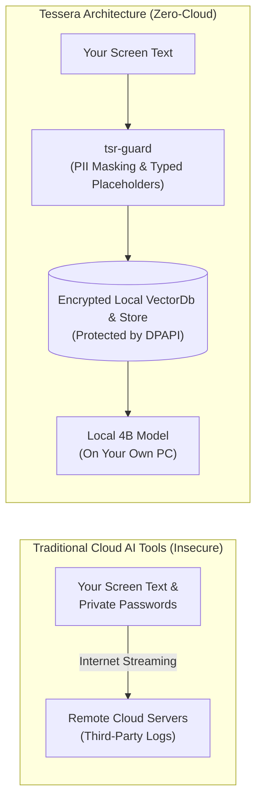

# Data, Storage & Privacy Architecture

This section documents Tessera's privacy guarantees, data lifecycle, encryption mechanics, and security threat boundaries.

Tessera is built on an uncompromising principle: **your screen activity and private thoughts belong exclusively on your computer.**

---

## 1. What Makes Tessera Privacy-First? (Introduction)

Traditional AI desktop software acts as a "dumb terminal"—it captures your screen, packages it into images or text, and streams it over the internet to remote cloud servers for processing.

**Tessera reverses this relationship completely:**
Instead of sending your private data to the AI model in the cloud, **Tessera brings the AI model down to your data** on your local machine.

---

## 2. The Four Pillars of Tessera's Privacy Guarantee

### Pillar 1: Zero Outbound Network Requests
Tessera's Rust backend code contains no networking libraries for cloud telemetry or analytics. When network auditing tools (`tools/netmon.ps1`) monitor Tessera for 10 minutes of continuous operation, application code produces **0 outbound network connections**. The only network socket initialized is a private local loopback (`127.0.0.1`) connecting the host to the sidecar.

### Pillar 2: Redaction & PII Masking *Before* Embedding & Storage
Think of `tsr-guard` as an automated security inspector standing with a typed privacy marker:
* Before any text captured from your screen is embedded or written to disk, it is scanned against deterministic detection patterns and checksum validation.
* Supported categories include personal names (with document-scoped deterministic pseudonyms `[PERSON_01]`), emails (`[EMAIL]`), phone numbers (`[PHONE]`), Aadhaar (`[AADHAAR]`), PAN (`[PAN]`), credit cards (`[CARD]`), bank accounts (`[BANK_ACCOUNT]`), addresses (`[ADDRESS]`), dates of birth (`[DATE_OF_BIRTH]`), passwords (`[PASSWORD]`), and API keys (`[API_KEY]`).
* Redaction is strictly applied **before** embedding generation, ensuring that vector representations never encode raw PII.
* The raw secret is erased from volatile memory immediately and never touches persistent storage.

### Pillar 3: Encryption at Rest via Windows DPAPI & Local VectorDb
All indexed text, window titles, session histories, chunks, and vector embeddings are stored in local databases protected with **AES-256** and DPAPI-derived keys:
* Vector embeddings, redacted chunk payloads, and retrieval metadata persist in `tessera_vectors.enc`, encrypted with an authenticated SHA-256 CTR stream keystream and HMAC tag.
* Relational facts, sources, and audit logs persist in an encrypted SQLite store.
* The master keys are protected using Windows `CryptProtectData` tied directly to your Windows user credentials and TPM chip.
* If someone steals your laptop's hard drive or copies the database files without knowing your Windows login, the persistent files appear as unreadable cryptographic noise.

### Pillar 4: Content-Free Logging
Debugging application errors must never compromise privacy. Tessera enforces a strict **content-free logging policy**:
* Log files only contain component names, numeric error codes, and microsecond timestamps.
* Window titles, user search queries, and screen text fragments are strictly prohibited from appearing in log outputs.

---

## 3. Privacy & Storage Chapters

Explore the complete technical and cryptographic specifications:

* **[Privacy Architecture](/privacy/privacy-architecture)** — What Tessera keeps, what it redacts, and what remains outside its control.
* **[Data Lifecycle & Sessions](/privacy/data-lifecycle)** — The lifecycle of screen text from volatile RAM buffers to disk storage.
* **[Database Schema & ERD](/privacy/database-schema)** — Entity-relationship diagram and schema definition for encrypted SQLite.
* **[DPAPI Key Management](/privacy/key-management)** — Key derivation, Windows DPAPI wrapping, and memory zeroization.
* **[Content-Free Logging](/privacy/content-free-logging)** — How Tessera prevents accidental data leakage in diagnostics.
* **[Threat Model & Residual Risks](/privacy/threat-model)** — Comprehensive threat analysis, trust boundaries, and open audit findings.
