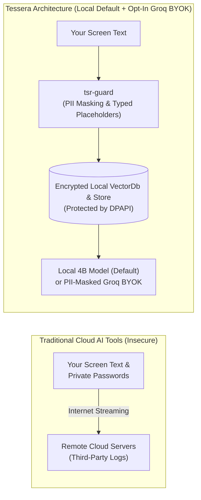

# Data, Storage & Privacy Architecture

This section documents Tessera's privacy guarantees, data lifecycle, encryption mechanics, and security threat boundaries.

Tessera is built on an uncompromising principle: **your screen activity and private thoughts belong exclusively on your computer.**

---

## 1. What Makes Tessera Privacy-First? (Introduction)

Traditional AI desktop software acts as a "dumb terminal"—it captures your screen, packages it into images or text, and streams it over the internet to remote cloud servers for processing.

**Tessera reverses this relationship completely:**
Instead of sending your private data to the AI model in the cloud, **Tessera brings the AI model down to your data** on your local machine.

---

## 2. The Four Pillars of Tessera's Privacy Guarantee

### Pillar 1: Local-First Default & Explicit Network Boundaries
Tessera's Rust backend runs locally by default (`TSR_LLM_PROVIDER=local`) against a private loopback (`127.0.0.1`) sidecar. Optional network connections occur strictly under explicit user configuration or third-party WebView2 startup:
* **Model & Embedder Downloads:** Strictly user-initiated in **AI Setup** with Hugging Face LFS/SHA-256 verification against `tools/models.lock`.
* **Optional Groq BYOK:** When enabled with your own DPAPI-protected `GROQ_API_KEY`, only PII-masked prompts are sent to `api.groq.com`.
* **Microsoft WebView2 Runtime:** Initiates one upstream HTTPS request on startup ([ADR-0002](/developer/faq)).

### Pillar 2: Redaction & PII Masking *Before* Embedding & Storage
Think of `tsr-guard` as an automated security inspector standing with a typed privacy marker:
* Before any text captured from your screen is embedded, stored on disk, or sent to an optional Groq endpoint, it is scanned against deterministic detection patterns and checksum validation.
* Supported categories and typed placeholders include:
  - Personal names: `[PERSON_01]`, `[PERSON_02]` (deterministic document-scoped pseudonyms)
  - Contact information: `[EMAIL]`, `[PHONE]`
  - National & financial IDs: `[AADHAAR]`, `[PAN]`, `[CARD]`, `[BANK_ACCOUNT]`, `[IFSC]`
  - Personal demographics: `[ADDRESS]`, `[DATE_OF_BIRTH]`
  - Credentials & secrets: `[PASSWORD]`, `[SECRET]`, `[API_KEY]`, `[JWT]`, `[PRIVATE_KEY]`, `[OTP]`
* Masking occurs **before** embedding generation, ensuring that vector representations and `VectorDb` payloads never encode raw sensitive identifiers.
* Retrieved snippets and model responses undergo secondary validation before display.
* *Note on Limits:* Tessera does not claim universal PII detection or complete anonymity; detection relies on deterministic heuristics and checksums, with known boundaries around uncontextualized names and unstructured text.

### Pillar 3: Encryption at Rest via Windows DPAPI & Local VectorDb
All indexed text, window titles, session histories, and vector embeddings are stored in local databases protected with **AES-256** and DPAPI-derived keys:
* Vector embeddings, redacted chunk payloads, and retrieval metadata persist in `tessera_vectors.enc`, encrypted with **`ring::aead::AES_256_GCM`** (format v2), 96-bit CSPRNG nonces, header/nonce AAD authentication, and automatic `.v1.bak` migration from legacy v1 files.
* Relational facts, sources, and audit logs persist in an encrypted SQLite store.
* The master keys are protected using Windows `CryptProtectData` tied directly to your Windows user credentials and TPM chip.
* If someone steals your laptop's hard drive or copies the database files without knowing your Windows login, the persistent files appear as unreadable cryptographic noise.

### Pillar 4: Content-Free Logging
Debugging application errors must never compromise privacy. Tessera enforces a strict **content-free logging policy**:
* Log files only contain component names, numeric error codes, and microsecond timestamps.
* Window titles, user search queries, and screen text fragments are strictly prohibited from appearing in log outputs.

---

## 3. Privacy & Storage Chapters

Explore the complete technical and cryptographic specifications:

* **[Privacy Architecture](/privacy/privacy-architecture)** — What Tessera keeps, what it redacts, and what remains outside its control.
* **[Data Lifecycle & Sessions](/privacy/data-lifecycle)** — The lifecycle of screen text from volatile RAM buffers to disk storage.
* **[Database Schema & ERD](/privacy/database-schema)** — Entity-relationship diagram and schema definition for encrypted SQLite.
* **[DPAPI Key Management](/privacy/key-management)** — Key derivation, Windows DPAPI wrapping, and memory zeroization.
* **[Content-Free Logging](/privacy/content-free-logging)** — How Tessera prevents accidental data leakage in diagnostics.
* **[Threat Model & Residual Risks](/privacy/threat-model)** — Comprehensive threat analysis, trust boundaries, and open audit findings.
