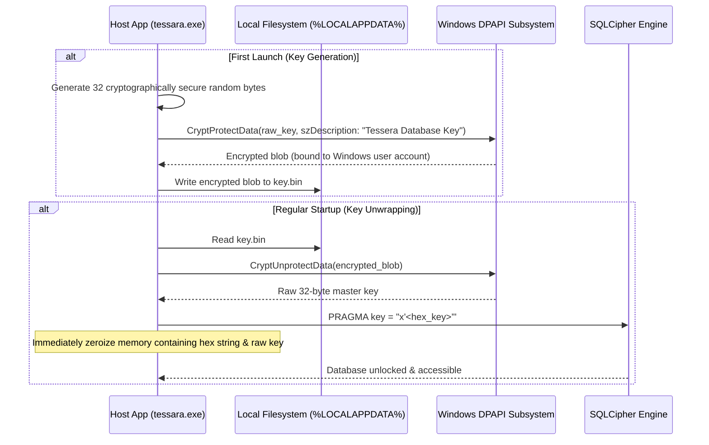

# DPAPI Key Management

This document explains how Tessera creates, encrypts, unwraps, and wipes the cryptographic master key that protects the local SQLCipher database.

---

## 1. The Key Lifecycle

---

## 2. Cryptographic Implementation Details

### Raw Key PRAGMA Injection
Standard SQLCipher allows opening a database using a password string, which runs through PBKDF2 with 256,000 iterations to derive a key. 

To eliminate password derivation overhead and maximize security, Tessera passes a **raw 32-byte hexadecimal key** (`x'...'` syntax). SQLCipher bypasses PBKDF2 entirely and uses the 256-bit entropy directly as the AES-256 cipher key.

### Zeroizing Buffers
To prevent keys from remaining in memory:
- The unwrapped key is stored in a `Zeroizing<[u8; 32]>` container.
- The formatted hexadecimal PRAGMA string is wrapped in `Zeroizing<String>`.
- Upon dropping the string or completing the open handshake, the memory buffers are overwritten with zeros using the `zeroize` crate.

### User Account Binding
Because Windows DPAPI (`CryptProtectData`) binds encryption to the user's Windows login credentials:
- Another user logging into the same computer cannot unwrap `key.bin`.
- Copying `tessara.db` and `key.bin` to a different machine yields an unreadable, undecryptable file.
