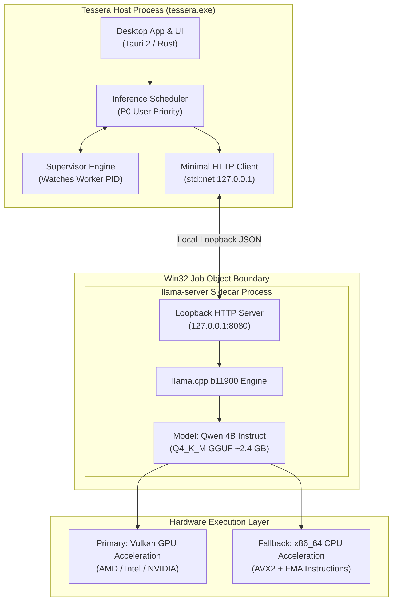

# AI & Inference Runtime

This section documents Tessera's hardware-agnostic artificial intelligence infrastructure, sidecar execution model, GGUF model handling, and runtime performance.

Whether you are new to local AI or an experienced systems architect, this guide explains how Tessera runs large language models on everyday Windows hardware without cloud servers or proprietary vendor toolkits.

---

## 1. What is the AI Runtime? (Introduction)

An **AI Runtime** is the computational engine responsible for loading neural network weights into memory, executing billions of mathematical matrix multiplications, and generating text responses token by token.

In most local AI setups, the runtime is deeply intertwined with the application code, requiring complex native drivers.

**Tessera uses an Isolated Sidecar Architecture:**
Instead of embedding model execution inside the main desktop application, Tessera launches a dedicated, separate background process running a pinned, hash-verified build of `llama.cpp` (`llama-server.exe`). The main app communicates with this worker over a private, local loopback network connection (`127.0.0.1`).

---

## 2. The Problem It Solves: Hardware Vendor Independence

Traditionally, software that uses local AI forces developers and users into a vendor trap:

* **The CUDA Monopoly:** Most software only works if you own an NVIDIA graphics card with proprietary CUDA drivers installed.
* **Driver Mismatches:** If a user updates their graphics driver, compiled neural network applications often fail to start.
* **Catastrophic Out-Of-Memory Crashes:** Generating AI text requires substantial memory. If a model exceeds available VRAM, it can crash the entire host process.

**Tessera's Engineering Solution:**
* **Vendor-Independent Acceleration:** Tessera targets **Vulkan 1.2+**, an open, standardized cross-vendor graphics standard supported by AMD Radeon, Intel Iris/Arc, and NVIDIA GeForce hardware.
* **Universal CPU Fallback:** If a system lacks a compatible GPU or runs out of video memory, Tessera automatically switches to an optimized CPU engine utilizing modern **AVX2** and **FMA** vector instructions.
* **Process Sandboxing:** The AI engine is confined inside a Windows **Job Object**. Even if the model process runs out of memory or crashes, your main desktop application and open windows remain completely unaffected.

---

## 3. The Runtime Architecture in Plain English

### The "Car & Engine" Analogy:
Think of Tessera as a car body and dashboard, and the AI sidecar as an engine running in an isolated compartment:
1. The driver (the user) asks a question on the dashboard.
2. The host application checks safety rules and passes the question through a protected conduit to the engine.
3. The engine does the heavy computational work using whatever fuel is available (GPU if present, CPU otherwise).
4. If the engine stalls due to a heavy workload, the dashboard remains lit and operational; the supervisor simply restarts the engine.

---

## 4. What is a GGUF Model?

Tessera exclusively runs models stored in the **GGUF** format (`.gguf`), created by the `llama.cpp` project:

* **Compact Quantization (`Q4_K_M`):** By default, neural network weights are 16-bit floating-point numbers. Quantization compresses these weights into 4-bit integers. This shrinks a model from $\sim 8 \text{ GB}$ down to $\sim 2.4 \text{ GB}$ with negligible loss in language understanding.
* **Single Self-Contained File:** A GGUF file contains everything needed: architecture definitions, tokenizer vocabulary, and all tensor weights in a single binary package.
* **Default Reference Model:** Tessera is tuned for **Qwen 4B Instruct** quantized at `Q4_K_M`, providing the ideal balance of speed, low memory footprint ($\sim 3.8 \text{ GB}$ total RAM), and structured JSON output accuracy.

---

## 5. Runtime Chapters

Explore the complete technical specifications across the AI runtime:

* **[Hardware Backends](/runtime/hardware-backends)** — Supported acceleration backends (Vulkan, AVX2 CPU) and driver prerequisites.
* **[Backend Selection Matrix](/runtime/backend-selection)** — How Tessera automatically detects GPU capabilities and falls back to CPU.
* **[Model Validation & GGUF](/runtime/model-validation)** — Zero-copy header inspection, checksum verification, and manifest locking.
* **[Sidecar Lifecycle](/runtime/sidecar-lifecycle)** — Process supervisor, startup flags, health polling, and Job Object limits.
* **[Loopback HTTP Client](/runtime/loopback-client)** — Zero-dependency HTTP/1.1 client with streaming cancellation deadlines.
* **[Structured Grammar Outputs](/runtime/structured-outputs)** — Enforcing strict JSON schema responses using grammar sampling.
* **[Memory Sizing & VRAM](/runtime/memory-sizing)** — Exact mathematical formulas for model weights, KV caches, and compute buffers.
* **[Performance & Benchmarks](/runtime/performance)** — Measured token generation speeds and latency on Windows 11 hardware.
