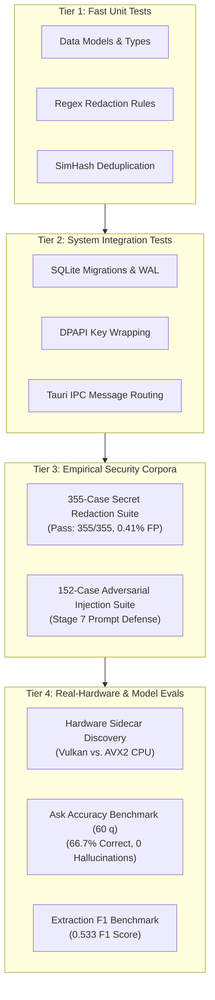

# Testing & Quality Assurance

This section documents Tessera's testing philosophy, regression test suites, hardware validation harnesses, and empirical benchmark evaluations.

Testing an AI-integrated systems application presents unique challenges: while traditional software produces predictable, identical outputs, neural networks can produce varied text, and hardware drivers can behave differently on each PC.

---

## 1. Why Rigorous Testing Matters in Tessera (Introduction)

Because Tessera observes live desktop screens and handles private information, a software defect could lead to secret leakage, out-of-memory crashes, or incorrect answers.

To prevent this, Tessera follows a strict **"measured, not assumed"** testing regime across four distinct validation tiers:



---

## 2. The Four Testing Tiers Explained

### Tier 1: Deterministic Unit Tests
* **Speed:** Runs in seconds.
* **Scope:** Validates isolated algorithms, such as regular expression matching, tokenization, 64-bit SimHash calculations, and JSON schema parsing.
* **Execution:** `cargo test --workspace`

### Tier 2: System Integration Tests
* **Speed:** Runs in under 30 seconds.
* **Scope:** Tests multi-component interactions on Windows: initializing temporary SQLite databases, wrapping encryption keys using DPAPI (`CryptProtectData`), and routing commands between Tauri and background workers.

### Tier 3: Security & Redaction Corpora
* **Secret Redaction (355 Cases):** A comprehensive suite of test cases containing credit cards (Visa, MasterCard, Amex), API keys (GitHub, AWS, OpenAI, Stripe), passwords, and private identifiers. Evaluated by `tools/gen_redaction_corpus.py`.
* **Prompt Injection (152 Cases):** Tests adversarial text designed to trick language models into ignoring instructions or leaking data. Evaluated by `tools/injection_stage7.py`.

### Tier 4: Real-Hardware & Evaluation Benchmarks
* **Hardware Validation:** Tests whether the `llama.cpp` sidecar properly starts up on the local GPU via Vulkan or safely falls back to CPU.
* **Model Evals (`tsr-eval`):** Tests the actual 4-billion parameter model against real-world user queries to measure accuracy, recall, and hallucination rates.

---

## 3. Quickstart: How to Run Tests Locally

Execute these commands in your PowerShell terminal from the project root:

```powershell
# 1. Run all standard workspace unit tests
cargo test --workspace

# 2. Run the 355-case secret redaction test suite
cargo test -p tsr-guard --test redaction_corpus

# 3. Run hardware sidecar discovery tests
cargo test -p tsr-infer --test real_hardware -- --ignored

# 4. Run the network dependency boundary check
python tools/check_network_deps.py --locked
```

---

## 4. Testing Chapters

Explore each testing category in detail:

* **[Running Tests](/testing/running-tests)** — Complete catalog of Cargo test flags, filters, and CI scripts.
* **[Hardware Validation Suite](/testing/hardware-tests)** — Real-hardware test harnesses and driver detection tests.
* **[Redaction Test Suite](/testing/redaction-tests)** — Detailed analysis of the 355-case secret corpus and false-positive rates.
* **[Prompt Injection Corpus](/testing/injection-tests)** — Adversarial injection attacks and delimiter defense mechanisms.
* **[Evaluations & Benchmarks](/testing/evals-and-benchmarks)** — Empirical results from `docs/ledger.md` and `docs/final-report.md`.
